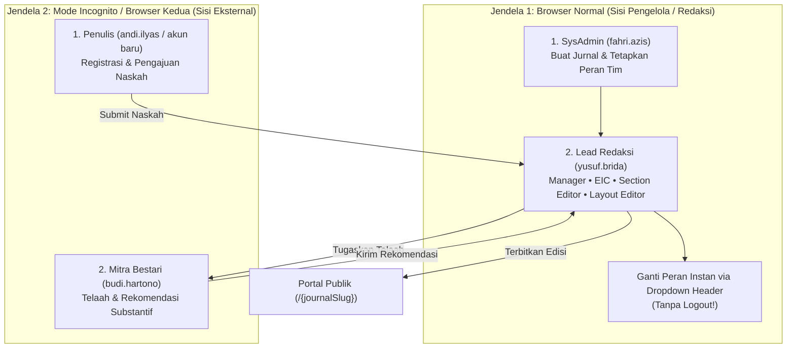

# Skenario & Panduan Demo End-to-End OJS SIRIDA (BRIDA Makassar)

Dokumen ini berisi panduan skenario demonstrasi aplikasi Open Journal System (OJS) dari tahap awal (registrasi pengguna & inisialisasi jurnal oleh SysAdmin) hingga sebuah artikel ilmiah terbit resmi (*published*) di portal publik.

Skenario ini dioptimalkan dengan strategi **"Zero-Friction Switching"** agar presenter **tidak perlu bolak-balik logout dan login**, meminimalisir risiko lupa kata sandi atau salah akun saat presentasi di hadapan audiens/penguji.

---

## 1. Arsitektur & Strategi Demo (Zero-Friction Switching)

Aplikasi memiliki fitur bawaan **Role Switcher** di navbar (`/auth/switch-role`) serta arsitektur **Multi-Tenant / Multi-Role**. Kita memanfaatkan kapabilitas ini dengan membagi sesi demo ke dalam **2 Jendela Browser**:



> [!TIP]
> **Kunci Efisiensi**: Dengan menetapkan akun `yusuf.brida@makassar.go.id` memegang peran *Manager, EIC, Section Editor*, dan *Layout Editor* untuk jurnal demo, Anda dapat menjalankan seluruh siklus editorial 100% dari 1 akun menggunakan dropdown **Ganti Peran** di navigasi atas.

---

## 2. Cheat-Sheet Akun Demo (Kredensial)

Semua akun default dari database seeder menggunakan kata sandi seragam: `password123`.

| No | Peran / Aktor | Nama Akun | Email Login | Password | Fungsi & Tanggung Jawab dalam Demo |
|:---:|:---|:---|:---|:---:|:---|
| **1** | **System Administrator** | `fahri.azis` | `fahri.azis@makassar.go.id` | `password123` | Registrasi instansi jurnal baru & alokasi peran awal tim redaksi |
| **2** | **Master Editorial (Multi-Role)** | `yusuf.brida` | `yusuf.brida@makassar.go.id` | `password123` | **Akun Utama Pengelola**: Berpindah peran antara Manager, EIC, Section Editor, dan Layout Editor |
| **3** | **Mitra Bestari (Reviewer)** | `budi.hartono` | `budi.hartono@eng.unhas.ac.id` | `password123` | Menerima penugasan telaah, mengisi rubrik evaluasi, & kirim rekomendasi |
| **4** | **Penulis (Author Seeded)** | `andi.ilyas` | `andi.ilyas@unhas.ac.id` | `password123` | Akun penulis siap pakai (terverifikasi) untuk submit naskah secara instan |
| **5** | **Penulis Baru (Registran)** | `budi.santoso` | `budi.santoso@demo.ac.id` | `password123` | Akun yang didaftarkan saat mendemokan form registrasi publik |

---

## 3. Estimasi Alur & Durasi Presentasi

| Babak | Aktor & Layar | Durasi | Poin Utama yang Ditekankan |
|:---|:---|:---:|:---|
| **Babak 1** | Registrasi & Portal Publik *(Incognito)* | 1.5 Menit | Portal ramah pengguna, UI responsif, alur onboarding penulis baru |
| **Babak 2** | SysAdmin Setup Jurnal & Tim *(Normal)* | 2 Menit | Skalabilitas multi-tenancy platform & delegasi peran terpusat |
| **Babak 3** | Journal Manager Setup *(Normal)* | 1.5 Menit | Struktur seksi naskah & persiapan edisi berkala terbitan |
| **Babak 4** | Penulis Mengajukan Naskah *(Incognito)* | 2 Menit | Checklist etika riset, input metadata, & upload naskah |
| **Babak 5** | Siklus Editorial Lengkap *(Normal & Incognito)* | 4 Menit | Desk review, peer review independen, putusan EIC, galai PDF |
| **Babak 6** | Publikasi Resmi & Verifikasi *(Normal & Publik)* | 1 Menit | Artikel tayang di edisi resmi dan dapat diunduh publik |
| **Total** | | **~12 Menit** | Padat, komprehensif, dan bebas hambatan teknis |

---

## 4. Panduan Eksekusi Langkah demi Langkah (Step-by-Step Script)

### BABAK 1: Eksplorasi Publik & Registrasi Pengguna Baru
> **Lokasi**: Jendela Browser 2 (Mode Incognito)

1. Buka halaman utama: `http://localhost:8000/` (atau domain server Anda).
2. Tunjukkan tampilan portal publik: katalog jurnal, arsip publik, dan informasi dewan redaksi.
3. Klik tombol **Daftar / Registrasi** di sudut kanan atas (`/register`).
4. Isi data pendaftaran penulis:
   - **Nama Lengkap**: `Dr. Budi Santoso, M.T.`
   - **Email**: `budi.santoso@demo.ac.id`
   - **Username**: `budi.santoso`
   - **Afiliasi**: `Fakultas Teknik Universitas Hasanuddin`
   - **Kata Sandi**: `password123` (Konfirmasi: `password123`)
5. Klik tombol **Daftar Akun**.
6. Tampilkan halaman pemberitahuan (*Notice: Silakan verifikasi email Anda*).
   > [!NOTE]
   > Jelaskan kepada audiens: *"Sistem menerapkan standar keamanan tinggi dengan mekanisme verifikasi email sebelum akun penulis diizinkan melakukan pengajuan naskah."*

---

### BABAK 2: SysAdmin – Tambah Jurnal Baru & Alokasi Tim Redaksi
> **Lokasi**: Jendela Browser 1 (Normal)  
> **Login**: `fahri.azis@makassar.go.id` / `password123`

1. Masuk ke halaman login (`/login`), masukkan kredensial SysAdmin.
2. Pada **Portal Administrator Sistem**, buka menu **Manajemen Instansi Jurnal** (`/sysadmin/journals`).
3. Klik tombol **+ Tambah Jurnal Baru**:
   - **Nama Jurnal**: `Jurnal Riset Terapan Makassar`
   - **Inisial**: `JRTM`
   - **Slug Jurnal**: `jrtm` *(URL publik akan menjadi `/jrtm`)*
   - **Penerbit**: `Badan Riset dan Inovasi Daerah (BRIDA) Kota Makassar`
   - **Email Redaksi**: `jrtm@makassar.go.id`
   - **Status**: `Aktif`
   - Klik **Simpan Jurnal**.
4. Pindah ke menu **Direktori Pengguna & Hak Akses** (`/sysadmin/users`):
   > [!IMPORTANT]
   > **Langkah Optimalisasi (Batch Assign Peran)**:
   > 1. Cari user `yusuf.brida@makassar.go.id`, klik **Tetapkan Peran Jurnal**:
   >    - Pilih Jurnal: `Jurnal Riset Terapan Makassar (JRTM)`
   >    - Centang Peran: **Manajer Jurnal (`manager`)**, **Pemimpin Redaksi (`editor_in_chief`)**, **Editor Bagian (`section_editor`)**, dan **Penata Letak (`layout_editor`)**.
   >    - Klik **Simpan**.
   > 2. Cari user `budi.hartono@eng.unhas.ac.id`, klik **Tetapkan Peran Jurnal**:
   >    - Pilih Jurnal: `Jurnal Riset Terapan Makassar (JRTM)`
   >    - Centang Peran: **Mitra Bestari (`reviewer`)**.
   >    - Klik **Simpan**.
5. **Logout dari SysAdmin.**

---

### BABAK 3: Journal Manager – Setup Struktur Seksi & Edisi Terbitan
> **Lokasi**: Jendela Browser 1 (Normal)  
> **Login**: `yusuf.brida@makassar.go.id` / `password123`

1. Login sebagai **Andi Muhammad Yusuf, M.Si.**.
2. Masuk ke **Portal Manajer Jurnal** (`/journalmanager`).
   *(Pastikan jurnal aktif di header adalah `JRTM`, jika multi-jurnal gunakan menu Switch Journal).*
3. **Konfigurasi Bidang Naskah (Section)** di menu `/journalmanager/sections`:
   - Klik **Tambah Bidang Naskah**:
     - **Nama Seksi**: `Artikel Riset dan Kebijakan`
     - **Slug**: `riset-kebijakan`
     - Centang opsi: *Menerima Pengajuan Naskah*
     - Klik **Simpan**.
4. **Persiapan Edisi Terbitan (Issue)** di menu `/journalmanager/issues`:
   - Klik **Buat Edisi Terbitan Baru**:
     - **Volume**: `1`
     - **Nomor**: `1`
     - **Tahun**: `2026`
     - **Judul Edisi**: `Volume 1 Nomor 1 (2026): Edisi Perdana JRTM`
     - Klik **Simpan Draft Edisi**.
   *(Edisi ini sekarang siap menampung artikel yang akan dipublikasikan).*

---

### BABAK 4: Penulis – Pengajuan Naskah Ilmiah (Submission)
> **Lokasi**: Jendela Browser 2 (Mode Incognito)  
> **Login**: `andi.ilyas@unhas.ac.id` / `password123` *(Akun Penulis terverifikasi)*

1. Buka halaman login di jendela incognito, masuk sebagai `andi.ilyas@unhas.ac.id`.
2. Masuk ke menu **Pengajuan Naskah** -> Klik **+ Ajukan Naskah Baru** (`/author/submissions/create`):
   - **Pilih Jurnal**: `Jurnal Riset Terapan Makassar (JRTM)`
   - **Pilih Bidang Naskah**: `Artikel Riset dan Kebijakan`
   - **Judul Naskah**: `Implementasi Kebijakan Transportasi Cerdas Berbasis Komunitas di Kota Makassar`
   - **Abstrak**: `Penelitian ini mengevaluasi efektivitas integrasi transportasi publik pintar berbasis halte terpadu dan aplikasi mobile di kawasan metropolitan Makassar dalam mereduksi kemacetan perkotaan...`
   - **Kata Kunci**: `Smart City, Transportasi Publik, Kebijakan Daerah, Makassar`
   - **Unggah Berkas Naskah**: Upload berkas naskah format `.docx` atau `.pdf`.
   - Centang seluruh pernyataan integritas akademik dan persetujuan pedoman penulis.
3. Klik tombol **Kirim Naskah Ilmiah**.
4. Muncul notifikasi sukses dengan rincian status naskah (misal: `#SUB-2026-0001`).

---

### BABAK 5: Siklus Redaksi, Telaah & Produksi Galai (Tanpa Logout!)
> **Lokasi**: Jendela Browser 1 (Normal)  
> **Kondisi**: Tetap login sebagai `yusuf.brida`

#### 5.1. Desk Review & Undangan Reviewer (Peran: Editor in Chief)
1. Di navbar atas, klik dropdown ganti peran -> pilih **Portal Pemimpin Redaksi (Editor in Chief)** (`/eic/dashboard`).
2. Masuk ke menu **Daftar Naskah** (`/eic/submissions`), buka naskah `#SUB-2026-0001`.
3. Buka tab **Desk Review**:
   - Centang kesesuaian ruang lingkup & kelengkapan berkas (*Passed*).
   - Masukkan skor uji kesamaan (*Similarity Check*): misal `12%`.
   - Pilih Hasil Evaluasi: **Lolos Desk Review (Passed)**.
   - Klik **Simpan Hasil Desk Review**.
4. Pada panel **Putaran Telaah (Review Round 1)**:
   - Klik tombol **Tugaskan Reviewer**:
   - Cari dan pilih nama **Dr. Ir. Budi Hartono, M.Eng.** (`budi.hartono`).
   - Klik **Kirim Undangan Telaah**.

#### 5.2. Penilaian Substantif oleh Mitra Bestari (Buka Jendela 2 Incognito)
1. Di Jendela 2 (Incognito), logout dari Penulis, lalu login sebagai Reviewer:
   - **Email**: `budi.hartono@eng.unhas.ac.id`
   - **Password**: `password123`
2. Buka menu **Daftar Penugasan** (`/reviewer/assignments`), klik naskah yang baru ditugaskan.
3. Klik tombol **Terima Permintaan Telaah** (*Accept Assignment*).
4. Klik **Isi Lembar Evaluasi Telaah**:
   - Berikan penilaian rubrik (Originalitas: *Sangat Baik*, Metodologi: *Baik*).
   - Catatan Penulis: *"Naskah sangat relevan dengan isu transportasi perkotaan. Pembahasan hasil riset komprehensif."*
   - Rekomendasi Akhir: Pilih **Diterima Tanpa Revisi (Accept Submission)**.
   - Klik **Kirim Rekomendasi Telaah Resmi**.

#### 5.3. Keputusan Akhir EIC & Bebas Biaya APC (Kembali ke Jendela 1 Normal)
1. Kembali ke Jendela 1 (Normal), refresh halaman naskah EIC (`/eic/submissions/{id}`).
2. Tunjukkan kepada audiens bahwa ulasan dari reviewer telah masuk secara anonim dan transparan.
3. Buka panel **Keputusan Editorial**:
   - Pilih Keputusan: **Naskah Diterima (Accept Submission)**.
   - Catatan Resmi: *"Selamat, naskah dinyatakan diterima untuk diproses ke tahap tata letak dan penerbitan."*
   - Klik **Kirim Keputusan Editorial**.
4. Buka tab **Biaya APC / Pembayaran**:
   - Klik **Bebaskan Biaya APC (Waive APC Fee)** agar syarat penerbitan terpenuhi tanpa transfer bank.

#### 5.4. Unggah Galai PDF & Persetujuan Akhir (Ganti Peran: Layout Editor & EIC)
1. Di navbar atas Jendela 1, klik dropdown ganti peran -> pilih **Portal Penata Letak (Layout Editor)** (`/layouteditor`).
2. Buka naskah terkait di `/layouteditor/submissions/{id}`.
3. Buka tab **Galai Publikasi**:
   - Format: `PDF`
   - Label Berkas: `PDF Galai Resmi`
   - Unggah file PDF final artikel.
   - Klik **Simpan Galai**.
4. Klik tombol **Ajukan Persetujuan Akhir Galai** (*Request Final Approval*).
5. Ganti peran kembali ke **Pemimpin Redaksi (Editor in Chief)**:
   - Buka naskah terkait -> pada bagian Galai, klik **Setujui Galai (Approve Galley)**.  
   *(Naskah kini otomatis berstatus `ready_for_issue`).*

---

### BABAK 6: Publikasi Terbitan Resmi & Verifikasi Publik
> **Lokasi**: Jendela Browser 1 (Normal) & Tab Publik Bebas Akses

#### 6.1. Masukkan Naskah ke Edisi Terbitan (Peran: Journal Manager)
1. Di navbar atas Jendela 1, klik dropdown ganti peran -> pilih **Portal Manajer Jurnal (Journal Manager)** (`/journalmanager`).
2. Buka menu **Edisi & Terbitan** (`/journalmanager/issues`).
3. Klik edisi `Volume 1 Nomor 1 (2026)`.
4. Pada bagian **Daftar Isi Edisi**, klik **+ Tambahkan Naskah ke Edisi**:
   - Pilih artikel `#SUB-2026-0001` (Implementasi Kebijakan Transportasi Cerdas...).
   - Rentang Halaman: `1 - 14`.
   - Klik **Tambahkan**.
5. Klik tombol utama: **Terbitkan Edisi Sekarang (Publish Issue)**:
   - Centang konfirmasi persetujuan terbit.
   - Klik **Terbitkan & Tetapkan sebagai Edisi Terkini (Current Issue)**.

#### 6.2. Verifikasi Hasil Akhir di Portal Pembaca Dunia (Grand Finale)
1. Buka tab baru di browser tanpa login: `http://localhost:8000/jrtm` (atau via menu *Lihat Situs Publik*).
2. Tunjukkan pembuktian sukses:
   - Edisi `Vol. 1 No. 1 (2026)` tampil sebagai **Current Issue** di landing page jurnal.
   - Naskah muncul di daftar artikel lengkap dengan judul, abstrak, dan penulis `Dr. Andi Muhammad Ilyas`.
   - Klik tombol **Unduh PDF**: Berkas galai PDF dapat langsung dibaca dan diunduh pembaca.
   - Klik tombol **Sitasi (Cite)**: Format APA, Harvard, dan BibTeX ter-generate otomatis.

---

## 5. Tips & Antisipasi Kendala Lapangan (Troubleshooting)

> [!TIP]
> **Jika Kuota Waktu Presentasi Sangat Singkat (di bawah 7 menit):**
> Anda bisa melewati Babak 1 dan langsung mulai dari Babak 4 menggunakan akun Penulis yang sudah terverifikasi (`andi.ilyas@unhas.ac.id`).
>
> **Jika Butuh Memverifikasi Akun Baru Secara Instan:**
> Jika mendemokan registrasi akun baru dan ingin langsung login tanpa membuka inbox email, jalankan perintah Artisan satu baris via terminal:
> ```powershell
> php artisan tinker --execute "App\Models\User::where('email', 'budi.santoso@demo.ac.id')->update(['email_verified_at' => now(), 'status' => 'active']);"
> ```
>
> **Keunggulan Presentasi yang Patut Diucapkan:**
> 1. *"Platform ini mendukung multi-tenancy instansi pemerintahan secara modular."*
> 2. *"Proses editorial menerapkan double-blind peer review yang objektif dan terdokumentasi rapi."*
> 3. *"Pengelola jurnal memiliki fleksibilitas tinggi dengan Role Switcher terpadu tanpa mengorbankan batasan hak akses keamanan data."*
