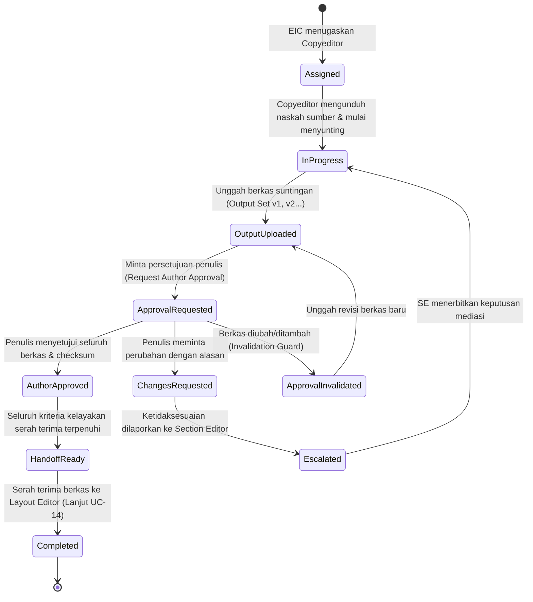

# Spesifikasi Teknis & Alur Kerja Portal Copy Editor
## Platform SIRIDA — Sistem Manajemen Jurnal Ilmiah
**Pemerintah Kota Makassar — Badan Riset dan Inovasi Daerah (BRIDA)**

---

## 1. Pengenalan & Gambaran Umum

Modul **Portal Copy Editor** mengelola alur kerja pasca-keputusan editorial (tahap produksi awal) setelah naskah resmi diterima (*accepted*). Tugas utama Copy Editor meliputi penyuntingan tata bahasa, gaya selingkung jurnal, standardisasi format sitasi, verifikasi integritas berkas keluaran (*output set*), koordinasi persetujuan penulis (*author approval*), mediasi sengketa redaksi, hingga serah terima berkas final ke Layout Editor.

Dasar perancangan modul ini mengacu pada:
* **Use Case SRS:** `UC-13 Copyediting` dan `UC-14 Layout`.
* **Aturan Domain (Invariants):** [`docs/contract-decisions.md`](contract-decisions.md) (Bagian 3.4 & 4).
* **Skema ERD Definitif:** [`docs/erd.md`](erd.md) (Tabel 33 `copyedits`, Tabel 34 `copyedit_outputs`, Tabel 35 `copyedit_approvals`, Tabel 36 `copyedit_approved_files`, Tabel 41 `production_escalations`).

---

## 2. Siklus Hidup Alur Kerja Copyediting (UC-13)



### Aturan Bisnis & Invariant Wajib (Business Invariants)

1. **Pemisahan Berkas Sumber & Berkas Keluaran:**
   * Berkas acuan yang disunting merujuk pada `source_file_id` (naskah final dari tahap review).
   * Berkas hasil suntingan dikelola secara terkelompok melalui `copyedit_outputs` (Output Set).
2. **Invalidation Guard (Pencegahan Mutasi Diam-Diam):**
   * Setiap penambahan, penghapusan, atau penimpaan berkas pada Output Set yang sedang menunggu persetujuan atau telah disetujui penulis akan **secara otomatis membatalkan status persetujuan sebelumnya** (`copyedit_approvals.invalidated_at = NOW()`).
   * Penulis wajib meninjau dan menyetujui ulang seluruh set berkas yang baru.
3. **Pemberangusan Perubahan Checksum (Checksum Freeze):**
   * Persetujuan penulis mengunci hash **SHA-256** seluruh berkas ke dalam `copyedit_approved_files`.
   * Jika hash byte berkas berubah tanpa pencatatan versi baru, sistem menolak proses serah terima ke Layout Editor.
4. **Mediasi Tanpa Melompati Persetujuan (Production Escalation):**
   * Jika penulis mengajukan keberatan substansi atau istilah teknis (*changes with reason*), tiket eskalasi (`production_escalations`) diterbitkan ke Section Editor / Editor in Chief.
   * Alur tidak boleh dipaksa lanjut ke layout sebelum tiket eskalasi diselesaikan (*resolved*).
5. **Kesiapan Serah Terima Galley (Handoff Readiness):**
   * Naskah hanya dapat diserahkan ke Layout Editor apabila:
     - `copyedit_approvals.status = 'approved'` aktif (tidak berstatus `invalidated`).
     - Tidak ada tiket `production_escalations` yang berstatus `pending`.
     - Layout Editor telah ditentukan.

---

## 3. Pemetaan Skema Basis Data (Kepatuhan Definitif `docs/erd.md`)

Modul Copy Editor mengimplementasikan 5 tabel inti dari **Modul 05 (Produksi dan Proofreading)** dan berelasi erat dengan tabel katalog berkas dari **Modul 07**:

### A. Tabel 33: `copyedits`
Menyimpan penugasan copyediting per manuskrip oleh Editor in Chief.
* `id`: `CHAR(26)` NOT NULL — Primary Key berbasis ULID.
* `submission_id`: `CHAR(26)` NOT NULL — Foreign Key ke `submissions.id`.
* `copy_editor_id`: `CHAR(26)` NOT NULL — Foreign Key ke `users.id`.
* `source_file_id`: `CHAR(26)` NOT NULL — Foreign Key ke `files.id` (manuskrip acuan yang disunting).
* `status`: `VARCHAR(191)` NOT NULL — Status pengerjaan (`assigned`, `in_progress`, `completed`).
* `notes`: `TEXT` NULL — Catatan umum copyeditor.
* `due_at`: `DATETIME(6)` NOT NULL — Batas waktu penyelesaian copyediting (UTC).
* `version`: `INT` NOT NULL DEFAULT 1 — Optimistic locking counter.
* `created_at`: `DATETIME(6)` NOT NULL (UTC).
* `updated_at`: `DATETIME(6)` NOT NULL (UTC).
* *Constraints:* `PRIMARY KEY (id)`, Foreign Keys dengan `ON DELETE RESTRICT`.

### B. Tabel 34: `copyedit_outputs`
Daftar berkas hasil suntingan yang diunggah oleh Copy Editor (Output Set).
* `copyedit_id`: `CHAR(26)` NOT NULL — Primary Key & FK ke `copyedits.id`.
* `file_id`: `CHAR(26)` NOT NULL — Primary Key & FK ke `files.id`.
* `position`: `INT` NOT NULL DEFAULT 1 — Urutan posisi penempatan berkas.
* `created_at`: `DATETIME(6)` NOT NULL (UTC).
* `updated_at`: `DATETIME(6)` NOT NULL (UTC).
* *Constraints:* `PRIMARY KEY (copyedit_id, file_id)`.

### C. Tabel 35: `copyedit_approvals`
Rekaman persetujuan hasil suntingan copyedit oleh penulis naskah (*author approval*).
* `id`: `CHAR(26)` NOT NULL — Primary Key ULID.
* `copyedit_id`: `CHAR(26)` NOT NULL — Foreign Key ke `copyedits.id`.
* `author_id`: `CHAR(26)` NOT NULL — Foreign Key ke `users.id`.
* `decision`: `VARCHAR(191)` NOT NULL — Keputusan persetujuan (`approved`, `revisions_requested`).
* `reason`: `TEXT` NULL — Catatan penjelasan penulis jika meminta perbaikan.
* `output_version`: `INT` NOT NULL DEFAULT 1 — Versi output set saat approval dibuat.
* `approved_at`: `DATETIME(6)` NOT NULL — Waktu persetujuan diberikan (UTC).
* `invalidated_at`: `DATETIME(6)` NULL — Waktu persetujuan dibatalkan otomatis jika ada perubahan berkas baru (*Invalidation Guard*).
* `note`: `TEXT` NULL — Catatan tambahan.
* `created_at`: `DATETIME(6)` NOT NULL (UTC).
* `updated_at`: `DATETIME(6)` NOT NULL (UTC).

### D. Tabel 36: `copyedit_approved_files`
Pembekuan daftar berkas dan checksum spesifik yang telah disetujui penulis (*Checksum Freeze*).
* `approval_id`: `CHAR(26)` NOT NULL — Primary Key & FK ke `copyedit_approvals.id`.
* `file_id`: `CHAR(26)` NOT NULL — Primary Key & FK ke `files.id`.
* `checksum_sha256`: `TEXT` NOT NULL — Hash SHA-256 berkas yang dikunci saat approval.
* `created_at`: `DATETIME(6)` NOT NULL (UTC).
* `updated_at`: `DATETIME(6)` NOT NULL (UTC).
* *Constraints:* `PRIMARY KEY (approval_id, file_id)`.

### E. Tabel 39: `production_escalations`
Pencatatan masalah teknis atau sengketa redaksi yang dieskalasi ke Section Editor / EIC.
* `id`: `CHAR(26)` NOT NULL — Primary Key ULID.
* `submission_id`: `CHAR(26)` NOT NULL — FK ke `submissions.id`.
* `copyedit_id`: `CHAR(26)` NULL — FK ke `copyedits.id` (XOR dengan `galley_id`).
* `galley_id`: `CHAR(26)` NULL — FK ke `galleys.id`.
* `opened_by`: `CHAR(26)` NOT NULL — FK ke `users.id` (Copy Editor yang membuka eskalasi).
* `reason`: `TEXT` NOT NULL — Uraian keberatan penulis / sengketa teknis.
* `status`: `VARCHAR(191)` NOT NULL — Status eskalasi (`open`, `investigating`, `resolved`).
* `resolution`: `TEXT` NULL — Solusi penyelesaian dari Section Editor.
* `resume_stage`: `TEXT` NULL — Tahap kerja yang dilanjutkan pasca-resolusi.
* `version`: `INT` NOT NULL DEFAULT 1.
* *Constraints:* `CHECK ((copyedit_id IS NOT NULL AND galley_id IS NULL) OR (copyedit_id IS NULL AND galley_id IS NOT NULL))`.

### F. Tabel 37: `layout_assignments` & Tabel 51: `files`
* **Tabel 37 `layout_assignments`**: Menerima serah terima naskah pasca-copyedit (`submission_id`, `layout_editor_id`, `assigned_by`, `assigned_at`, `due_at`, `reason`).
* **Tabel 51 `files`**: Katalog fisik berkas di cloud storage (`journal_id`, `uploaded_by`, `purpose`, `file_name`, `file_type`, `size`, `checksum_sha256`, `storage_key`, `antivirus_status`). Berkas berstatus karantina dilarang disunting atau diserahterimakan.

---

## 4. Rute Web (Web Routes Contract)

Semua rute bernaung di bawah middleware `auth` dan prefix `/copyeditor`:

| Metode | URI | Nama Rute | Controller & Method | Deskripsi |
| :--- | :--- | :--- | :--- | :--- |
| `GET` | `/copyeditor/submissions` | `copyeditor.submissions.index` | `CopyeditorSubmissionController@index` | Daftar penugasan copyedit (Tahap 1) |
| `GET` | `/copyeditor/submissions/{id}` | `copyeditor.submissions.show` | `CopyeditorSubmissionController@show` | Detail ruang kerja naskah copyedit (Tahap 2) |
| `GET` | `/copyeditor/guidelines` | `copyeditor.guidelines` | `CopyeditorSubmissionController@guidelines` | Panduan gaya selingkung & unduh template Word |
| `POST` | `/copyeditor/upload` | `copyeditor.upload` | `CopyeditorSubmissionController@uploadFile` | Unggah berkas suntingan (Invalidation Guard) |
| `POST` | `/copyeditor/request-approval` | `copyeditor.request-approval` | `CopyeditorSubmissionController@requestApproval` | Minta persetujuan penulis |
| `POST` | `/copyeditor/escalate` | `copyeditor.escalate` | `CopyeditorSubmissionController@submitEscalation` | Terbitkan tiket eskalasi mediasi ke Section Editor |
| `POST` | `/copyeditor/complete-handoff` | `copyeditor.complete-handoff` | `CopyeditorSubmissionController@completeHandoff` | Serah terima naskah ke Layout Editor |

---

## 5. Kontrak Data Frontend (Blade View Variables Contract)

Untuk mencegah pengerjaan ulang (*rework*) saat backend dibangun, seluruh tampilan Blade **tidak boleh menggunakan data hardcode**. Tampilan Blade mengonsumsi data melalui struktur variabel kontrak berikut:

### A. Kontrak Data Halaman Daftar Penugasan (`copyeditor.submissions.index`)

Variabel yang dipasok oleh Controller / ViewModel (`CopyeditorSubmissionsViewModel`):

```php
[
    // 1. Profil Pengguna Aktif
    'userProfile' => [
        'name' => string,               // 'Andi Kurniawan, S.Hum., M.Pd.'
        'affiliation' => string,        // 'Balai Penelitian & Pengembangan BRIDA Makassar'
        'initials' => string,           // 'AK'
        'unread_notifications' => int,  // 3
    ],

    // 2. Metrik Ringkasan Atas (Summary Metrics)
    'metrics' => [
        'total_active' => int,          // 12 (Total penugasan berjalan)
        'awaiting_approval' => int,     // 4 (Sedang menunggu persetujuan penulis)
        'escalated' => int,             // 2 (Sedang dalam mediasi dewan redaksi)
        'completed' => int,             // 18 (Riwayat naskah telah diserahkan ke layout)
    ],

    // 3. Tab Filter Status
    'tabs' => [
        'active' => string,             // 'all' | 'editing' | 'awaiting_approval' | 'escalated' | 'completed'
        'counts' => [
            'all' => int,
            'editing' => int,
            'awaiting_approval' => int,
            'escalated' => int,
            'completed' => int,
        ],
    ],

    // 4. Daftar Naskah Penugasan (Paginated Collection)
    'submissions' => [
        [
            'id' => string,                     // '01JARK948X...' (ULID)
            'number' => string,                 // 'SUB-2026-00106'
            'title' => string,                  // Judul naskah lengkap
            'section_title' => string,          // 'Inovasi Daerah & Kebijakan Publik'
            'corresponding_author' => [
                'name' => string,               // 'Dr. Nurfadillah Bahar, M.Kes.'
                'email' => string,              // 'nurfadillah.bahar@unhas.ac.id'
                'affiliation' => string,        // 'Universitas Hasanuddin'
            ],
            'section_editor' => string,         // 'Prof. Hamka, Ph.D.'
            'assigned_at' => string,            // '18 Okt 2026'
            'due_at' => string,                 // '29 Okt 2026 23:59 WITA'
            'is_overdue' => bool,               // false
            'is_urgent' => bool,                // true (deadline <= 3 hari)
            'status' => string,                 // 'in_progress' | 'awaiting_author_approval' | 'approved' | 'escalated' | 'completed'
            'status_label' => string,           // 'Sedang Disunting' | 'Menunggu Penulis' | 'Eskalasi Mediasi'
            'status_badge_class' => string,     // 'bg-sky-50 text-sky-800 border-sky-200'
            'output_set_version' => string,     // 'Output Set v2' (atau null jika belum ada)
            'files_count' => int,               // 2
            'has_active_escalation' => bool,    // false
            'url_workspace' => string,          // URL ke ruang kerja naskah
        ],
        // ... naskah lainnya
    ],

    // 5. Data Pagination
    'pagination' => [
        'current_page' => int,
        'per_page' => int,
        'total' => int,
        'last_page' => int,
    ],
]
```

### B. Kontrak Data Ruang Kerja Naskah (`copyeditor.submissions.show`)

Dipasok oleh Controller melalui `CopyeditorSubmissionDetailViewModel`:

```php
[
    'submission' => [
        'id' => string,                         // 'SUB-2026-00106' (atau ULID)
        'number' => string,                     // 'SUB-2026-00106'
        'assignment_code' => string,            // '#CE-01JARK948X'
        'title' => string,
        'section_title' => string,
        'corresponding_author' => [
            'name' => string,                   // 'Dr. Nurfadillah Bahar, M.Kes.'
            'email' => string,                  // 'nurfadillah.bahar@unhas.ac.id'
            'affiliation' => string,            // 'Universitas Hasanuddin'
        ],
        'section_editor' => string,             // 'Prof. Hamka, Ph.D.'
        'layout_editor' => string,              // 'Rahmat Hidayat, S.Kom.'
        'assigned_at' => string,                // '18 Okt 2026'
        'due_at' => string,                     // '29 Okt 2026 23:59 WITA'
        'is_urgent' => bool,                    // true
        'status' => string,                     // 'in_progress' | 'awaiting_author_approval' | 'escalated' | 'approved' | 'completed'
        'status_label' => string,               // 'Tahap Copyediting Aktif'
        'status_badge_class' => string,         // 'bg-sky-50 text-sky-800 border-sky-200'
        
        // 1. Data Naskah Acuan / Sumber (FK source_file_id -> files)
        'source_file' => [
            'id' => string,
            'name' => string,                   // 'SUB2026-00106_Source_Accepted.docx'
            'size_formatted' => string,         // '2.14 MB'
            'download_url' => string,
        ],

        // 2. Daftar Berkas Keluaran Suntingan (copyedit_outputs + files)
        'output_files' => [
            [
                'id' => string,                 // 'FILE-01JARK948X-01'
                'name' => string,               // 'SUB2026-00106_Copyedit_Final_Clean.docx'
                'type' => string,               // 'Naskah Utama' | 'Lampiran Data'
                'size_formatted' => string,     // '2.05 MB'
                'sha256' => string,             // Hash 64-karakter hex
                'uploaded_at' => string,        // '24 Okt 2026 14:20 WITA'
                'download_url' => string,
            ],
        ],

        // 3. Status Persetujuan Penulis (copyedit_approvals)
        'approval' => [
            'status' => string,                 // 'requested' | 'approved' | 'changes_requested' | 'invalidated'
            'status_label' => string,           // 'Menunggu Respon Penulis'
            'is_approved' => bool,              // false
            'is_waiting' => bool,               // true
            'has_changes_requested' => bool,    // false
            'author_note' => ?string,           // Catatan jika penulis meminta perbaikan
            'approved_at' => ?string,           // '24 Okt 2026 10:00 WITA'
            'invalidated_at' => ?string,        // Waktu pembatalan otomatis jika berkas baru diunggah
        ],

        // 4. Tiket Mediasi / Eskalasi Redaksi (production_escalations)
        'escalation' => [
            'has_active' => bool,               // true jika ada tiket yang berstatus 'open' atau 'investigating'
            'ticket_id' => ?string,             // 'ESC-2026-0042'
            'category' => ?string,              // 'Ketidaksesuaian Terminologi Teknis'
            'reason' => ?string,                // Uraian keberatan penulis / sengketa redaksi
            'status' => ?string,                // 'Menunggu Mediasi Section Editor'
            'created_at' => ?string,            // '24 Okt 2026 11:15 WITA'
        ],

        // 5. Status Kesiapan Serah Terima ke Layout (layout_assignments)
        'handoff' => [
            'is_ready' => bool,                 // true jika is_approved=true dan has_active=false
            'is_completed' => bool,             // true jika naskah telah diserahkan
            'assigned_layout_editor' => string, // 'Rahmat Hidayat, S.Kom.'
            'notes_placeholder' => string,
            'completed_at' => ?string,
        ],

        // 6. Jejak Aktivitas Naskah (Activity Timeline)
        'activity_timeline' => [
            [
                'title' => string,              // 'Permintaan Persetujuan Dikirim'
                'actor' => string,              // 'Andi Kurniawan (Copy Editor)'
                'date' => string,               // '24 Okt 2026, 14:30 WITA'
                'description' => string,
                'badge_class' => string,
            ],
        ],
    ]
]
```

### C. Komponen Modular Blade (Partials Ruang Kerja Tahap 2)

Ruang kerja naskah dibagi menjadi partials kohesif di folder `resources/views/copyeditor/submissions/partials/`:
1. `header-card.blade.php`: Header naskah, nomor ID, batas waktu, dan tombol unduh naskah mentah asli.
2. `step-1-outputs.blade.php`: Langkah 1 — Daftar berkas suntingan terunggah, form unggah `.docx`, dan guard invalidasi ramah.
3. `step-2-approval.blade.php`: Langkah 2 — Status persetujuan penulis, catatan revisi, dan aksi pemicu mediasi redaksi.
4. `step-3-handoff.blade.php`: Langkah 3 — Form catatan dan konfirmasi serah terima ke Layout Editor.
5. `sidebar-info.blade.php`: Informasi tim editorial, widget panduan gaya selingkung, dan riwayat aktivitas.
6. `modal-escalate.blade.php`: Modal interaktif pengajuan mediasi sengketa ke Section Editor.
7. `modal-handoff-confirm.blade.php`: Modal konfirmasi kepatuhan serah terima naskah ke Layout Editor.

---

## 6. Panduan untuk Developer Backend Saat Integrasi

Ketika mengimplementasikan Controller dan Service backend:
1. **Query Sumber Data:** Ambil data dari tabel `copyedits` dengan relasi `submission.contributors`, `submission.section`, `outputs.file`, `approvals.approvedFiles`, dan `escalations`.
2. **Hitung Invalidation Guard:** Pada saat mutasi file (`uploadOutput`), buat entri baru di `files` dan `copyedit_outputs`, lalu eksekusi query update `UPDATE copyedit_approvals SET invalidated_at = NOW(), status = 'invalidated' WHERE copyedit_id = ? AND status IN ('requested', 'approved')`.
3. **Penyusunan ViewModel:** Teruskan hasil query Eloquent ke ViewModel `CopyeditorSubmissionsViewModel` dan `CopyeditorSubmissionDetailViewModel` sehingga menghasilkan array dengan kunci yang tepat sesuai Bab 5.
4. **Tidak Ada Perubahan Blade:** Tim frontend telah menyusun seluruh antarmuka menggunakan variabel-variabel di atas. Backend hanya perlu menyediakan data yang cocok tanpa perlu memodifikasi kode Blade.
