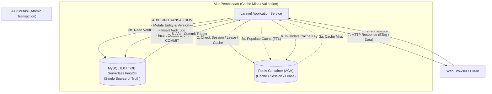

# SIRIDA — Dokumentasi Skema Basis Data & ERD (Entity Relationship Diagram)

Dokumen ini memuat rancangan skema. Hasil pembandingan 5 November 2026 menemukan perbedaan dengan bagian aktif FigJam dan skema hasil migrasi aplikasi. Daftar perbedaan serta pemetaan pengujian tersedia dalam [pemeriksaan CI/CD dan kebutuhan](ci-cd.md#perbandingan-skema-dengan-erd).

**Baseline Arsitektur:** MySQL 8.0 / TiDB Cloud Serverless (InnoDB wire protocol) + Redis in-memory • Framework Laravel 13 (PHP 8.4)  
**Revisi Desain:** 22 Oktober 2026 • **Arsitektur:** Modular Monolith Laravel 13 (Blade + ViewModel Pattern OOP)  
**Metrik Desain:** 58 Tabel MySQL • 8 Modul Domain • 94 Relasi Foreign Key • Redis Key-Value Ledger

---

## 1. Ikhtisar & Standar Konvensi Basis Data

Dokumen ini merupakan spesifikasi lengkap struktur persistensi data sistem **SIRIDA (Sistem Informasi Riset dan Publikasi Ilmiah Daerah)**. Skema ini dirancang berdasarkan prinsip _contract-first_, mengikat alur penelaahan naskah ilmiah (_double-blind peer review_), keputusan editorial multi-tahap, produksi berkas penerbitan (_galley_), integrasi eksternal (Crossref DOI, ORCID, Antivirus/Malware Scanner), serta audit transaksi dan _outbox pattern_.

### 1.1 Konvensi Kunci & Tipe Data

1. **Primary Key (PK) & Foreign Key (FK):**
    - Menggunakan format **ULID (Universally Unique Lexicographically Sortable Identifier)** dengan tipe `CHAR(26)` ASCII binary collation.
    - ULID memberikan pengurutan berbasis waktu (_time-ordered sequence_) bawaan tanpa mengekspos autoincrement ID ke publik serta kompatibel dengan _high-throughput distributed insertion_.
2. **Optimistic Locking / Concurrency Control:**
    - Setiap entitas yang dapat mengalami mutasi memiliki kolom `version` bertipe `INT` atau `BIGINT` dengan constraint default `>= 1`.
    - Digunakan sebagai dasar pengecekan concurrency header HTTP `If-Match` / `ETag`.
3. **Format Waktu & Audit:**
    - Seluruh tabel wajib memiliki kolom `created_at` dan `updated_at` bertipe `DATETIME(6)` dengan basis zona waktu **UTC** yang bersumber dari clock database.
    - Pada rekaman yang bersifat _immutable_ (seperti snapshot, catatan audit, putaran review tertutup), nilai `updated_at` bernilai sama persis dengan `created_at` dan dibekukan.
    - Kolom datetime pendukung lifecycle (`submitted_at`, `completed_at`, `published_at`, `revoked_at`, `resolved_at`, dll.) bernilai `NULL` sebelum kejadian dan menjadi `NOT NULL` setelah transisi selesai.
4. **Generated Columns untuk Menggantikan Fitur Spesifik PostgreSQL:**
    - **Uniqueness pada Status Aktif (`live_slot`):** MySQL tidak mendukung _partial unique index_ (`WHERE revoked_at IS NULL`). Skema mengatasinya dengan kolom generated `live_slot TINYINT GENERATED ALWAYS AS (IF(revoked_at IS NULL, 1, NULL)) STORED`, lalu dibuat index `UNIQUE(foreign_id, role, live_slot)`.
    - **Handling NULLS NOT DISTINCT (`journal_scope` & `galley_scope`):** Dibuat kolom generated `COALESCE(journal_id, '')` atau `COALESCE(galley_id, '')` STORED agar index komposit dapat mencegah duplikasi rekaman unik pada scope sistem/jurnal publik.
    - **Normalisasi Identitas:** `email_normalized` dan `username_normalized` dibuat sebagai `STORED GENERATED ALWAYS AS (LOWER(TRIM(...))) NOT NULL` dengan index `UNIQUE`. Penulisan asli kapitalisasi pengguna tetap dipreservasi di kolom `email` dan `username` untuk kebutuhan display profil dan sertifikat publikasi, sedangkan kolom normalized menjamin pencegahan celah account impersonation, collision, dan race condition (sesuai rekomendasi OWASP).
5. **Collation & Karakter:**
    - Menggunakan character set `utf8mb4` dengan collation `utf8mb4_unicode_ci` (atau `utf8mb4_0900_ai_ci` pada MySQL 8.0 native) untuk menjamin kompatibilitas 100% antara Docker Compose lokal (`mysql:8.0`) dan TiDB Cloud Serverless. Karakter case-insensitive (`_ci`) memastikan pencarian dan validasi keunikan identitas (email/username) terlindungi dari kerentanan impersonasi dan duplikasi, sementara input asli pengguna tetap dipreservasi di kolom display.
6. **Integritas Referensial & Penghapusan:**
    - Menggunakan aturan default `ON DELETE RESTRICT` pada semua relasi data riwayat, berkas, dan ledger transaksi. Akun yang dihapus menggunakan pola _tombstone/soft-delete_ (`deleted_at`), tanpa menjalankan cascade delete yang dapat menghancurkan rekam jejak naskah ilmiah.

---

## 2. Diagram Relasi Tingkat Tinggi (ERD Visual)

```mermaid
erDiagram
    %% MODUL 01: Identitas dan Akses
    users ||--o| user_profiles : "has"
    users ||--o{ journal_memberships : "holds"
    journals ||--o{ journal_memberships : "has_members"
    journal_memberships ||--o{ journal_role_grants : "assigned"
    users ||--o{ system_role_grants : "holds_system_role"
    users ||--o{ sessions : "has_sessions"
    users ||--o{ identity_challenges : "receives"
    users ||--o| orcid_connections : "links"

    %% MODUL 02: Jurnal dan Konten
    journals ||--o{ sections : "contains"
    journals ||--o| journal_settings : "configured_by"
    journals ||--o{ review_rubric_versions : "defines"
    journals ||--o{ journal_pages : "publishes"
    journals ||--o{ announcements : "broadcasts"
    journals ||--o{ email_templates : "customizes"

    %% MODUL 03: Submission dan Editorial
    journals ||--o{ submissions : "receives"
    sections ||--o{ submissions : "categorizes"
    users ||--o{ submissions : "authors"
    submissions ||--o{ submission_contributors : "lists"
    submissions ||--o{ editor_assignments : "handled_by"
    users ||--o{ editor_assignments : "assigned_editor"
    submissions ||--o{ desk_reviews : "evaluates"
    submissions ||--o{ editorial_decisions : "decides"
    editorial_decisions ||--o{ revisions : "requests"
    submissions ||--o{ revisions : "submits_revision"
    submissions ||--o{ ethics_cases : "reported_in"
    ethics_cases ||--o{ ethics_evidence : "contains_evidence"
    submissions ||--o{ similarity_checks : "scanned_with"
    submissions ||--o{ submission_events : "logs"

    %% MODUL 04: Peer Review
    submissions ||--o{ review_rounds : "cycles_through"
    review_rubric_versions ||--o{ review_rounds : "evaluates_with"
    review_rounds ||--o{ review_assignments : "assigns"
    users ||--o{ review_assignments : "invited_reviewer"
    review_assignments ||--o| reviews : "completes"
    reviews ||--o{ review_annotations : "annotates"
    review_assignments ||--o{ review_extensions : "requests_extension"
    review_assignments ||--o{ review_reminders : "sends_reminder"
    editorial_decisions ||--o{ decision_feedback : "attaches_feedback"
    reviews ||--o{ decision_feedback : "includes_review"

    %% MODUL 05: Produksi dan Proofreading
    submissions ||--o{ copyedits : "undergoes_copyedit"
    copyedits ||--o{ copyedit_outputs : "produces"
    copyedits ||--o{ copyedit_approvals : "author_approves"
    copyedit_approvals ||--o{ copyedit_approved_files : "freezes_files"
    submissions ||--o{ layout_assignments : "layout_assigned"
    submissions ||--o{ galleys : "publishes_galley"
    galleys ||--o| galleys : "supersedes"
    galleys ||--o{ proof_assignments : "proofread_by"
    proof_assignments ||--o{ proofreading_notes : "records_issues"
    galleys ||--o{ galley_approvals : "signoff"
    submissions ||--o{ production_escalations : "escalates"

    %% MODUL 06: Artikel dan Publikasi
    submissions ||--o| articles : "becomes_published_article"
    journals ||--o{ issues : "publishes_issue"
    issues ||--o{ issue_articles : "includes"
    articles ||--o| issue_articles : "placed_in"
    articles ||--o{ article_contributors : "credits"
    articles ||--o{ article_galleys : "presents"
    galleys ||--o{ article_galleys : "mapped_from"
    articles ||--o| doi_registrations : "registered_doi"
    doi_registrations ||--o{ crossref_deposits : "deposits_to_crossref"
    articles ||--o{ article_metrics : "measures_views"

    %% MODUL 07: Berkas dan Penyimpanan
    journals ||--o{ files : "stores_files"
    users ||--o{ files : "uploaded_by"
    files ||--o{ scan_attempts : "security_scanned"
    submissions ||--o{ submission_files : "attaches"
    files ||--o{ submission_files : "attached_file"

    %% MODUL 08: Operasional, Audit, dan Sistem
    journals ||--o{ user_imports : "imports_users"
    users ||--o{ user_imports : "created_by"
    users ||--o{ notifications : "notified"
    journals ||--o{ audit_logs : "audits"
    outbox_events ||--o{ notifications : "triggers"
    users ||--o{ system_settings : "manages_settings"
```

---

## 3. Katalog Modul & Kamus Data 58 Tabel

Berikut rincian spesifikasi 58 tabel yang terbagi dalam 8 modul domain:

### Modul 01: Identitas dan Akses (8 Tabel)

Menangani autentikasi pengguna, profil, relasi multi-jurnal (_membership_), pemberian peran (_role grants_), sesi web stateful bawaan Laravel, verifikasi akun, dan koneksi ORCID.

#### 1. `users`

Tabel entitas akun sentral sistem SIRIDA.

- **Kolom:**
    - `id` CHAR(26) NOT NULL — Primary Key (ULID).
    - `email` VARCHAR(254) NOT NULL — Alamat email pengguna.
    - `username` VARCHAR(100) NOT NULL — Username login unik.
    - `full_name` TEXT NOT NULL — Nama lengkap pengguna beserta gelar.
    - `password_hash` TEXT NOT NULL — Hash kata sandi (Argon2id/Bcrypt).
    - `status` VARCHAR(191) NOT NULL — Status akun (`active`, `locked`, `pending_verification`, `disabled`).
    - `email_verified_at` DATETIME(6) NULL — Waktu email berhasil diverifikasi.
    - `locked_until` DATETIME(6) NULL — Waktu kedaluwarsa kunci akun akibat gagal login 5 kali.
    - `deleted_at` DATETIME(6) NULL — Waktu akun di-soft delete (tombstone).
    - `version` BIGINT NOT NULL DEFAULT 1 — Versi kontrol konkurensi (UserAttributes/ETag).
    - `failed_login_count` INT NOT NULL DEFAULT 0 — Akumulator kegagalan autentikasi berurutan.
    - `last_failed_login_at` DATETIME(6) NULL — Timestamp kegagalan login terakhir.
    - `created_at` DATETIME(6) NOT NULL — Waktu pembuatan rekaman (UTC).
    - `updated_at` DATETIME(6) NOT NULL — Waktu perubahan rekaman terakhir (UTC).
    - `email_normalized` VARCHAR(254) GENERATED ALWAYS AS (LOWER(TRIM(email))) STORED NOT NULL — Indeks penutup race condition.
    - `username_normalized` VARCHAR(100) GENERATED ALWAYS AS (LOWER(TRIM(username))) STORED NOT NULL — Indeks penutup race condition.
- **Constraints & Indexes:**
    - `PRIMARY KEY (id)`
    - `UNIQUE KEY uq_users_email_norm (email_normalized)`
    - `UNIQUE KEY uq_users_username_norm (username_normalized)`
    - `CHECK (failed_login_count >= 0)`
    - `CHECK (version >= 1)`

#### 2. `user_profiles`

Profil akademik dan afiliasi pengguna.

- **Kolom:**
    - `user_id` CHAR(26) NOT NULL — Primary Key & Foreign Key ke `users.id`.
    - `affiliation` TEXT NULL — Institusi, universitas, atau lembaga riset pengguna.
    - `country_code` VARCHAR(191) NULL — Kode negara ISO 2-huruf.
    - `created_at` DATETIME(6) NOT NULL (UTC).
    - `updated_at` DATETIME(6) NOT NULL (UTC).
- **Constraints:**
    - `PRIMARY KEY (user_id)`
    - `FOREIGN KEY (user_id) REFERENCES users(id) ON DELETE RESTRICT`

#### 3. `journal_memberships`

Keanggotaan seorang pengguna pada lingkup jurnal spesifik.

- **Kolom:**
    - `id` CHAR(26) NOT NULL — Primary Key (ULID).
    - `user_id` CHAR(26) NOT NULL — FK ke `users.id`.
    - `journal_id` CHAR(26) NOT NULL — FK ke `journals.id`.
    - `status` VARCHAR(191) NOT NULL — Status keanggotaan (`active`, `suspended`, `inactive`).
    - `expertise` JSON NULL — Array kata kunci kepakaran penelaah (misal: `["Machine Learning", "NLP"]`).
    - `version` INT NOT NULL DEFAULT 1 — Versi keanggotaan.
    - `created_at` DATETIME(6) NOT NULL (UTC).
    - `updated_at` DATETIME(6) NOT NULL (UTC).
- **Constraints & Indexes:**
    - `PRIMARY KEY (id)`
    - `FOREIGN KEY (user_id) REFERENCES users(id) ON DELETE RESTRICT`
    - `FOREIGN KEY (journal_id) REFERENCES journals(id) ON DELETE RESTRICT`
    - `UNIQUE KEY uq_membership_user_journal (user_id, journal_id)`

#### 4. `journal_role_grants`

Pemberian peran jurnal (Editor, Section Editor, Reviewer, Author, Proofreader) berbasis membership.

- **Kolom:**
    - `id` CHAR(26) NOT NULL — Primary Key (ULID).
    - `membership_id` CHAR(26) NOT NULL — FK ke `journal_memberships.id`.
    - `role_code` VARCHAR(191) NOT NULL — Kode peran jurnal.
    - `assigned_at` DATETIME(6) NOT NULL — Waktu pemberian peran.
    - `revoked_at` DATETIME(6) NULL — Waktu pencabutan peran (NULL bila aktif).
    - `created_at` DATETIME(6) NOT NULL (UTC).
    - `updated_at` DATETIME(6) NOT NULL (UTC).
    - `live_slot` TINYINT GENERATED ALWAYS AS (IF(revoked_at IS NULL, 1, NULL)) STORED — Slot virtual aktif.
- **Constraints & Indexes:**
    - `PRIMARY KEY (id)`
    - `FOREIGN KEY (membership_id) REFERENCES journal_memberships(id) ON DELETE RESTRICT`
    - `UNIQUE KEY uq_jrole_live (membership_id, role_code, live_slot)`

#### 5. `system_role_grants`

Pemberian peran level sistem global (System Administrator).

- **Kolom:**
    - `id` CHAR(26) NOT NULL — Primary Key (ULID).
    - `user_id` CHAR(26) NOT NULL — FK ke `users.id`.
    - `role_code` VARCHAR(191) NOT NULL — Kode peran sistem (`sysadmin`).
    - `revoked_at` DATETIME(6) NULL — Waktu pencabutan peran.
    - `created_at` DATETIME(6) NOT NULL (UTC).
    - `updated_at` DATETIME(6) NOT NULL (UTC).
    - `live_slot` TINYINT GENERATED ALWAYS AS (IF(revoked_at IS NULL, 1, NULL)) STORED.
- **Constraints & Indexes:**
    - `PRIMARY KEY (id)`
    - `FOREIGN KEY (user_id) REFERENCES users(id) ON DELETE RESTRICT`
    - `UNIQUE KEY uq_sysrole_live (user_id, role_code, live_slot)`

#### 6. `sessions`

Tabel sesi web bawaan Laravel (`sessions`) untuk menyimpan status autentikasi stateful pengguna dan perlindungan CSRF.

- **Kolom:**
    - `id` VARCHAR(255) NOT NULL — Primary Key (Session ID string).
    - `user_id` CHAR(26) NULL — FK ke `users.id` (NULL jika guest).
    - `ip_address` VARCHAR(45) NULL — Alamat IP pengguna.
    - `user_agent` TEXT NULL — Metadata peramban web klien.
    - `payload` LONGTEXT NOT NULL — Data serialisasi sesi (termasuk pemilihan konteks jurnal dan peran aktif).
    - `last_activity` INT NOT NULL — Timestamp UNIX waktu interaksi terakhir.
- **Constraints & Indexes:**
    - `PRIMARY KEY (id)`
    - `FOREIGN KEY (user_id) REFERENCES users(id) ON DELETE CASCADE`
    - `INDEX idx_sessions_user_id (user_id)`
    - `INDEX idx_sessions_last_activity (last_activity)`

#### 7. `identity_challenges`

Token challenge untuk verifikasi email pendaftaran dan reset kata sandi.

- **Kolom:**
    - `id` CHAR(26) NOT NULL — Primary Key (ULID).
    - `user_id` CHAR(26) NOT NULL — FK ke `users.id`.
    - `purpose` VARCHAR(191) NOT NULL — Tujuan challenge (`email_verification`, `password_reset`).
    - `token_hash` VARCHAR(191) NOT NULL — Hash SHA-256 token verifikasi.
    - `expires_at` DATETIME(6) NOT NULL — Batas waktu challenge.
    - `consumed_at` DATETIME(6) NULL — Waktu challenge berhasil diselesaikan.
    - `created_at` DATETIME(6) NOT NULL (UTC).
    - `updated_at` DATETIME(6) NOT NULL (UTC).
- **Constraints & Indexes:**
    - `PRIMARY KEY (id)`
    - `FOREIGN KEY (user_id) REFERENCES users(id) ON DELETE RESTRICT`
    - `UNIQUE KEY uq_id_challenges_hash (token_hash)`

#### 8. `orcid_connections`

Tautan identitas ORCID terverifikasi milik peneliti.

- **Kolom:**
    - `user_id` CHAR(26) NOT NULL — Primary Key & FK ke `users.id`.
    - `orcid` VARCHAR(191) NOT NULL — Nomor identifikasi ORCID (format: `0000-0002-1825-0097`).
    - `credential_ref` TEXT NOT NULL — Referensi penyimpanan kredensial token ORCID.
    - `verified_at` DATETIME(6) NULL — Waktu verifikasi langsung dari endpoint ORCID.
    - `created_at` DATETIME(6) NOT NULL (UTC).
    - `updated_at` DATETIME(6) NOT NULL (UTC).
- **Constraints & Indexes:**
    - `PRIMARY KEY (user_id)`
    - `FOREIGN KEY (user_id) REFERENCES users(id) ON DELETE RESTRICT`
    - `UNIQUE KEY uq_orcid_num (orcid)`

---

### Modul 02: Jurnal dan Konten (7 Tabel)

Mengatur identitas jurnal, fokus dan ruang lingkup (_sections_), pengaturan kebijakan, rubrik penilaian reviewer, halaman statis, pengumuman, dan template email notifikasi.

#### 9. `journals`

Metadata utama instansi jurnal ilmiah yang dikelola.

- **Kolom:**
    - `id` CHAR(26) NOT NULL — Primary Key (ULID).
    - `slug` VARCHAR(191) NOT NULL — URL identifier unik untuk jurnal (misal: `jtiik`, `sirida-medika`).
    - `name` TEXT NOT NULL — Nama lengkap jurnal.
    - `issn` TEXT NULL — Nomor cetak ISSN.
    - `eissn` TEXT NULL — Nomor elektronik E-ISSN.
    - `status` VARCHAR(191) NOT NULL — Status publikasi jurnal (`active`, `archived`, `unlisted`).
    - `current_issue_id` CHAR(26) NULL — FK ke `issues.id` (edisi terbitan berjalan saat ini).
    - `version` INT NOT NULL DEFAULT 1 — Versi kontrol optimistik.
    - `created_at` DATETIME(6) NOT NULL (UTC).
    - `updated_at` DATETIME(6) NOT NULL (UTC).
- **Constraints & Indexes:**
    - `PRIMARY KEY (id)`
    - `UNIQUE KEY uq_journals_slug (slug)`
    - `CHECK (version >= 1)`

#### 10. `sections`

Bagian atau subjek bidang naskah pada jurnal (contoh: _Original Research_, _Review Article_, _Case Study_).

- **Kolom:**
    - `id` CHAR(26) NOT NULL — Primary Key (ULID).
    - `journal_id` CHAR(26) NOT NULL — FK ke `journals.id`.
    - `name` TEXT NOT NULL — Nama seksi jurnal.
    - `slug` VARCHAR(191) NOT NULL — Slug seksi dalam jurnal.
    - `description` TEXT NULL — Deskripsi fokus dan cakupan seksi.
    - `accepting_submissions` BOOLEAN NOT NULL DEFAULT TRUE — Status penerimaan naskah baru pada seksi ini.
    - `position` INT NOT NULL DEFAULT 0 — Urutan tampilan pada menu atau tabel isi.
    - `version` INT NOT NULL DEFAULT 1.
    - `created_at` DATETIME(6) NOT NULL (UTC).
    - `updated_at` DATETIME(6) NOT NULL (UTC).
- **Constraints & Indexes:**
    - `PRIMARY KEY (id)`
    - `FOREIGN KEY (journal_id) REFERENCES journals(id) ON DELETE RESTRICT`
    - `UNIQUE KEY uq_section_journal_slug (journal_id, slug)`

#### 11. `journal_settings`

Pengaturan kebijakan editorial, alur submission, format accepted guidelines, dan review timeline.

- **Kolom:**
    - `journal_id` CHAR(26) NOT NULL — Primary Key & FK ke `journals.id`.
    - `policy` JSON NOT NULL — Dokumen JSON konfigurasi lengkap kebijakan jurnal.
    - `version` INT NOT NULL DEFAULT 1.
    - `updated_by` CHAR(26) NOT NULL — FK ke `users.id` (manajer jurnal yang mengubah).
    - `created_at` DATETIME(6) NOT NULL (UTC).
    - `updated_at` DATETIME(6) NOT NULL (UTC).
- **Constraints:**
    - `PRIMARY KEY (journal_id)`
    - `FOREIGN KEY (journal_id) REFERENCES journals(id) ON DELETE RESTRICT`
    - `FOREIGN KEY (updated_by) REFERENCES users(id) ON DELETE RESTRICT`

#### 12. `review_rubric_versions`

Riwayat dan versi form rubrik penilaian yang diisi oleh peer reviewer.

- **Kolom:**
    - `id` CHAR(26) NOT NULL — Primary Key (ULID).
    - `journal_id` CHAR(26) NOT NULL — FK ke `journals.id`.
    - `version` INT NOT NULL DEFAULT 1 — Nomor versi rubrik (inkremental).
    - `criteria` JSON NOT NULL — Daftar kriteria dan skala skor rubrik.
    - `reviewer_guidelines` TEXT NULL — Panduan khusus untuk reviewer.
    - `created_at` DATETIME(6) NOT NULL (UTC).
    - `updated_at` DATETIME(6) NOT NULL (UTC).
- **Constraints & Indexes:**
    - `PRIMARY KEY (id)`
    - `FOREIGN KEY (journal_id) REFERENCES journals(id) ON DELETE RESTRICT`
    - `UNIQUE KEY uq_rubric_journal_version (journal_id, version)`

#### 13. `journal_pages`

Halaman informasi statis publik (contoh: _Author Guidelines_, _Editorial Board_, _Peer Review Process_, _Indexing_).

- **Kolom:**
    - `id` CHAR(26) NOT NULL — Primary Key (ULID).
    - `journal_id` CHAR(26) NOT NULL — FK ke `journals.id`.
    - `slug` VARCHAR(191) NOT NULL — Slug tautan halaman.
    - `title` TEXT NOT NULL — Judul halaman.
    - `body_html` TEXT NOT NULL — Isi konten HTML tersanitasi.
    - `published` BOOLEAN NOT NULL DEFAULT FALSE.
    - `version` INT NOT NULL DEFAULT 1.
    - `created_at` DATETIME(6) NOT NULL (UTC).
    - `updated_at` DATETIME(6) NOT NULL (UTC).
- **Constraints & Indexes:**
    - `PRIMARY KEY (id)`
    - `FOREIGN KEY (journal_id) REFERENCES journals(id) ON DELETE RESTRICT`
    - `UNIQUE KEY uq_page_journal_slug (journal_id, slug)`

#### 14. `announcements`

Warta berita atau panggilan pengajuan naskah (_Call for Papers_).

- **Kolom:**
    - `id` CHAR(26) NOT NULL — Primary Key (ULID).
    - `journal_id` CHAR(26) NOT NULL — FK ke `journals.id`.
    - `title` TEXT NOT NULL — Judul pengumuman.
    - `body_html` TEXT NOT NULL — Konten pengumuman.
    - `published` BOOLEAN NOT NULL DEFAULT FALSE.
    - `expires_at` DATETIME(6) NOT NULL — Batas waktu penayangan.
    - `version` INT NOT NULL DEFAULT 1.
    - `created_at` DATETIME(6) NOT NULL (UTC).
    - `updated_at` DATETIME(6) NOT NULL (UTC).
- **Constraints:**
    - `PRIMARY KEY (id)`
    - `FOREIGN KEY (journal_id) REFERENCES journals(id) ON DELETE RESTRICT`

#### 15. `email_templates`

Template pesan email transaksional per event (notifikasi revisi, undangan reviewer, keputusan akhir).

- **Kolom:**
    - `id` CHAR(26) NOT NULL — Primary Key (ULID).
    - `journal_id` CHAR(26) NOT NULL — FK ke `journals.id`.
    - `event_type` VARCHAR(191) NOT NULL — Kode event (misal: `reviewer.invited`, `decision.accepted`).
    - `locale` VARCHAR(191) NOT NULL DEFAULT 'id' — Kode bahasa (misal: `id`, `en`).
    - `subject` TEXT NOT NULL — Subjek email dengan placeholder variabel.
    - `body_text` TEXT NOT NULL — Batang tubuh pesan teks email.
    - `enabled` BOOLEAN NOT NULL DEFAULT TRUE.
    - `version` INT NOT NULL DEFAULT 1.
    - `created_at` DATETIME(6) NOT NULL (UTC).
    - `updated_at` DATETIME(6) NOT NULL (UTC).
- **Constraints & Indexes:**
    - `PRIMARY KEY (id)`
    - `FOREIGN KEY (journal_id) REFERENCES journals(id) ON DELETE RESTRICT`
    - `UNIQUE KEY uq_email_tpl_event_locale (journal_id, event_type, locale)`

---

### Modul 03: Submission dan Editorial (11 Tabel)

Mengelola naskah ilmiah yang diajukan oleh penulis, kontributor bersama (_co-authors_), penugasan editor, pemeriksaan awal (_desk review_), keputusan editorial, revisi naskah, cek kesamaan (_similarity_), dan investigasi etika publikasi.

#### 16. `submissions`

Tabel transaksi inti naskah ilmiah yang diajukan.

- **Kolom:**
    - `id` CHAR(26) NOT NULL — Primary Key (ULID).
    - `journal_id` CHAR(26) NOT NULL — FK ke `journals.id`.
    - `section_id` CHAR(26) NOT NULL — FK ke `sections.id`.
    - `author_id` CHAR(26) NOT NULL — FK ke `users.id` (Primary Author/Submitter).
    - `title` TEXT NOT NULL — Judul naskah ilmiah.
    - `abstract` TEXT NOT NULL — Abstrak naskah.
    - `keywords` JSON NOT NULL — Array kata kunci naskah.
    - `references` TEXT NULL — Daftar pustaka acuan naskah.
    - `subject_area` TEXT NULL — Bidang kepakaran naskah.
    - `status` VARCHAR(191) NOT NULL — Status alur kerja (`draft`, `submitted`, `in_review`, `revisions_requested`, `accepted`, `declined`, `in_production`, `published`, `archived`).
    - `guideline_acceptance` JSON NOT NULL — Rekaman persetujuan checklist panduan penulis.
    - `submitted_at` DATETIME(6) NULL — Waktu naskah resmi diajukan pertama kali.
    - `version` INT NOT NULL DEFAULT 1.
    - `created_at` DATETIME(6) NOT NULL (UTC).
    - `updated_at` DATETIME(6) NOT NULL (UTC).
- **Constraints:**
    - `PRIMARY KEY (id)`
    - `FOREIGN KEY (journal_id) REFERENCES journals(id) ON DELETE RESTRICT`
    - `FOREIGN KEY (section_id) REFERENCES sections(id) ON DELETE RESTRICT`
    - `FOREIGN KEY (author_id) REFERENCES users(id) ON DELETE RESTRICT`

#### 17. `submission_contributors`

Daftar penulis pertama dan rekan penulis (_co-authors_).

- **Kolom:**
    - `id` CHAR(26) NOT NULL — Primary Key (ULID).
    - `submission_id` CHAR(26) NOT NULL — FK ke `submissions.id`.
    - `user_id` CHAR(26) NULL — FK ke `users.id` (NULL jika coauthor eksternal belum memiliki akun).
    - `given_name` TEXT NOT NULL — Nama depan penulis.
    - `family_name` TEXT NULL — Nama keluarga/belakang.
    - `email` VARCHAR(254) NOT NULL — Alamat email korespondensi.
    - `affiliation` TEXT NOT NULL — Afiliasi institusi.
    - `orcid` TEXT NULL — Nomor ORCID penulis.
    - `is_corresponding` BOOLEAN NOT NULL DEFAULT FALSE — Tanda penulis korespondensi utama.
    - `position` INT NOT NULL DEFAULT 1 — Urutan kepengarangan (Author Order).
    - `created_at` DATETIME(6) NOT NULL (UTC).
    - `updated_at` DATETIME(6) NOT NULL (UTC).
- **Constraints:**
    - `PRIMARY KEY (id)`
    - `FOREIGN KEY (submission_id) REFERENCES submissions(id) ON DELETE RESTRICT`
    - `FOREIGN KEY (user_id) REFERENCES users(id) ON DELETE RESTRICT`

#### 18. `editor_assignments`

Penugasan Section Editor atau Editor in Chief untuk memimpin penanganan naskah.

- **Kolom:**
    - `id` CHAR(26) NOT NULL — Primary Key (ULID).
    - `submission_id` CHAR(26) NOT NULL — FK ke `submissions.id`.
    - `editor_id` CHAR(26) NOT NULL — FK ke `users.id`.
    - `role` VARCHAR(64) NOT NULL — Peran penugasan (`section_editor`, `managing_editor`).
    - `assigned_at` DATETIME(6) NOT NULL — Waktu penugasan.
    - `revoked_at` DATETIME(6) NULL — Waktu pencabutan atau penggantian editor.
    - `note` TEXT NULL — Catatan penugasan dari Pemimpin Redaksi.
    - `created_at` DATETIME(6) NOT NULL (UTC).
    - `updated_at` DATETIME(6) NOT NULL (UTC).
    - `live_slot` TINYINT GENERATED ALWAYS AS (IF(revoked_at IS NULL, 1, NULL)) STORED.
- **Constraints & Indexes:**
    - `PRIMARY KEY (id)`
    - `FOREIGN KEY (submission_id) REFERENCES submissions(id) ON DELETE RESTRICT`
    - `FOREIGN KEY (editor_id) REFERENCES users(id) ON DELETE RESTRICT`
    - `UNIQUE KEY uq_editor_assign_live (submission_id, role, live_slot)`

#### 19. `desk_reviews`

Evaluasi awal kelayakan naskah oleh editor sebelum diteruskan ke peer-review.

- **Kolom:**
    - `id` CHAR(26) NOT NULL — Primary Key (ULID).
    - `submission_id` CHAR(26) NOT NULL — FK ke `submissions.id`.
    - `assessed_by` CHAR(26) NOT NULL — FK ke `users.id`.
    - `scope_fit` BOOLEAN NOT NULL — Apakah sesuai dengan fokus dan skop jurnal.
    - `files_complete` BOOLEAN NOT NULL — Kelengkapan berkas manuskrip & pelengkap.
    - `guidelines_compliant` BOOLEAN NOT NULL — Kepatuhan terhadap format template penulisan.
    - `similarity_score` DECIMAL(5,2) NULL — Skor persentase uji plagiasi awal.
    - `notes` TEXT NULL — Catatan desk review.
    - `status` VARCHAR(191) NOT NULL — Status hasil (`passed`, `rejected`, `revision_required`).
    - `version` INT NOT NULL DEFAULT 1.
    - `created_at` DATETIME(6) NOT NULL (UTC).
    - `updated_at` DATETIME(6) NOT NULL (UTC).
- **Constraints:**
    - `PRIMARY KEY (id)`
    - `FOREIGN KEY (submission_id) REFERENCES submissions(id) ON DELETE RESTRICT`
    - `FOREIGN KEY (assessed_by) REFERENCES users(id) ON DELETE RESTRICT`

#### 20. `editorial_decisions`

Keputusan resmi editor terhadap naskah (_Accept_, _Revisions Required_, _Resubmit for Review_, _Decline_).

- **Kolom:**
    - `id` CHAR(26) NOT NULL — Primary Key (ULID).
    - `submission_id` CHAR(26) NOT NULL — FK ke `submissions.id`.
    - `review_round_id` CHAR(26) NULL — FK ke `review_rounds.id` (NULL jika keputusan desk review).
    - `decided_by` CHAR(26) NOT NULL — FK ke `users.id`.
    - `decision` VARCHAR(191) NOT NULL — Jenis keputusan resmi.
    - `note_for_author` TEXT NOT NULL — Surat/penjelasan resmi untuk penulis.
    - `internal_note` TEXT NULL — Catatan internal sesama tim redaksi.
    - `status` VARCHAR(191) NOT NULL — Status keputusan (`draft`, `sent`, `corrected`).
    - `revision_due_at` DATETIME(6) NULL — Batas waktu pengumpulan revisi (wajib jika butuh revisi).
    - `sent_at` DATETIME(6) NULL — Waktu keputusan dirilis kepada penulis.
    - `override_reason` TEXT NULL — Alasan jika keputusan mengoreksi keputusan sebelumnya.
    - `version` INT NOT NULL DEFAULT 1.
    - `corrects_decision_id` CHAR(26) NULL — Self-FK ke `editorial_decisions.id` jika merupakan koreksi keputusan lama.
    - `minimum_review_override_reason` TEXT NULL — Alasan jika keputusan diambil tanpa memenuhi kuota review minimum.
    - `created_at` DATETIME(6) NOT NULL (UTC).
    - `updated_at` DATETIME(6) NOT NULL (UTC).
- **Constraints:**
    - `PRIMARY KEY (id)`
    - `FOREIGN KEY (submission_id) REFERENCES submissions(id) ON DELETE RESTRICT`
    - `FOREIGN KEY (review_round_id) REFERENCES review_rounds(id) ON DELETE RESTRICT`
    - `FOREIGN KEY (decided_by) REFERENCES users(id) ON DELETE RESTRICT`
    - `FOREIGN KEY (corrects_decision_id) REFERENCES editorial_decisions(id) ON DELETE RESTRICT`

#### 21. `decision_feedback`

Pemetaan feedback dan komentar reviewer yang dilampirkan editor ke dalam keputusan resmi.

- **Kolom:**
    - `decision_id` CHAR(26) NOT NULL — PK & FK ke `editorial_decisions.id`.
    - `review_id` CHAR(26) NOT NULL — PK & FK ke `reviews.id`.
    - `released_feedback` JSON NOT NULL — Salinan komentar reviewer yang telah disaring anonimitasnya.
    - `released_at` DATETIME(6) NOT NULL (UTC).
    - `created_at` DATETIME(6) NOT NULL (UTC).
    - `updated_at` DATETIME(6) NOT NULL (UTC).
- **Constraints:**
    - `PRIMARY KEY (decision_id, review_id)`
    - `FOREIGN KEY (decision_id) REFERENCES editorial_decisions(id) ON DELETE RESTRICT`
    - `FOREIGN KEY (review_id) REFERENCES reviews(id) ON DELETE RESTRICT`

#### 22. `revisions`

Putaran revisi naskah yang dikirimkan oleh penulis berdasarkan keputusan editor.

- **Kolom:**
    - `id` CHAR(26) NOT NULL — Primary Key (ULID).
    - `submission_id` CHAR(26) NOT NULL — FK ke `submissions.id`.
    - `decision_id` CHAR(26) NOT NULL — FK ke `editorial_decisions.id`.
    - `round` INT NOT NULL DEFAULT 1 — Nomor putaran revisi.
    - `status` VARCHAR(191) NOT NULL — Status revisi (`draft`, `submitted`, `overdue`, `accepted`).
    - `manuscript_file_id` CHAR(26) NOT NULL — FK ke `files.id` (berkas revisi manuskrip).
    - `response_letter_file_id` CHAR(26) NOT NULL — FK ke `files.id` (surat tanggapan/matriks revisi).
    - `due_at` DATETIME(6) NOT NULL — Batas akhir submit revisi.
    - `grace_policy_snapshot` JSON NULL — Kebijakan toleransi perpanjangan waktu.
    - `submitted_at` DATETIME(6) NULL — Waktu revisi resmi dikirimkan penulis.
    - `version` INT NOT NULL DEFAULT 1.
    - `note` TEXT NULL — Catatan penjelasan dari penulis.
    - `created_at` DATETIME(6) NOT NULL (UTC).
    - `updated_at` DATETIME(6) NOT NULL (UTC).
- **Constraints:**
    - `PRIMARY KEY (id)`
    - `FOREIGN KEY (submission_id) REFERENCES submissions(id) ON DELETE RESTRICT`
    - `FOREIGN KEY (decision_id) REFERENCES editorial_decisions(id) ON DELETE RESTRICT`
    - `FOREIGN KEY (manuscript_file_id) REFERENCES files(id) ON DELETE RESTRICT`
    - `FOREIGN KEY (response_letter_file_id) REFERENCES files(id) ON DELETE RESTRICT`

#### 23. `ethics_cases`

Pencatatan kasus dugaan pelanggaran etika publikasi (fabrikasi, falsifikasi, plagiarisme).

- **Kolom:**
    - `id` CHAR(26) NOT NULL — Primary Key (ULID).
    - `submission_id` CHAR(26) NOT NULL — FK ke `submissions.id`.
    - `opened_by` CHAR(26) NOT NULL — FK ke `users.id`.
    - `investigator_id` CHAR(26) NOT NULL — FK ke `users.id` (Editor/Komite Etik).
    - `category` TEXT NOT NULL — Kategori dugaan pelanggaran.
    - `description` TEXT NOT NULL — Rincian laporan dugaan.
    - `status` VARCHAR(191) NOT NULL — Status investigasi (`opened`, `in_investigation`, `resolved`, `dismissed`).
    - `resolution` TEXT NULL — Keputusan hasil investigasi.
    - `resolved_at` DATETIME(6) NULL — Waktu kasus diselesaikan.
    - `version` INT NOT NULL DEFAULT 1.
    - `created_at` DATETIME(6) NOT NULL (UTC).
    - `updated_at` DATETIME(6) NOT NULL (UTC).
- **Constraints:**
    - `PRIMARY KEY (id)`
    - `FOREIGN KEY (submission_id) REFERENCES submissions(id) ON DELETE RESTRICT`
    - `FOREIGN KEY (opened_by) REFERENCES users(id) ON DELETE RESTRICT`
    - `FOREIGN KEY (investigator_id) REFERENCES users(id) ON DELETE RESTRICT`

#### 24. `ethics_evidence`

Berkas bukti-bukti investigasi kasus etika.

- **Kolom:**
    - `case_id` CHAR(26) NOT NULL — PK & FK ke `ethics_cases.id`.
    - `file_id` CHAR(26) NOT NULL — PK & FK ke `files.id`.
    - `created_at` DATETIME(6) NOT NULL (UTC).
    - `updated_at` DATETIME(6) NOT NULL (UTC).
- **Constraints:**
    - `PRIMARY KEY (case_id, file_id)`
    - `FOREIGN KEY (case_id) REFERENCES ethics_cases(id) ON DELETE RESTRICT`
    - `FOREIGN KEY (file_id) REFERENCES files(id) ON DELETE RESTRICT`

#### 25. `similarity_checks`

Hasil uji kemiripan teks/plagiarisme melalui layanan pihak ketiga.

- **Kolom:**
    - `id` CHAR(26) NOT NULL — Primary Key (ULID).
    - `submission_id` CHAR(26) NOT NULL — FK ke `submissions.id`.
    - `file_id` CHAR(26) NOT NULL — FK ke `files.id` (berkas yang diperiksa).
    - `provider` VARCHAR(191) NOT NULL — Nama penyedia (Turnitin, iThenticate).
    - `status` VARCHAR(191) NOT NULL — Status proses (`queued`, `processing`, `completed`, `failed`).
    - `score` DECIMAL(5,2) NULL — Nilai persentase kemiripan (0.00 s/d 100.00).
    - `report_file_id` CHAR(26) NULL — FK ke `files.id` (laporan PDF hasil scan).
    - `author_visible` BOOLEAN NOT NULL DEFAULT FALSE — Izin keterlihatan skor bagi penulis.
    - `completed_at` DATETIME(6) NULL — Waktu scan selesai.
    - `created_at` DATETIME(6) NOT NULL (UTC).
    - `updated_at` DATETIME(6) NOT NULL (UTC).
- **Constraints:**
    - `PRIMARY KEY (id)`
    - `FOREIGN KEY (submission_id) REFERENCES submissions(id) ON DELETE RESTRICT`
    - `FOREIGN KEY (file_id) REFERENCES files(id) ON DELETE RESTRICT`
    - `FOREIGN KEY (report_file_id) REFERENCES files(id) ON DELETE RESTRICT`

#### 26. `submission_events`

Ledger audit jejak status dan siklus hidup manuskrip (append-only).

- **Kolom:**
    - `id` CHAR(26) NOT NULL — Primary Key (ULID).
    - `submission_id` CHAR(26) NOT NULL — FK ke `submissions.id`.
    - `actor_id` CHAR(26) NOT NULL — FK ke `users.id` (eksekutor event).
    - `event_type` VARCHAR(191) NOT NULL — Tipe transisi (misal: `submission.created`, `decision.rendered`).
    - `from_status` TEXT NULL — Status naskah sebelum aksi.
    - `to_status` TEXT NULL — Status naskah sesudah aksi.
    - `safe_payload` JSON NOT NULL — Snapshot aman data mutasi.
    - `occurred_at` DATETIME(6) NOT NULL — Waktu nyata terjadinya aksi.
    - `created_at` DATETIME(6) NOT NULL (UTC).
    - `updated_at` DATETIME(6) NOT NULL (UTC).
- **Constraints:**
    - `PRIMARY KEY (id)`
    - `FOREIGN KEY (submission_id) REFERENCES submissions(id) ON DELETE RESTRICT`
    - `FOREIGN KEY (actor_id) REFERENCES users(id) ON DELETE RESTRICT`

---

### Modul 04: Peer Review (6 Tabel)

Mengatur putaran penelaahan sejawat (_review rounds_), undangan dan batas waktu penelaah, form penilaian rubric, anotasi naskah anonim, perpanjangan waktu, dan pengingat review.

#### 27. `review_rounds`

Putaran penelaahan ilmiah (_round 1_, _round 2_, dst.) yang membekukan naskah dan rubrik.

- **Kolom:**
    - `id` CHAR(26) NOT NULL — Primary Key (ULID).
    - `submission_id` CHAR(26) NOT NULL — FK ke `submissions.id`.
    - `round` INT NOT NULL DEFAULT 1 — Nomor putaran review.
    - `manuscript_file_id` CHAR(26) NOT NULL — FK ke `files.id` (berkas asli author).
    - `anonymized_file_id` CHAR(26) NOT NULL — FK ke `files.id` (berkas bersih identitas author).
    - `rubric_version_id` CHAR(26) NOT NULL — FK ke `review_rubric_versions.id`.
    - `minimum_completed_reviews` INT NOT NULL DEFAULT 2 — Target review selesai sebelum editor mengambil keputusan.
    - `status` VARCHAR(191) NOT NULL — Status putaran (`active`, `completed`, `cancelled`).
    - `version` INT NOT NULL DEFAULT 1.
    - `review_type` VARCHAR(191) NOT NULL DEFAULT 'double_blind' — Jenis review (wajib double_blind).
    - `note` TEXT NULL — Catatan internal putaran.
    - `manuscript_checksum` CHAR(64) NOT NULL — Checksum SHA-256 berkas manuskrip.
    - `anonymized_checksum` CHAR(64) NOT NULL — Checksum SHA-256 berkas anonim.
    - `rubric_snapshot` JSON NOT NULL — Snapshot kriteria penilaian yang dibekukan.
    - `reviewer_title` TEXT NOT NULL — Proyeksi judul aman tanpa identitas.
    - `reviewer_abstract` TEXT NOT NULL — Proyeksi abstrak aman tanpa identitas.
    - `closed_at` DATETIME(6) NULL — Waktu putaran resmi ditutup.
    - `created_at` DATETIME(6) NOT NULL (UTC).
    - `updated_at` DATETIME(6) NOT NULL (UTC).
- **Constraints & Indexes:**
    - `PRIMARY KEY (id)`
    - `FOREIGN KEY (submission_id) REFERENCES submissions(id) ON DELETE RESTRICT`
    - `FOREIGN KEY (manuscript_file_id) REFERENCES files(id) ON DELETE RESTRICT`
    - `FOREIGN KEY (anonymized_file_id) REFERENCES files(id) ON DELETE RESTRICT`
    - `FOREIGN KEY (rubric_version_id) REFERENCES review_rubric_versions(id) ON DELETE RESTRICT`
    - `CHECK (review_type = 'double_blind')`

#### 28. `review_assignments`

Undangan dan penugasan penelaah sejawat individual.

- **Kolom:**
    - `id` CHAR(26) NOT NULL — Primary Key (ULID).
    - `review_round_id` CHAR(26) NOT NULL — FK ke `review_rounds.id`.
    - `reviewer_id` CHAR(26) NOT NULL — FK ke `users.id`.
    - `status` VARCHAR(191) NOT NULL — Status (`invited`, `accepted`, `declined`, `completed`, `overdue`, `cancelled`).
    - `response_due_at` DATETIME(6) NOT NULL — Batas waktu menjawab undangan.
    - `review_due_at` DATETIME(6) NOT NULL — Batas waktu penyerahan hasil review.
    - `responded_at` DATETIME(6) NULL — Waktu undangan direspon.
    - `completed_at` DATETIME(6) NULL — Waktu review selesai dikirimkan.
    - `deadline_version` INT NOT NULL DEFAULT 1 — Versi penghitungan deadline akibat extension.
    - `version` INT NOT NULL DEFAULT 1.
    - `invitation_message` TEXT NULL — Pesan khusus editor saat mengundang.
    - `created_at` DATETIME(6) NOT NULL (UTC).
    - `updated_at` DATETIME(6) NOT NULL (UTC).
    - `live_slot` TINYINT GENERATED ALWAYS AS (IF(status IN ('invited','accepted','overdue'), 1, NULL)) STORED.
- **Constraints & Indexes:**
    - `PRIMARY KEY (id)`
    - `FOREIGN KEY (review_round_id) REFERENCES review_rounds(id) ON DELETE RESTRICT`
    - `FOREIGN KEY (reviewer_id) REFERENCES users(id) ON DELETE RESTRICT`
    - `UNIQUE KEY uq_rev_assign_live (review_round_id, reviewer_id, live_slot)`

#### 29. `reviews`

Hasil evaluasi dan penilaian yang dikirimkan oleh reviewer.

- **Kolom:**
    - `id` CHAR(26) NOT NULL — Primary Key (ULID).
    - `assignment_id` CHAR(26) NOT NULL — FK & UK ke `review_assignments.id`.
    - `scores` JSON NOT NULL — Pasangan kriteria dan skor angka hasil penilaian.
    - `comments_for_author` TEXT NOT NULL — Masukan konstruktif untuk dibaca penulis.
    - `confidential_comments_for_editor` TEXT NULL — Catatan rahasia yang hanya dapat dibaca editor.
    - `recommendation` TEXT NOT NULL — Rekomendasi reviewer (`accept`, `revisions_required`, `resubmit`, `decline`).
    - `certify_no_conflict` BOOLEAN NOT NULL DEFAULT FALSE — Pernyataan bebas konflik kepentingan.
    - `status` VARCHAR(191) NOT NULL — Status review (`draft`, `submitted`).
    - `submitted_at` DATETIME(6) NULL — Waktu hasil review di-submit resmi.
    - `version` INT NOT NULL DEFAULT 1.
    - `created_at` DATETIME(6) NOT NULL (UTC).
    - `updated_at` DATETIME(6) NOT NULL (UTC).
- **Constraints & Indexes:**
    - `PRIMARY KEY (id)`
    - `FOREIGN KEY (assignment_id) REFERENCES review_assignments(id) ON DELETE RESTRICT`
    - `UNIQUE KEY uq_review_assignment (assignment_id)`
    - `CHECK (certify_no_conflict = TRUE)`

#### 30. `review_annotations`

Berkas naskah beranotasi atau catatan tambahan dari reviewer.

- **Kolom:**
    - `review_id` CHAR(26) NOT NULL — PK & FK ke `reviews.id`.
    - `file_id` CHAR(26) NOT NULL — PK & FK ke `files.id`.
    - `created_at` DATETIME(6) NOT NULL (UTC).
    - `updated_at` DATETIME(6) NOT NULL (UTC).
- **Constraints:**
    - `PRIMARY KEY (review_id, file_id)`
    - `FOREIGN KEY (review_id) REFERENCES reviews(id) ON DELETE RESTRICT`
    - `FOREIGN KEY (file_id) REFERENCES files(id) ON DELETE RESTRICT`

#### 31. `review_extensions`

Permohonan dan persetujuan perpanjangan batas waktu penelaahan.

- **Kolom:**
    - `id` CHAR(26) NOT NULL — Primary Key (ULID).
    - `assignment_id` CHAR(26) NOT NULL — FK ke `review_assignments.id`.
    - `requested_due_at` DATETIME(6) NOT NULL — Tanggal baru yang dimohonkan reviewer.
    - `reason` TEXT NOT NULL — Alasan permohonan extension.
    - `status` VARCHAR(191) NOT NULL — Status permohonan (`pending`, `approved`, `rejected`).
    - `decided_by` CHAR(26) NULL — FK ke `users.id` (editor yang memutuskan).
    - `decision_reason` TEXT NULL — Alasan persetujuan/penolakan editor.
    - `decided_at` DATETIME(6) NULL — Waktu diputuskan.
    - `version` INT NOT NULL DEFAULT 1.
    - `created_at` DATETIME(6) NOT NULL (UTC).
    - `updated_at` DATETIME(6) NOT NULL (UTC).
- **Constraints:**
    - `PRIMARY KEY (id)`
    - `FOREIGN KEY (assignment_id) REFERENCES review_assignments(id) ON DELETE RESTRICT`
    - `FOREIGN KEY (decided_by) REFERENCES users(id) ON DELETE RESTRICT`

#### 32. `review_reminders`

Pencatatan pengiriman surat pengingat (_reminder_) otomatis atau manual kepada penelaah.

- **Kolom:**
    - `id` CHAR(26) NOT NULL — Primary Key (ULID).
    - `assignment_id` CHAR(26) NOT NULL — FK ke `review_assignments.id`.
    - `sent_by` CHAR(26) NOT NULL — FK ke `users.id`.
    - `queued_at` DATETIME(6) NOT NULL — Waktu reminder dimasukkan ke antrean.
    - `delivery_status` TEXT NOT NULL — Status pengiriman email.
    - `message` TEXT NULL — Isi pesan pengingat.
    - `created_at` DATETIME(6) NOT NULL (UTC).
    - `updated_at` DATETIME(6) NOT NULL (UTC).
- **Constraints:**
    - `PRIMARY KEY (id)`
    - `FOREIGN KEY (assignment_id) REFERENCES review_assignments(id) ON DELETE RESTRICT`
    - `FOREIGN KEY (sent_by) REFERENCES users(id) ON DELETE RESTRICT`

---

### Modul 05: Produksi dan Proofreading (10 Tabel)

Menangani penugasan copyediting bahasa, berkas keluaran copyedit, persetujuan penulis, penugasan tata letak (_layout editor_), pembuatan galai publikasi (_PDF/HTML galleys_), koreksi proofreading bertahap, dan eskalasi teknis redaksi.

#### 33. `copyedits`

Pekerjaan penyuntingan bahasa dan format teks manuskrip.

- **Kolom:**
    - `id` CHAR(26) NOT NULL — Primary Key (ULID).
    - `submission_id` CHAR(26) NOT NULL — FK ke `submissions.id`.
    - `copy_editor_id` CHAR(26) NOT NULL — FK ke `users.id`.
    - `source_file_id` CHAR(26) NOT NULL — FK ke `files.id` (manuskrip yang disunting).
    - `status` VARCHAR(191) NOT NULL — Status (`assigned`, `in_progress`, `completed`).
    - `notes` TEXT NULL — Catatan umum copyeditor.
    - `due_at` DATETIME(6) NOT NULL — Batas waktu selesai penyuntingan.
    - `version` INT NOT NULL DEFAULT 1.
    - `created_at` DATETIME(6) NOT NULL (UTC).
    - `updated_at` DATETIME(6) NOT NULL (UTC).
- **Constraints:**
    - `PRIMARY KEY (id)`
    - `FOREIGN KEY (submission_id) REFERENCES submissions(id) ON DELETE RESTRICT`
    - `FOREIGN KEY (copy_editor_id) REFERENCES users(id) ON DELETE RESTRICT`
    - `FOREIGN KEY (source_file_id) REFERENCES files(id) ON DELETE RESTRICT`

#### 34. `copyedit_outputs`

Daftar berkas hasil suntingan yang diunggah copyeditor.

- **Kolom:**
    - `copyedit_id` CHAR(26) NOT NULL — PK & FK ke `copyedits.id`.
    - `file_id` CHAR(26) NOT NULL — PK & FK ke `files.id`.
    - `position` INT NOT NULL DEFAULT 1.
    - `created_at` DATETIME(6) NOT NULL (UTC).
    - `updated_at` DATETIME(6) NOT NULL (UTC).
- **Constraints:**
    - `PRIMARY KEY (copyedit_id, file_id)`
    - `FOREIGN KEY (copyedit_id) REFERENCES copyedits.id ON DELETE RESTRICT`
    - `FOREIGN KEY (file_id) REFERENCES files(id) ON DELETE RESTRICT`

#### 35. `copyedit_approvals`

Persetujuan hasil suntingan copyedit oleh penulis naskah.

- **Kolom:**
    - `id` CHAR(26) NOT NULL — Primary Key (ULID).
    - `copyedit_id` CHAR(26) NOT NULL — FK ke `copyedits.id`.
    - `author_id` CHAR(26) NOT NULL — FK ke `users.id`.
    - `decision` VARCHAR(191) NOT NULL — Keputusan persetujuan (`approved`, `revisions_requested`).
    - `reason` TEXT NULL — Catatan penjelasan penulis.
    - `output_version` INT NOT NULL DEFAULT 1.
    - `approved_at` DATETIME(6) NOT NULL — Waktu persetujuan diberikan.
    - `invalidated_at` DATETIME(6) NULL — Waktu approval dibatalkan jika ada koreksi ulang.
    - `note` TEXT NULL.
    - `created_at` DATETIME(6) NOT NULL (UTC).
    - `updated_at` DATETIME(6) NOT NULL (UTC).
- **Constraints:**
    - `PRIMARY KEY (id)`
    - `FOREIGN KEY (copyedit_id) REFERENCES copyedits.id ON DELETE RESTRICT`
    - `FOREIGN KEY (author_id) REFERENCES users(id) ON DELETE RESTRICT`

#### 36. `copyedit_approved_files`

Pembekuan daftar berkas dan checksum spesifik yang telah disetujui penulis.

- **Kolom:**
    - `approval_id` CHAR(26) NOT NULL — PK & FK ke `copyedit_approvals.id`.
    - `file_id` CHAR(26) NOT NULL — PK & FK ke `files.id`.
    - `checksum_sha256` TEXT NOT NULL — Checksum SHA-256 yang dibekukan saat approval.
    - `created_at` DATETIME(6) NOT NULL (UTC).
    - `updated_at` DATETIME(6) NOT NULL (UTC).
- **Constraints:**
    - `PRIMARY KEY (approval_id, file_id)`
    - `FOREIGN KEY (approval_id) REFERENCES copyedit_approvals.id ON DELETE RESTRICT`
    - `FOREIGN KEY (file_id) REFERENCES files(id) ON DELETE RESTRICT`

#### 37. `layout_assignments`

Penugasan Layout Editor untuk merancang tata letak publikasi naskah ke format Galley.

- **Kolom:**
    - `id` CHAR(26) NOT NULL — Primary Key (ULID).
    - `submission_id` CHAR(26) NOT NULL — FK ke `submissions.id`.
    - `layout_editor_id` CHAR(26) NOT NULL — FK ke `users.id`.
    - `due_at` DATETIME(6) NOT NULL — Batas waktu pengerjaan layout.
    - `version` INT NOT NULL DEFAULT 1.
    - `assigned_by` CHAR(26) NOT NULL — FK ke `users.id` (editor yang menugaskan).
    - `assigned_at` DATETIME(6) NOT NULL — Waktu penugasan.
    - `revoked_at` DATETIME(6) NULL — Waktu pencabutan penugasan layout editor aktif.
    - `reason` TEXT NOT NULL — Alasan penugasan/pergantian layout editor.
    - `created_at` DATETIME(6) NOT NULL (UTC).
    - `updated_at` DATETIME(6) NOT NULL (UTC).
    - `live_slot` TINYINT GENERATED ALWAYS AS (IF(revoked_at IS NULL, 1, NULL)) STORED.
- **Constraints & Indexes:**
    - `PRIMARY KEY (id)`
    - `FOREIGN KEY (submission_id) REFERENCES submissions(id) ON DELETE RESTRICT`
    - `FOREIGN KEY (layout_editor_id) REFERENCES users(id) ON DELETE RESTRICT`
    - `FOREIGN KEY (assigned_by) REFERENCES users(id) ON DELETE RESTRICT`
    - `UNIQUE KEY uq_layout_assign_live (submission_id, live_slot)`

#### 38. `galleys`

Berkas galai publikasi final (PDF, XML, HTML) dari naskah.

- **Kolom:**
    - `id` CHAR(26) NOT NULL — Primary Key (ULID).
    - `submission_id` CHAR(26) NOT NULL — FK ke `submissions.id`.
    - `file_id` CHAR(26) NOT NULL — FK ke `files.id`.
    - `supersedes_galley_id` CHAR(26) NULL — FK ke `galleys.id` (galley lama yang digantikan oleh rekaman ini).
    - `format` VARCHAR(191) NOT NULL — Format galai (`pdf`, `xml`, `html`).
    - `stage` VARCHAR(191) NOT NULL — Tahap pengerjaan (`draft`, `proofreading`, `approved`).
    - `status` VARCHAR(191) NOT NULL — Status galai (`active`, `superseded`, `rejected`).
    - `checksum_sha256` TEXT NOT NULL — Checksum berkas galai terkini.
    - `approved_checksum` TEXT NULL — Checksum saat galai memperoleh persetujuan proofread.
    - `version` INT NOT NULL DEFAULT 1.
    - `label` TEXT NOT NULL — Label tampilan (misal: "PDF Full Text", "HTML Interactive").
    - `created_at` DATETIME(6) NOT NULL (UTC).
    - `updated_at` DATETIME(6) NOT NULL (UTC).
- **Constraints:**
    - `PRIMARY KEY (id)`
    - `FOREIGN KEY (submission_id) REFERENCES submissions(id) ON DELETE RESTRICT`
    - `FOREIGN KEY (file_id) REFERENCES files(id) ON DELETE RESTRICT`
    - `FOREIGN KEY (supersedes_galley_id) REFERENCES galleys(id) ON DELETE RESTRICT`

#### 39. `production_escalations`

Pencatatan masalah atau hambatan teknis pada tahap produksi yang dieskalasi ke editor.

- **Kolom:**
    - `id` CHAR(26) NOT NULL — Primary Key (ULID).
    - `submission_id` CHAR(26) NOT NULL — FK ke `submissions.id`.
    - `copyedit_id` CHAR(26) NULL — FK ke `copyedits.id`.
    - `galley_id` CHAR(26) NULL — FK ke `galleys.id`.
    - `opened_by` CHAR(26) NOT NULL — FK ke `users.id`.
    - `reason` TEXT NOT NULL — Masalah teknis yang ditemukan.
    - `status` VARCHAR(191) NOT NULL — Status eskalasi (`open`, `investigating`, `resolved`).
    - `resolution` TEXT NULL — Solusi penyelesaian masalah produksi.
    - `resume_stage` TEXT NULL — Tahap kerja yang dilanjutkan pasca resolusi.
    - `version` INT NOT NULL DEFAULT 1.
    - `created_at` DATETIME(6) NOT NULL (UTC).
    - `updated_at` DATETIME(6) NOT NULL (UTC).
- **Constraints:**
    - `PRIMARY KEY (id)`
    - `FOREIGN KEY (submission_id) REFERENCES submissions(id) ON DELETE RESTRICT`
    - `FOREIGN KEY (copyedit_id) REFERENCES copyedits.id ON DELETE RESTRICT`
    - `FOREIGN KEY (galley_id) REFERENCES galleys(id) ON DELETE RESTRICT`
    - `FOREIGN KEY (opened_by) REFERENCES users(id) ON DELETE RESTRICT`
    - `CHECK ((copyedit_id IS NOT NULL AND galley_id IS NULL) OR (copyedit_id IS NULL AND galley_id IS NOT NULL))`

#### 40. `proof_assignments`

Penugasan proofreader dan penulis untuk memeriksa berkas galai sebelum terbit.

- **Kolom:**
    - `id` CHAR(26) NOT NULL — Primary Key (ULID).
    - `galley_id` CHAR(26) NOT NULL — FK ke `galleys.id`.
    - `proofreader_id` CHAR(26) NOT NULL — FK ke `users.id`.
    - `due_at` DATETIME(6) NOT NULL — Batas waktu pemeriksaan proof.
    - `status` VARCHAR(191) NOT NULL — Status (`assigned`, `in_progress`, `completed`).
    - `assigned_at` DATETIME(6) NOT NULL — Waktu penugasan.
    - `file_id` CHAR(26) NOT NULL — FK ke `files.id` (berkas galai yang ditugaskan).
    - `checksum_sha256` CHAR(64) NOT NULL — Checksum SHA-256 berkas.
    - `message` TEXT NULL — Pesan pengantar penugasan.
    - `created_at` DATETIME(6) NOT NULL (UTC).
    - `updated_at` DATETIME(6) NOT NULL (UTC).
- **Constraints:**
    - `PRIMARY KEY (id)`
    - `FOREIGN KEY (galley_id) REFERENCES galleys(id) ON DELETE RESTRICT`
    - `FOREIGN KEY (proofreader_id) REFERENCES users(id) ON DELETE RESTRICT`
    - `FOREIGN KEY (file_id) REFERENCES files(id) ON DELETE RESTRICT`

#### 41. `proofreading_notes`

Catatan koreksi spesifik (tipografi, kesalahan format tabel/gambar) pada berkas galai.

- **Kolom:**
    - `id` CHAR(26) NOT NULL — Primary Key (ULID).
    - `proof_assignment_id` CHAR(26) NOT NULL — FK ke `proof_assignments.id`.
    - `galley_id` CHAR(26) NOT NULL — FK ke `galleys.id`.
    - `file_id` CHAR(26) NOT NULL — FK ke `files.id`.
    - `checksum_sha256` TEXT NOT NULL — Checksum berkas saat catatan dibuat.
    - `category` TEXT NOT NULL — Kategori kesalahan (`typo`, `layout`, `metadata`, `reference`).
    - `page` INT NULL — Nomor halaman letak kesalahan (NULL jika koreksi umum).
    - `severity` TEXT NOT NULL — Tingkat keparahan (`minor`, `major`, `critical`).
    - `description` TEXT NOT NULL — Rincian koreksi yang harus diperbaiki layout editor.
    - `resolved` BOOLEAN NOT NULL DEFAULT FALSE — Status penyelesaian koreksi.
    - `resolution` TEXT NULL — Penjelasan perbaikan dari layout editor.
    - `resolved_at` DATETIME(6) NULL — Waktu koreksi diselesaikan.
    - `version` INT NOT NULL DEFAULT 1.
    - `created_at` DATETIME(6) NOT NULL (UTC).
    - `updated_at` DATETIME(6) NOT NULL (UTC).
- **Constraints:**
    - `PRIMARY KEY (id)`
    - `FOREIGN KEY (proof_assignment_id) REFERENCES proof_assignments.id ON DELETE RESTRICT`
    - `FOREIGN KEY (galley_id) REFERENCES galleys(id) ON DELETE RESTRICT`
    - `FOREIGN KEY (file_id) REFERENCES files(id) ON DELETE RESTRICT`
    - `CHECK (page IS NULL OR page >= 1)`

#### 42. `galley_approvals`

Persetujuan akhir (_sign-off_) terhadap berkas galai oleh penulis dan editor.

- **Kolom:**
    - `id` CHAR(26) NOT NULL — Primary Key (ULID).
    - `galley_id` CHAR(26) NOT NULL — FK ke `galleys.id`.
    - `approved_by` CHAR(26) NOT NULL — FK ke `users.id`.
    - `stage` VARCHAR(191) NOT NULL — Tahap approval (`author_signoff`, `editor_final`).
    - `checksum_sha256` TEXT NOT NULL — Checksum galai yang disetujui.
    - `approved_at` DATETIME(6) NOT NULL — Waktu persetujuan.
    - `invalidated_at` DATETIME(6) NULL — Waktu pembatalan jika naskah ditarik kembali.
    - `file_id` CHAR(26) NOT NULL — FK ke `files.id`.
    - `note` TEXT NULL.
    - `created_at` DATETIME(6) NOT NULL (UTC).
    - `updated_at` DATETIME(6) NOT NULL (UTC).
- **Constraints:**
    - `PRIMARY KEY (id)`
    - `FOREIGN KEY (galley_id) REFERENCES galleys.id ON DELETE RESTRICT`
    - `FOREIGN KEY (approved_by) REFERENCES users(id) ON DELETE RESTRICT`
    - `FOREIGN KEY (file_id) REFERENCES files(id) ON DELETE RESTRICT`

---

### Modul 06: Artikel dan Publikasi (8 Tabel)

Mengelola entitas artikel yang terbit (_published article_), edisi terbitan (_issues_), penempatan artikel pada edisi, registrasi nomor DOI, deposit metadata Crossref, dan statistik metrik sitasi/kunjungan.

#### 43. `issues`

Edisi terbitan berkala jurnal ilmiah (Volume, Nomor, Tahun).

- **Kolom:**
    - `id` CHAR(26) NOT NULL — Primary Key (ULID).
    - `journal_id` CHAR(26) NOT NULL — FK ke `journals.id`.
    - `volume` TEXT NOT NULL — Nomor volume terbitan.
    - `number` TEXT NOT NULL — Nomor edisi issue.
    - `year` INT NOT NULL — Tahun terbitan.
    - `title` TEXT NOT NULL — Judul edisi terbitan.
    - `description` TEXT NULL — Kata pengantar editorial issue.
    - `status` VARCHAR(191) NOT NULL — Status (`draft`, `scheduled`, `published`).
    - `scheduled_at` DATETIME(6) NULL — Waktu publikasi terjadwal.
    - `publication_date` DATE NULL — Tanggal resmi terbit yang dicetak pada sitasi.
    - `failure_diagnostics` JSON NULL — Log aman jika publikasi otomatis gagal.
    - `version` INT NOT NULL DEFAULT 1.
    - `publication_failure_code` TEXT NULL — Kode kesalahan publikasi.
    - `publication_failed_at` DATETIME(6) NULL — Waktu kegagalan publikasi issue.
    - `created_at` DATETIME(6) NOT NULL (UTC).
    - `updated_at` DATETIME(6) NOT NULL (UTC).
- **Constraints:**
    - `PRIMARY KEY (id)`
    - `FOREIGN KEY (journal_id) REFERENCES journals(id) ON DELETE RESTRICT`

#### 44. `issue_articles`

Penempatan dan pengurutan artikel di dalam edisi terbitan.

- **Kolom:**
    - `issue_id` CHAR(26) NOT NULL — PK & FK ke `issues.id`.
    - `article_id` CHAR(26) NOT NULL — PK & FK ke `articles.id` (Unique per artikel).
    - `position` INT NOT NULL DEFAULT 1 — Urutan artikel pada daftar isi.
    - `pages` TEXT NULL — Rentang halaman artikel (contoh: "101-115").
    - `created_at` DATETIME(6) NOT NULL (UTC).
    - `updated_at` DATETIME(6) NOT NULL (UTC).
- **Constraints & Indexes:**
    - `PRIMARY KEY (issue_id, article_id)`
    - `FOREIGN KEY (issue_id) REFERENCES issues(id) ON DELETE RESTRICT`
    - `FOREIGN KEY (article_id) REFERENCES articles(id) ON DELETE RESTRICT`
    - `UNIQUE KEY uq_issue_articles_article (article_id)`
    - `UNIQUE KEY uq_issue_articles_pos (issue_id, position)`

#### 45. `articles`

Rekaman resmi artikel ilmiah yang siap atau sudah diterbitkan.

- **Kolom:**
    - `id` CHAR(26) NOT NULL — Primary Key (ULID).
    - `submission_id` CHAR(26) NOT NULL — FK & UK ke `submissions.id`.
    - `journal_id` CHAR(26) NOT NULL — FK ke `journals.id`.
    - `section_id` CHAR(26) NOT NULL — FK ke `sections.id`.
    - `slug` VARCHAR(191) NOT NULL — URL slug publik artikel.
    - `title` TEXT NOT NULL — Judul final artikel.
    - `abstract` TEXT NOT NULL — Abstrak final.
    - `keywords` JSON NOT NULL — Array kata kunci final.
    - `references` TEXT NULL — Daftar pustaka final.
    - `license` TEXT NOT NULL — Lisensi hak cipta (contoh: "CC BY 4.0").
    - `status` VARCHAR(191) NOT NULL — Status artikel (`in_press`, `published`, `retracted`).
    - `published_at` DATETIME(6) NULL — Timestamp artikel resmi dapat diakses publik.
    - `version` INT NOT NULL DEFAULT 1.
    - `created_at` DATETIME(6) NOT NULL (UTC).
    - `updated_at` DATETIME(6) NOT NULL (UTC).
- **Constraints & Indexes:**
    - `PRIMARY KEY (id)`
    - `FOREIGN KEY (submission_id) REFERENCES submissions(id) ON DELETE RESTRICT`
    - `FOREIGN KEY (journal_id) REFERENCES journals(id) ON DELETE RESTRICT`
    - `FOREIGN KEY (section_id) REFERENCES sections(id) ON DELETE RESTRICT`
    - `UNIQUE KEY uq_articles_submission (submission_id)`
    - `UNIQUE KEY uq_articles_slug (journal_id, slug)`

#### 46. `article_contributors`

Kredit atribusi kepengarangan final yang dibekukan untuk publikasi publik.

- **Kolom:**
    - `id` CHAR(26) NOT NULL — Primary Key (ULID).
    - `article_id` CHAR(26) NOT NULL — FK ke `articles.id`.
    - `given_name` TEXT NOT NULL — Nama depan penulis.
    - `family_name` TEXT NULL — Nama keluarga/belakang.
    - `affiliation` TEXT NOT NULL — Afiliasi institusi resmi.
    - `orcid` TEXT NULL — Nomor ORCID terverifikasi.
    - `position` INT NOT NULL DEFAULT 1 — Urutan posisi kepengarangan.
    - `created_at` DATETIME(6) NOT NULL (UTC).
    - `updated_at` DATETIME(6) NOT NULL (UTC).
- **Constraints:**
    - `PRIMARY KEY (id)`
    - `FOREIGN KEY (article_id) REFERENCES articles(id) ON DELETE RESTRICT`

#### 47. `article_galleys`

Asosiasi berkas galai publikasi final yang ditautkan ke artikel.

- **Kolom:**
    - `article_id` CHAR(26) NOT NULL — PK & FK ke `articles.id`.
    - `galley_id` CHAR(26) NOT NULL — PK & FK ke `galleys.id`.
    - `position` INT NOT NULL DEFAULT 1.
    - `created_at` DATETIME(6) NOT NULL (UTC).
    - `updated_at` DATETIME(6) NOT NULL (UTC).
- **Constraints:**
    - `PRIMARY KEY (article_id, galley_id)`
    - `FOREIGN KEY (article_id) REFERENCES articles(id) ON DELETE RESTRICT`
    - `FOREIGN KEY (galley_id) REFERENCES galleys(id) ON DELETE RESTRICT`

#### 48. `article_metrics`

Pencatatan metrik pembacaan abstrak dan pengunduhan galai (COUNTER compliant).

- **Kolom:**
    - `id` CHAR(26) NOT NULL — Primary Key (ULID).
    - `article_id` CHAR(26) NOT NULL — FK ke `articles.id`.
    - `galley_id` CHAR(26) NULL — FK ke `galleys.id` (NULL jika event view abstract).
    - `event_type` VARCHAR(191) NOT NULL — Tipe event (`abstract_view`, `galley_download`).
    - `visit_hash` CHAR(64) NOT NULL — Hash anonim pengunjung (kombinasi IP, User-Agent, Salt harian).
    - `window_start` DATETIME(6) NOT NULL — Awal jendela waktu agregasi (UTC).
    - `count` INT NOT NULL DEFAULT 1 — Jumlah klik dalam jendela waktu.
    - `created_at` DATETIME(6) NOT NULL (UTC).
    - `updated_at` DATETIME(6) NOT NULL (UTC).
    - `galley_scope` CHAR(26) GENERATED ALWAYS AS (COALESCE(galley_id, '')) STORED.
- **Constraints & Indexes:**
    - `PRIMARY KEY (id)`
    - `FOREIGN KEY (article_id) REFERENCES articles(id) ON DELETE RESTRICT`
    - `FOREIGN KEY (galley_id) REFERENCES galleys(id) ON DELETE RESTRICT`
    - `UNIQUE KEY uq_metrics_window (article_id, galley_scope, event_type, visit_hash, window_start)`

#### 49. `doi_registrations`

Pencatatan pengalokasian dan status registrasi nomor Digital Object Identifier (DOI).

- **Kolom:**
    - `article_id` CHAR(26) NOT NULL — Primary Key & FK ke `articles.id`.
    - `doi` VARCHAR(191) NOT NULL — String canonical DOI (misal: `10.1234/sirida.v1i1.12`).
    - `status` VARCHAR(191) NOT NULL — Status registrasi (`reserved`, `submitted`, `registered`, `failed`).
    - `registered_at` DATETIME(6) NULL — Waktu konfirmasi aktif dari registri DOI.
    - `created_at` DATETIME(6) NOT NULL (UTC).
    - `updated_at` DATETIME(6) NOT NULL (UTC).
- **Constraints & Indexes:**
    - `PRIMARY KEY (article_id)`
    - `FOREIGN KEY (article_id) REFERENCES articles(id) ON DELETE RESTRICT`
    - `UNIQUE KEY uq_doi_string (doi)`

#### 50. `crossref_deposits`

Riwayat deposit metadata artikel ke Crossref XML API.

- **Kolom:**
    - `id` CHAR(26) NOT NULL — Primary Key (ULID).
    - `article_id` CHAR(26) NOT NULL — FK ke `doi_registrations.article_id`.
    - `doi` TEXT NOT NULL — Nomor DOI yang didepositkan.
    - `metadata_checksum` CHAR(64) NOT NULL — Checksum SHA-256 payload XML.
    - `metadata_snapshot` JSON NOT NULL — Snapshot metadata yang didepositkan.
    - `status` VARCHAR(191) NOT NULL — Status (`queued`, `processing`, `completed`, `failed`).
    - `attempt_count` INT NOT NULL DEFAULT 0.
    - `external_submission_id` TEXT NULL — ID batch tracking dari Crossref.
    - `last_error_code` TEXT NULL — Kode kesalahan deposit jika gagal.
    - `next_retry_at` DATETIME(6) NULL — Waktu jadwal pengulangan (retry).
    - `completed_at` DATETIME(6) NULL — Waktu deposit tuntas dikonfirmasi.
    - `created_at` DATETIME(6) NOT NULL (UTC).
    - `updated_at` DATETIME(6) NOT NULL (UTC).
- **Constraints:**
    - `PRIMARY KEY (id)`
    - `FOREIGN KEY (article_id) REFERENCES doi_registrations(article_id) ON DELETE RESTRICT`

---

### Modul 07: Manajemen Berkas dan Penyimpanan (3 Tabel)

Menangani katalog induk berkas naskah dan publikasi, asosiasi berkas submission, verifikasi integritas checksum SHA-256, dan pemindaian keamanan malware.

#### 51. `files`

Katalog induk berkas yang tersimpan aman pada sistem SIRIDA.

- **Kolom:**
    - `id` CHAR(26) NOT NULL — Primary Key (ULID).
    - `journal_id` CHAR(26) NOT NULL — FK ke `journals.id`.
    - `uploaded_by` CHAR(26) NOT NULL — FK ke `users.id`.
    - `anonymized_file_id` CHAR(26) NULL — FK ke `files.id` (self-referencing jika ada versi anonim untuk double-blind review).
    - `purpose` VARCHAR(191) NOT NULL — Tujuan penggunaan berkas (`manuscript`, `supplementary`, `review_report`, `galley`, `revision`).
    - `file_name` TEXT NOT NULL — Nama asli berkas.
    - `storage_key` VARCHAR(191) NOT NULL — Path unik penyimpanan di storage (Azure Blob).
    - `content_type` TEXT NOT NULL — Tipe MIME.
    - `size` BIGINT NOT NULL — Ukuran dalam bytes (1 s/d 20.971.520 bytes / 20 MiB).
    - `checksum_sha256` TEXT NOT NULL — Hash SHA-256 (64 hex characters).
    - `status` VARCHAR(191) NOT NULL — Status pemindaian keamanan (`pending_scan`, `scanning`, `clean`, `quarantined`, `infected`).
    - `scan_error_code` TEXT NULL — Kode kesalahan jika scan malware gagal.
    - `version` INT NOT NULL DEFAULT 1.
    - `storage_backend` TEXT NOT NULL — Backend storage (`azure_blob`, `local`).
    - `storage_bucket` TEXT NOT NULL — Nama container/bucket penyimpanan.
    - `storage_version_id` TEXT NULL — Versi objek storage jika versioning aktif.
    - `object_etag` TEXT NULL — ETag berkas dari storage.
    - `verified_at` DATETIME(6) NULL — Waktu berkas diverifikasi utuh.
    - `created_at` DATETIME(6) NOT NULL (UTC).
    - `updated_at` DATETIME(6) NOT NULL (UTC).
- **Constraints & Indexes:**
    - `PRIMARY KEY (id)`
    - `FOREIGN KEY (journal_id) REFERENCES journals(id) ON DELETE RESTRICT`
    - `FOREIGN KEY (uploaded_by) REFERENCES users(id) ON DELETE RESTRICT`
    - `FOREIGN KEY (anonymized_file_id) REFERENCES files(id) ON DELETE RESTRICT`
    - `UNIQUE KEY uq_files_storage_key (storage_key)`
    - `CHECK (size BETWEEN 1 AND 20971520)`

#### 52. `submission_files`

Asosiasi relasional antara berkas dengan naskah pengajuan.

- **Kolom:**
    - `submission_id` CHAR(26) NOT NULL — PK & FK ke `submissions.id`.
    - `file_id` CHAR(26) NOT NULL — PK & FK ke `files.id`.
    - `purpose` VARCHAR(191) NOT NULL — Peran berkas dalam submission.
    - `linked_at` DATETIME(6) NOT NULL — Waktu tautan dibuat.
    - `created_at` DATETIME(6) NOT NULL (UTC).
    - `updated_at` DATETIME(6) NOT NULL (UTC).
- **Constraints:**
    - `PRIMARY KEY (submission_id, file_id)`
    - `FOREIGN KEY (submission_id) REFERENCES submissions(id) ON DELETE RESTRICT`
    - `FOREIGN KEY (file_id) REFERENCES files(id) ON DELETE RESTRICT`

#### 53. `scan_attempts`

Catatan riwayat pemindaian malware (Microsoft Defender for Storage / Antivirus Engine).

- **Kolom:**
    - `id` CHAR(26) NOT NULL — Primary Key (ULID).
    - `file_id` CHAR(26) NOT NULL — FK ke `files.id`.
    - `scanner_version` TEXT NOT NULL — Versi engine scanner yang digunakan.
    - `status` VARCHAR(191) NOT NULL — Hasil pemindaian (`clean`, `malicious`, `error`).
    - `error_code` TEXT NULL — Rincian error jika pemindaian gagal.
    - `completed_at` DATETIME(6) NULL — Waktu pemindaian tuntas.
    - `created_at` DATETIME(6) NOT NULL (UTC).
    - `updated_at` DATETIME(6) NOT NULL (UTC).
- **Constraints:**
    - `PRIMARY KEY (id)`
    - `FOREIGN KEY (file_id) REFERENCES files(id) ON DELETE RESTRICT`

---

### Modul 08: Operasional, Audit, dan Sistem (5 Tabel)

Menangani impor massal pengguna, pengaturan global sistem, notifikasi pengguna, audit trail, dan transactional outbox events.

#### 54. `user_imports`

Pencatatan operasi pengimporan daftar pengguna/reviewer secara massal melalui berkas CSV.

- **Kolom:**
    - `id` CHAR(26) NOT NULL — Primary Key (ULID).
    - `journal_id` CHAR(26) NOT NULL — FK ke `journals.id`.
    - `file_id` CHAR(26) NOT NULL — FK ke `files.id` (berkas CSV sumber).
    - `created_by` CHAR(26) NOT NULL — FK ke `users.id`.
    - `default_roles` JSON NOT NULL — Peran bawaan yang diberikan kepada pengguna yang diimpor.
    - `send_invitation_email` BOOLEAN NOT NULL DEFAULT FALSE — Pilihan mengirim email notifikasi akun.
    - `status` VARCHAR(191) NOT NULL — Status eksekusi (`pending`, `processing`, `completed`, `failed`).
    - `total_rows` INT NOT NULL DEFAULT 0 — Total target baris CSV.
    - `processed_rows` INT NOT NULL DEFAULT 0 — Jumlah baris sukses diproses.
    - `failed_rows` INT NOT NULL DEFAULT 0 — Jumlah baris gagal.
    - `errors` JSON NULL — Array error aman per-baris yang gagal.
    - `completed_at` DATETIME(6) NULL — Waktu impor selesai.
    - `created_at` DATETIME(6) NOT NULL (UTC).
    - `updated_at` DATETIME(6) NOT NULL (UTC).
- **Constraints & Indexes:**
    - `PRIMARY KEY (id)`
    - `FOREIGN KEY (journal_id) REFERENCES journals(id) ON DELETE RESTRICT`
    - `FOREIGN KEY (file_id) REFERENCES files(id) ON DELETE RESTRICT`
    - `FOREIGN KEY (created_by) REFERENCES users(id) ON DELETE RESTRICT`

#### 55. `system_settings`

Tabel konfigurasi tingkat global platform jurnal SIRIDA (key-value store).

- **Kolom:**
    - `key` VARCHAR(191) NOT NULL — Primary Key nama pengaturan (misal: `site_name`, `maintenance_mode`, `default_locale`).
    - `value` JSON NOT NULL — Nilai konfigurasi terstruktur.
    - `updated_by` CHAR(26) NOT NULL — FK ke `users.id` (administrator yang mengubah konfigurasi).
    - `created_at` DATETIME(6) NOT NULL (UTC).
    - `updated_at` DATETIME(6) NOT NULL (UTC).
- **Constraints:**
    - `PRIMARY KEY (key)`
    - `FOREIGN KEY (updated_by) REFERENCES users(id) ON DELETE RESTRICT`

#### 56. `notifications`

Pemberitahuan persisten dalam aplikasi untuk setiap pengguna.

- **Kolom:**
    - `id` CHAR(26) NOT NULL — Primary Key (ULID).
    - `user_id` CHAR(26) NOT NULL — FK ke `users.id`.
    - `journal_id` CHAR(26) NOT NULL — FK ke `journals.id`.
    - `outbox_event_id` CHAR(26) NULL — FK ke `outbox_events.id`.
    - `event_type` VARCHAR(191) NOT NULL — Jenis event notifikasi.
    - `title` TEXT NOT NULL — Judul notifikasi.
    - `message` TEXT NOT NULL — Isi pesan ringkas notifikasi.
    - `resource_type` VARCHAR(191) NOT NULL — Tipe entitas yang dirujuk (`submission`, `review`, `issue`).
    - `resource_id` TEXT NOT NULL — Identifier entitas rujukan.
    - `read_at` DATETIME(6) NULL — Waktu notifikasi ditandai telah dibaca oleh pengguna.
    - `created_at` DATETIME(6) NOT NULL (UTC).
    - `updated_at` DATETIME(6) NOT NULL (UTC).
- **Constraints:**
    - `PRIMARY KEY (id)`
    - `FOREIGN KEY (user_id) REFERENCES users(id) ON DELETE RESTRICT`
    - `FOREIGN KEY (journal_id) REFERENCES journals(id) ON DELETE RESTRICT`
    - `FOREIGN KEY (outbox_event_id) REFERENCES outbox_events(id) ON DELETE RESTRICT`

#### 57. `audit_logs`

Catatan jejak audit komprehensif atas seluruh tindakan pengguna dan proses sistem (append-only).

- **Kolom:**
    - `id` CHAR(26) NOT NULL — Primary Key (ULID).
    - `journal_id` CHAR(26) NULL — FK ke `journals.id` (NULL jika event level sistem).
    - `actor_id` CHAR(26) NULL — FK ke `users.id` (Wajib terisi jika `actor_type = 'user'`).
    - `actor_type` VARCHAR(191) NOT NULL — Jenis aktor (`user`, `system`).
    - `system_actor` VARCHAR(191) NULL — Nama komponen sistem jika dieksekusi otomatis (`cron_worker`, `malware_scanner`).
    - `effective_role` TEXT NULL — Peran efektif pengguna saat mengeksekusi aksi.
    - `action` TEXT NOT NULL — Nama tindakan (misal: `user.login`, `decision.rendered`, `settings.updated`).
    - `resource_type` VARCHAR(191) NOT NULL — Jenis sumber daya.
    - `resource_id` TEXT NOT NULL — Identifier sumber daya.
    - `before_after` JSON NULL — Diff aman data sebelum dan sesudah perubahan.
    - `reason` TEXT NULL — Alasan tindakan.
    - `request_id` TEXT NULL — Correlation ID HTTP request.
    - `occurred_at` DATETIME(6) NOT NULL — Waktu terjadinya kejadian nyata.
    - `created_at` DATETIME(6) NOT NULL (UTC).
    - `updated_at` DATETIME(6) NOT NULL (UTC).
- **Constraints:**
    - `PRIMARY KEY (id)`
    - `FOREIGN KEY (journal_id) REFERENCES journals(id) ON DELETE RESTRICT`
    - `FOREIGN KEY (actor_id) REFERENCES users(id) ON DELETE RESTRICT`
    - `CHECK (actor_type IN ('user', 'system'))`
    - `CHECK ((actor_type = 'user' AND actor_id IS NOT NULL AND system_actor IS NULL) OR (actor_type = 'system' AND actor_id IS NULL AND system_actor IS NOT NULL))`

#### 58. `outbox_events`

Tabel transactional outbox untuk menjamin konsistensi pengiriman event / pesan asinkron.

- **Kolom:**
    - `id` CHAR(26) NOT NULL — Primary Key (ULID).
    - `aggregate_type` VARCHAR(191) NOT NULL — Jenis agregat domain (`submission`, `review`, `issue`, `user`).
    - `aggregate_id` TEXT NOT NULL — ID agregat sumber event.
    - `aggregate_version` INT NOT NULL DEFAULT 1 — Nomor versi agregat saat event dipancarkan.
    - `event_type` VARCHAR(191) NOT NULL — Nama event domain (misal: `submission.accepted`, `email.send_invitation`).
    - `dedupe_key` VARCHAR(191) NOT NULL — Kunci deduplikasi unik untuk mencegah eksekusi ganda worker.
    - `payload` JSON NOT NULL — Snapshot data lengkap yang dibutuhkan worker (termasuk isi template pesan).
    - `status` VARCHAR(191) NOT NULL — Status antrean (`pending`, `processing`, `delivered`, `failed`).
    - `attempts` INT NOT NULL DEFAULT 0 — Jumlah percobaan pengiriman oleh worker.
    - `available_at` DATETIME(6) NOT NULL — Waktu tercepat event siap diproses (mendukung delayed delivery).
    - `delivered_at` DATETIME(6) NULL — Waktu tuntas terkirim.
    - `created_at` DATETIME(6) NOT NULL (UTC).
    - `updated_at` DATETIME(6) NOT NULL (UTC).
- **Constraints & Indexes:**
    - `PRIMARY KEY (id)`
    - `UNIQUE KEY uq_outbox_dedupe (dedupe_key)`

---

## 4. Katalog Lengkap 114 Foreign Key

Katalog berikut merinci seluruh 114 relasi _Foreign Key_ lintas modul yang didefinisikan secara resmi pada skema InnoDB:

### 01 Identitas dan Akses (8 FK)

1. `user_profiles.user_id` $\rightarrow$ `users.id`
2. `journal_memberships.user_id` $\rightarrow$ `users.id`
3. `journal_memberships.journal_id` $\rightarrow$ `journals.id`
4. `journal_role_grants.membership_id` $\rightarrow$ `journal_memberships.id`
5. `system_role_grants.user_id` $\rightarrow$ `users.id`
6. `sessions.user_id` $\rightarrow$ `users.id`
7. `identity_challenges.user_id` $\rightarrow$ `users.id`
8. `orcid_connections.user_id` $\rightarrow$ `users.id`

### 02 Jurnal dan Konten (8 FK)

9. `journals.current_issue_id` $\rightarrow$ `issues.id`
10. `sections.journal_id` $\rightarrow$ `journals.id`
11. `journal_settings.journal_id` $\rightarrow$ `journals.id`
12. `journal_settings.updated_by` $\rightarrow$ `users.id`
13. `review_rubric_versions.journal_id` $\rightarrow$ `journals.id`
14. `journal_pages.journal_id` $\rightarrow$ `journals.id`
15. `announcements.journal_id` $\rightarrow$ `journals.id`
16. `email_templates.journal_id` $\rightarrow$ `journals.id`

### 03 Submission dan Editorial (29 FK)

17. `submissions.journal_id` $\rightarrow$ `journals.id`
18. `submissions.section_id` $\rightarrow$ `sections.id`
19. `submissions.author_id` $\rightarrow$ `users.id`
20. `submission_contributors.submission_id` $\rightarrow$ `submissions.id`
21. `submission_contributors.user_id` $\rightarrow$ `users.id`
22. `editor_assignments.submission_id` $\rightarrow$ `submissions.id`
23. `editor_assignments.editor_id` $\rightarrow$ `users.id`
24. `desk_reviews.submission_id` $\rightarrow$ `submissions.id`
25. `desk_reviews.assessed_by` $\rightarrow$ `users.id`
26. `editorial_decisions.submission_id` $\rightarrow$ `submissions.id`
27. `editorial_decisions.review_round_id` $\rightarrow$ `review_rounds.id`
28. `editorial_decisions.decided_by` $\rightarrow$ `users.id`
29. `editorial_decisions.corrects_decision_id` $\rightarrow$ `editorial_decisions.id`
30. `decision_feedback.decision_id` $\rightarrow$ `editorial_decisions.id`
31. `decision_feedback.review_id` $\rightarrow$ `reviews.id`
32. `revisions.submission_id` $\rightarrow$ `submissions.id`
33. `revisions.decision_id` $\rightarrow$ `editorial_decisions.id`
34. `revisions.manuscript_file_id` $\rightarrow$ `files.id`
35. `revisions.response_letter_file_id` $\rightarrow$ `files.id`
36. `ethics_cases.submission_id` $\rightarrow$ `submissions.id`
37. `ethics_cases.opened_by` $\rightarrow$ `users.id`
38. `ethics_cases.investigator_id` $\rightarrow$ `users.id`
39. `ethics_evidence.case_id` $\rightarrow$ `ethics_cases.id`
40. `ethics_evidence.file_id` $\rightarrow$ `files.id`
41. `similarity_checks.submission_id` $\rightarrow$ `submissions.id`
42. `similarity_checks.file_id` $\rightarrow$ `files.id`
43. `similarity_checks.report_file_id` $\rightarrow$ `files.id`
44. `submission_events.submission_id` $\rightarrow$ `submissions.id`
45. `submission_events.actor_id` $\rightarrow$ `users.id`

### 04 Peer Review (13 FK)

46. `review_rounds.submission_id` $\rightarrow$ `submissions.id`
47. `review_rounds.manuscript_file_id` $\rightarrow$ `files.id`
48. `review_rounds.anonymized_file_id` $\rightarrow$ `files.id`
49. `review_rounds.rubric_version_id` $\rightarrow$ `review_rubric_versions.id`
50. `review_assignments.review_round_id` $\rightarrow$ `review_rounds.id`
51. `review_assignments.reviewer_id` $\rightarrow$ `users.id`
52. `reviews.assignment_id` $\rightarrow$ `review_assignments.id`
53. `review_annotations.review_id` $\rightarrow$ `reviews.id`
54. `review_annotations.file_id` $\rightarrow$ `files.id`
55. `review_extensions.assignment_id` $\rightarrow$ `review_assignments.id`
56. `review_extensions.decided_by` $\rightarrow$ `users.id`
57. `review_reminders.assignment_id` $\rightarrow$ `review_assignments.id`
58. `review_reminders.sent_by` $\rightarrow$ `users.id`

### 05 Produksi dan Proofreading (28 FK)

59. `copyedits.submission_id` $\rightarrow$ `submissions.id`
60. `copyedits.copy_editor_id` $\rightarrow$ `users.id`
61. `copyedits.source_file_id` $\rightarrow$ `files.id`
62. `copyedit_outputs.copyedit_id` $\rightarrow$ `copyedits.id`
63. `copyedit_outputs.file_id` $\rightarrow$ `files.id`
64. `copyedit_approvals.copyedit_id` $\rightarrow$ `copyedits.id`
65. `copyedit_approvals.author_id` $\rightarrow$ `users.id`
66. `copyedit_approved_files.approval_id` $\rightarrow$ `copyedit_approvals.id`
67. `copyedit_approved_files.file_id` $\rightarrow$ `files.id`
68. `layout_assignments.submission_id` $\rightarrow$ `submissions.id`
69. `layout_assignments.layout_editor_id` $\rightarrow$ `users.id`
70. `layout_assignments.assigned_by` $\rightarrow$ `users.id`
71. `galleys.submission_id` $\rightarrow$ `submissions.id`
72. `galleys.file_id` $\rightarrow$ `files.id`
73. `galleys.supersedes_galley_id` $\rightarrow$ `galleys.id`
74. `proof_assignments.galley_id` $\rightarrow$ `galleys.id`
75. `proof_assignments.proofreader_id` $\rightarrow$ `users.id`
76. `proof_assignments.file_id` $\rightarrow$ `files.id`
77. `proofreading_notes.proof_assignment_id` $\rightarrow$ `proof_assignments.id`
78. `proofreading_notes.galley_id` $\rightarrow$ `galleys.id`
79. `proofreading_notes.file_id` $\rightarrow$ `files.id`
80. `galley_approvals.galley_id` $\rightarrow$ `galleys.id`
81. `galley_approvals.approved_by` $\rightarrow$ `users.id`
82. `galley_approvals.file_id` $\rightarrow$ `files.id`
83. `production_escalations.submission_id` $\rightarrow$ `submissions.id`
84. `production_escalations.copyedit_id` $\rightarrow$ `copyedits.id`
85. `production_escalations.galley_id` $\rightarrow$ `galleys.id`
86. `production_escalations.opened_by` $\rightarrow$ `users.id`

### 06 Artikel dan Publikasi (13 FK)

87. `articles.submission_id` $\rightarrow$ `submissions.id`
88. `articles.journal_id` $\rightarrow$ `journals.id`
89. `articles.section_id` $\rightarrow$ `sections.id`
90. `article_contributors.article_id` $\rightarrow$ `articles.id`
91. `article_galleys.article_id` $\rightarrow$ `articles.id`
92. `article_galleys.galley_id` $\rightarrow$ `galleys.id`
93. `issues.journal_id` $\rightarrow$ `journals.id`
94. `issue_articles.issue_id` $\rightarrow$ `issues.id`
95. `issue_articles.article_id` $\rightarrow$ `articles.id`
96. `doi_registrations.article_id` $\rightarrow$ `articles.id`
97. `crossref_deposits.article_id` $\rightarrow$ `doi_registrations.article_id`
98. `article_metrics.article_id` $\rightarrow$ `articles.id`
99. `article_metrics.galley_id` $\rightarrow$ `galleys.id`

### 07 Berkas dan Penyimpanan (6 FK)

100. `files.journal_id` $\rightarrow$ `journals.id`
101. `files.uploaded_by` $\rightarrow$ `users.id`
102. `files.anonymized_file_id` $\rightarrow$ `files.id`
103. `submission_files.submission_id` $\rightarrow$ `submissions.id`
104. `submission_files.file_id` $\rightarrow$ `files.id`
105. `scan_attempts.file_id` $\rightarrow$ `files.id`

### 08 Operasional, Audit, dan Sistem (9 FK)

106. `user_imports.journal_id` $\rightarrow$ `journals.id`
107. `user_imports.file_id` $\rightarrow$ `files.id`
108. `user_imports.created_by` $\rightarrow$ `users.id`
109. `system_settings.updated_by` $\rightarrow$ `users.id`
110. `notifications.user_id` $\rightarrow$ `users.id`
111. `notifications.journal_id` $\rightarrow$ `journals.id`
112. `notifications.outbox_event_id` $\rightarrow$ `outbox_events.id`
113. `audit_logs.journal_id` $\rightarrow$ `journals.id`
114. `audit_logs.actor_id` $\rightarrow$ `users.id`

---

## 5. 13 Aturan Persistensi Domain Wajib Diimplementasikan

Berikut adalah 13 aturan persistensi arsitektural yang wajib dipatuhi pada layer service, repository, dan migration Laravel:

### 01 • Users dan Lockout

- `users.version` bertipe `BIGINT >= 1` dipakai oleh DTO `UserAttributes` dan header HTTP `ETag`. Setiap mutasi data profil yang tampak pada UserAttributes wajib menaikkan nilai `version` secara atomik.
- `failed_login_count` dicatat per akun pengguna, bukan per alias email/username yang diketik. Mutasi counter dan `last_failed_login_at` wajib menggunakan baris terkunci (_row lock_ `SELECT ... FOR UPDATE`).
- Pada kegagalan ke-5 berturut-turut, sistem menetapkan `locked_until = waktu_DB + 15 menit` dan menerbitkan 1 event security-email pada tabel outbox.
- Login yang berhasil mereset counter ke 0. Kolom `locked_until` dan `last_failed_login_at` bernilai `NULL` sebelum terjadi kegagalan; evaluasi kedaluwarsa lock dihitung berdasarkan waktu DB. Perubahan lock/status yang memengaruhi representasi pengguna wajib menaikkan `version`.

### 02 • Active Context & Sesi Pengguna

- Konteks aktif pengguna (jurnal dan peran yang sedang dipilih) disimpan langsung di dalam sesi stateful Laravel (`session('active_journal_id')`, `session('active_role')`).
- Setiap request yang memerlukan konteks jurnal memvalidasi hak akses terkini terhadap tabel `journal_memberships` dan `journal_role_grants`. Jika keanggotaan dinonaktifkan atau peran dicabut, konteks sesi secara otomatis dibersihkan.
- Konteks jurnal wajib merujuk membership milik user bersangkutan; konteks sistem (`system_administrator`) tidak memerlukan `active_membership_id`.

### 03 • Keputusan Editorial Immutable

- `editorial_decisions.corrects_decision_id` adalah nullable self-FK ke keputusan berstatus `sent` sebelumnya pada submission yang sama. Nilai `NULL` menandakan keputusan normal; koreksi keputusan wajib menunjuk keputusan asli, menyertakan `override_reason`, dan hanya dapat dilakukan oleh Journal Manager.
- Keputusan berstatus `sent` beserta feedback yang telah dirilis bersifat permanen (_immutable_) dan tidak boleh di-update. Koreksi dilakukan dengan menambahkan baris baru tanpa mengubah `sent_at`, `status`, atau isi teks keputusan lama. Dilarang membuat self-reference langsung, hubungan siklus, maupun koreksi lintas naskah.
- `minimum_review_override_reason` menyimpan alasan dispensasi khusus jika jumlah review selesai di bawah batas minimum yang ditetapkan jurnal. `revision_due_at` wajib terisi hanya untuk jenis keputusan revisi; `sent_at` bernilai `NULL` saat draft dan `NOT NULL` segera setelah dirilis ke penulis.

### 04 • Riwayat Layout Assignment

- `layout_assignments.id` berperan sebagai PK, sedangkan `submission_id` adalah FK non-unique yang menyimpan seluruh riwayat penugasan. Aturan satu penugasan aktif dijaga melalui `UNIQUE(submission_id, live_slot)`.
- Pergantian Layout Editor: Kunci baris parent submission, isi `revoked_at = NOW()` pada penugasan aktif lama, lalu sisipkan baris penugasan baru dengan `assigned_by`, `assigned_at`, `due_at`, `reason`, dan `version` awal. Seluruh urutan langkah wajib berada dalam satu transaksi atomik.
- Dilarang menimpa kolom `layout_editor_id` pada baris yang sudah ada. `assigned_at` dan `due_at` bersifat `NOT NULL`, sedangkan `revoked_at` bernilai `NULL` selagi aktif dan terisi saat diganti/dicabut. Riwayat penugasan tetap dipertahankan meskipun akun editor ditombstone.

### 05 • Persistensi Data Command

- `revisions.note` dan `editor_assignments.note` menyimpan pesan pengantar saat perintah dieksekusi; `review_rounds.note` menyimpan catatan pembentukan putaran baru.
- `review_assignments.invitation_message`, `review_reminders.message`, dan `proof_assignments.message` mempertahankan teks isi pesan asli dari pengirim. `layout_assignments.reason` bersifat wajib; `copyedits.notes` tetap digunakan.
- `copyedit_approvals.note` dan `galley_approvals.note` mencatat alasan persetujuan. Kolom catatan opsional bernilai `NULL` jika tidak diberikan aktor.
- Log audit/event terstruktur menyimpan identitas aktor, waktu eksekusi, alasan, dan ringkasan mutasi; outbox event menggunakan snapshot teks pesan untuk kebutuhan pengiriman ulang (_retry_), tidak merekonstruksi pesan lama dari template terbaru saat dikirim ulang.

### 06 • Review Round dan Anonimitas

- `review_rounds.review_type` bertipe `NOT NULL` dengan constraint `CHECK (review_type = 'double_blind')`. Saat putaran review dibentuk, sistem membekukan pasangan `manuscript_file_id` + `manuscript_checksum`, `anonymized_file_id` + `anonymized_checksum`, serta `rubric_version_id` + `rubric_snapshot`.
- `reviewer_title` dan `reviewer_abstract` adalah proyeksi teks bebas yang telah disaring dari identitas penulis sebelum disimpan ke basis data; snapshot kriteria rubrik tidak memuat identitas author.
- Proyeksi DTO untuk reviewer hanya boleh membaca teks proyeksi aman, rubrik tersimpan, dan berkas anonim yang bersih. Rubrik, panduan, kriteria, dan berkas/checksum putaran tidak boleh dimutasi setelah dibuat; kebutuhan revisi baru mewajibkan pembuatan putaran review baru. `closed_at` bernilai `NULL` selama putaran aktif dan terisi saat ditutup. Undangan reviewer yang belum direspon tidak memberikan hak akses unduh manuskrip.

### 07 • Proofreading dan Approval

- `proofreading_notes.page` bernilai integer `>= 1`, atau `NULL` khusus catatan perbaikan yang berlaku untuk keseluruhan dokumen.
- Rekaman `proof_assignments`, `proofreading_notes`, dan `galley_approvals` wajib mengikat kombinasi `galley_id`, `file_id`, dan `checksum_sha256` yang valid dan saling konsisten. Trigger/service constraint memverifikasi kesamaan kepemilikan naskah submission yang sama.
- Persetujuan copyedit membekukan seluruh daftar pada `copyedit_approved_files` beserta checksum masing-masing berkas. Berkas galai baru tidak menempelkan kembali catatan proofreading dari berkas lama; approval sebelumnya diberi `invalidated_at = NOW()` dan memerlukan penelaahan ulang.
- `resolved_at` bernilai `NULL` sampai catatan proofreading diselesaikan; `approved_at` `NOT NULL` saat signoff dibuat; `invalidated_at` bernilai `NULL` hingga dibatalkan.

### 08 • Publikasi dan Crossref

- `issues.publication_failure_code` dan `publication_failed_at` bernilai `NULL` sebelum kegagalan; keduanya diisi bersamaan ketika proses publikasi mengalami eror. Kolom `failure_diagnostics` hanya menyimpan informasi teknis aman (tanpa kredensial).
- Percobaan ulang (_retry_) yang berhasil akan memperbarui status aktif issue dan tetap mempertahankan catatan kegagalan historis pada log audit/event.
- `publication_date` bernilai `NOT NULL` saat issue berstatus `published`, dan `NULL` sebelum tanggal resmi ditetapkan. `scheduled_at` bernilai `NULL` jika tidak menggunakan publikasi terjadwal. Kolom `articles.published_at` wajib bernilai `NOT NULL` segera setelah issue terbit.
- `crossref_deposits.completed_at` bernilai `NULL` selama status `queued`, `processing`, atau `retrying`, dan terisi `NOT NULL` saat sukses atau gagal terminal. `next_retry_at` hanya diisi saat retry dijadwalkan. Kegagalan deposit Crossref tidak membatalkan status publikasi artikel pada katalog jurnal lokal.

### 09 • Batch User Import Mandiri

- `user_imports.status` beralih dari `pending` $\rightarrow$ `processing` $\rightarrow$ `completed` / `failed` secara mandiri melalui Laravel Queue Job tanpa dependensi pada tabel operasi generik.
- `user_imports.send_invitation_email` bertipe `BOOLEAN NOT NULL` merekam keputusan eksplisit admin saat berkas impor CSV diunggah; worker dilarang menimpanya dengan konfigurasi bawaan saat eksekusi berjalan.
- Kolom `errors` menyimpan rincian kesalahan per baris CSV yang telah disanitasi dari stack trace maupun rahasia sistem.
- `completed_at` bernilai `NULL` selama status `pending` atau `processing`, dan terisi `NOT NULL` pada status akhir (`completed`, `failed`).

### 10 • Siklus Hidup Berkas dan Pemindaian Malware

- Alur pengunggahan berkas: Berkas diunggah melalui antarmuka web (Direct SAS Upload ke Azure Blob Storage) berbatas ukuran maksimal 20 MiB. Berkas disimpan langsung ke storage (Azure Blob / local) dan dicatat pada tabel `files` dengan status `pending_scan` (atau `clean` pada lingkungan lokal).
- Backend storage, path bucket, dan storage key di-generate oleh server secara unik menggunakan ULID; storage key bersifat _immutable_. Berkas turunan (_derivative/anonymized_) dicatat dengan mereferensikan `anonymized_file_id` ke `files.id` induknya tanpa memerlukan sesi terpisah.
- Server memverifikasi tipe MIME, ukuran berkas (maksimal 20 MiB), dan hash SHA-256 terhadap objek fisik. Integrasi Microsoft Defender for Storage mencatat setiap riwayat pemindaian pada `scan_attempts`. Berkas berstatus `quarantined` atau `infected` diblokir total dari seluruh proses editorial. URL unduh bertanda tangan (_Signed SAS URL_) di-generate secara temporer sesuai otorisasi sesi pengguna.

### 11 • Audit Actor dan Retensi

- Validasi constraint: `CHECK (actor_type IN ('user', 'system'))`.
    - Untuk aktor bertipe `user`: `actor_id` wajib `NOT NULL`, `system_actor` wajib `NULL`, dan `effective_role` merekam peran aktif saat perintah dijalankan.
    - Untuk aktor bertipe `system`: `actor_id` dan `effective_role` wajib `NULL`, sedangkan `system_actor` wajib `NOT NULL` (contoh: `scheduler.worker`, `scanner.defender`).
- Tabel `audit_logs` dan `submission_events` bersifat _append-only_. Kolom `occurred_at` (`NOT NULL`) mencatat waktu nyata terjadinya transaksi di dunia nyata, terpisah dari `created_at` yang mencatat waktu persistensi database. Nilai `updated_at` bernilai sama persis dengan `created_at`.
- Data rahasia, password hash, credential reference sensitif, dan PII yang tidak relevan dilarang masuk ke dalam payload audit.
- Seluruh rekam jejak editorial, penugasan reviewer, keputusan, dan atribusi kepengarangan publik wajib dipertahankan; akun yang ditutup hanya diberi penanda _tombstone/soft-delete_ tanpa cascade deletion yang memutus relasi riwayat.

### 12 • Timestamp dan Nullability

- Seluruh 58 tabel wajib menyertakan kolom `created_at` dan `updated_at` bertipe `DATETIME(6)` dengan basis zona waktu UTC dari clock RDBMS. `created_at` bersifat _immutable_; `updated_at` dimutasi secara atomik hanya pada pembaruan data yang sah. Pada tabel snapshot/immutable, keduanya bernilai sama setelah dibekukan.
- Kolom batas waktu (`expires_at`, `absolute_expires_at`, `response_due_at`, `review_due_at`) bersifat `NOT NULL` sejak rekaman dibuat. Kolom `due_at` wajib `NOT NULL` pada copyedit, layout, proof, dan revision yang telah terbentuk; `requested_due_at` `NOT NULL` pada permohonan extension; `revision_due_at` `NULL` kecuali pada keputusan editorial revisi.
- Kolom timestamp event transisi (`email_verified_at`, `locked_until`, `deleted_at`, `consumed_at`, `used_at`, `revoked_at`, `responded_at`, `submitted_at`, `resolved_at`, `published_at`, `registered_at`, `delivered_at`, `read_at`, `invalidated_at`) bernilai `NULL` sebelum event terjadi dan menjadi `NOT NULL` saat event selesai.
- Kolom `completed_at` bernilai `NULL` saat non-terminal, dan terisi saat terminal; `verified_at` wajib diisi setelah objek storage atau identitas ORCID diverifikasi. Dilarang mengosongkan kembali kolom timestamp historis untuk menyamarkan status transaksi.

### 13 • Constraint Scope dan Concurrency

- Normalisasi string email, username, slug, dan DOI yang dipadukan dengan indeks unik RDBMS menutup celah _race condition_.
- Kolom virtual generated `live_slot` menggantikan parsial unik PostgreSQL; kolom `journal_scope` dan `galley_scope` (`COALESCE(..., '')`) menggantikan fungsi `NULLS NOT DISTINCT`.
- Keberadaan Foreign Key ke ID saja tidak membuktikan kesamaan scope jurnal/submission. Integritas scope dijaga melalui Foreign Key komposit pada key unik (contoh: `UNIQUE(journal_id, id)`), atau melalui validasi transaksi ketat pada layer service yang dipadukan dengan _row-level locking_ pada entitas parent (`submissions` atau `journals`) serta trigger sinkronisasi.
- Pemeriksaan eksklusif XOR pada `production_escalations` (`copyedit_id` vs `galley_id`) ditegakkan melalui local `CHECK constraint`, sedangkan validasi integritas scope lintas tabel ditegakkan via transaksi database dan composite foreign keys.
- MySQL InnoDB bertindak sebagai satu-satunya _source of truth_ (otoritas data). Redis hanya difungsikan untuk cache, sesi sementara, rate limiter, dan lease lock. Redis lock bukan pengganti row lock, versioning optimistik, atau unique constraint MySQL. Mutasi status domain, penulisan log audit, dan pencatatan outbox event wajib tereksekusi dalam satu transaksi atomik MySQL.

---

## 6. Spesifikasi Redis In-Memory & Arsitektur Kegagalan

Redis difungsikan khusus sebagai lapisan akselerasi data sementara (_in-memory caching_), rate limiting, dan lease lock. Seluruh 58 tabel domain, audit trail, sesi pengguna, dan transaksi outbox tetap bertempat secara permanen di basis data relasional MySQL.

### 6.1 Tabel Pola Key Redis

Seluruh key Redis diorganisasikan dalam namespace berversi: `sirida:{env}:v1:`.

| Pola Key Logis                       | Tipe Data / Isi                         | Standar TTL                                              | Sumber Otoritas / Aturan Sinkronisasi                                                                                                            |
| ------------------------------------ | --------------------------------------- | -------------------------------------------------------- | ------------------------------------------------------------------------------------------------------------------------------------------------ |
| `session:{opaque_id}`                | `STRING` (data sesi terenkripsi)        | $\min(120\text{m idle},\text{sisa } 24\text{h absolut})$ | Sumber: `users` & tabel `sessions` (Laravel Session Store). Server memeriksa status validitas pengguna pada setiap request.   |
| `rate:login:account:{hmac}:{window}` | `STRING` (integer counter)              | 60 detik                                                 | Operasi `INCR` + `EXPIRE` atomik. Kunci lockout akun permanen tetap ditegakkan oleh MySQL.                                                       |
| `rate:login:ip:{hmac}:{window}`      | `STRING` (integer counter)              | 60 detik                                                 | IP klien di-hash menggunakan HMAC. Endpoint sensitif menerapkan _fail-closed_ jika limiter tidak dapat dihubungi.                                |
| `lock:{resource}:{id}`               | `STRING` (owner token unik)             | 30 detik (lease auto-expiry)                             | `SET key token NX PX 30000`. Pelepasan kunci hanya boleh dilakukan oleh token pemilik asli. Row lock MySQL tetap wajib pada transaksi penulisan. |
| `cache:journal:{id}:v{version}`      | `STRING` (JSON proyeksi publik jurnal)  | 300 detik (5 menit)                                      | Sumber: `journals` & `journal_settings`. Terinvalidation segera setelah commit transaksi pembaruan data jurnal.                                  |
| `cache:article:{id}:v{version}`      | `STRING` (JSON proyeksi artikel terbit) | 300 detik (5 menit)                                      | Sumber: `articles` & `article_galleys`. Cache wajib mengecek status unpublish/retraction sebelum melayani permintaan pembaca.                    |

### 6.2 Kebijakan Konsistensi & Failure Policy

1. **Penanganan Cache Miss & Mutasi Data:**
    - Alur pembacaan: Ketika terjadi _cache miss_, sistem membaca rekaman langsung dari MySQL InnoDB.
    - Alur penulisan: Mutasi status, penaikan versi entitas (`version = version + 1`), penulisan audit log, dan outbox event dituliskan secara atomik dalam transaksi MySQL. Perintah invalidasi (_DEL / UNLINK_) pada Redis dijalankan tepat setelah transaksi database berhasil di-commit (_after-commit hook_).
2. **Pemisahan Peran & Otorisasi:**
    - Keberadaan data pada cache tidak memberikan hak akses langsung; setiap permintaan web/HTTP wajib melewati pemeriksaan otorisasi policy Laravel berbasis status terkini database.
3. **Penanganan Kegagalan Layanan Redis (_Circuit Breaker_):**
    - **Lapisan Cache Publik:** Jika Redis mengalami kegagalan/mati, aplikasi diizinkan melakukan _bypass_ langsung ke MySQL (_fail-open_ untuk query publik) dengan pembatasan beban terkendali.
    - **Lapisan Sesi & Rate Limiting Sensitif:** Jika Redis tidak dapat dihubungi saat otentikasi login, permintaan dialihkan ke penanganan basis data atau ditolak dengan HTTP 503 / 429 (_fail-closed_) guna mencegah serangan brute-force tak terkendali.
4. **Konfigurasi Eviction Policy:**
    - Instance Redis gabungan (sesi, cache, rate limit) wajib dikonfigurasi dengan kebijakan `maxmemory-policy noeviction`. Sesi dan lease lock tidak boleh dibuang sembarangan oleh eviction acak.
    - Monitoring penggunaan memori RAM, AOF persistence, dan TTL aktif diterapkan untuk mencegah kehabisan kapasitas memori.
5. **Antrean Pekerjaan Bisnis:**
    - Seluruh antrean bisnis transaksi jurnal (_jobs_) tetap bersumber dari basis data MySQL / outbox pattern. Redis bukan tempat penyimpanan tunggal data pekerjaan bisnis, keputusan editorial, atau payload sesi.
6. **Payload Key & Keamanan:**
    - Key Redis wajib mematuhi serializer driver Laravel dan prefix koneksi. Dilarang keras menyimpan password plaintext, raw token rahasia, kredensial provider eksternal, atau komentar rahasia reviewer di dalam Redis.

---

## 7. Kesimpulan & Panduan Implementasi Migrasi

Struktur 58 tabel ini mengunci integritas sistem jurnal SIRIDA dari risiko inkonsistensi konkurensi, kebocoran anonimitas review, serta integritas berkas dan alur editorial.

Bagi pengembang yang membangun lapisan migrasi database Laravel (`database/migrations/`):

1. **Urutan Pembuatan Tabel:** Wajib mengikuti hierarki dependensi Foreign Key (buat tabel modul identitas dan berkas dasar terlebih dahulu sebelum modul transaksi editorial dan publikasi).
2. **Penggunaan Blueprint Laravel:**
    - Gunakan `$table->char('id', 26)->primary();` untuk seluruh PK (tipe data ULID `CHAR(26)`).
    - Gunakan `$table->dateTime('created_at', 6);` dan `$table->dateTime('updated_at', 6);` (presisi mikrodetik UTC).
    - Gunakan collation `utf8mb4_unicode_ci` (atau `utf8mb4_0900_ai_ci` pada MySQL 8.0 native) untuk menjamin kompatibilitas tanpa deviasi antara dev lokal (`mysql:8.0`) dan TiDB Cloud Serverless.
    - Definisikan seluruh kolom generated berindeks (`email_normalized`, `username_normalized`, `live_slot`, `journal_scope`, `galley_scope`) menggunakan `$table->storedAs(...)` untuk menjamin persistensi B-Tree indexing yang stabil dan deterministik lintas engine.
3. **Penyelarasan Model Eloquent:** Model Eloquent wajib menonaktifkan `$incrementing = false;`, menggunakan `$keyType = 'string';`, serta mengimplementasikan trait otomatisasi pembuatan ULID pada event `creating`.
