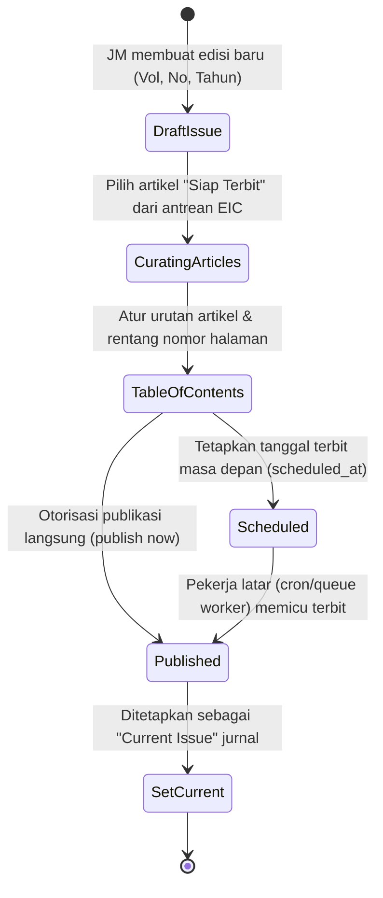

# Spesifikasi Teknis & Alur Kerja Portal Journal Manager
## Platform SIRIDA — Sistem Manajemen Jurnal Ilmiah
**Pemerintah Kota Makassar — Badan Riset dan Inovasi Daerah (BRIDA)**

---

## 1. Pengenalan & Gambaran Umum

Peran **Journal Manager (JM)** adalah pengelola operasional dan administrator tata kelola untuk satu instansi jurnal ilmiah tertentu pada platform SIRIDA. Berbeda dari *System Administrator* yang mengelola infrastruktur server secara global, dan *Editor in Chief (EIC)* yang berfokus pada substansi ilmiah serta keputusan naskah, Journal Manager bertanggung jawab penuh terhadap:

1. **Pengelolaan Terbitan & Edisi Publikasi (`UC-15`):**
   * Pembuatan nomor terbitan berkala (*Volume, Nomor, Tahun*).
   * Pengelompokan status edisi: *Future/Draft Issues*, *Scheduled Issues*, dan *Published/Back Issues*.
   * Penyusunan Daftar Isi Terbitan (*Table of Contents* / `issue_articles`) dari artikel yang berstatus "Siap Terbit" (*ready articles* yang telah disetujui EIC dengan galai aktif).
   * Penjadwalan tanggal terbit resmi atau eksekusi publikasi langsung (*publish now*).
   * Otorisasi penetapan Edisi Berjalan (*Current Issue*).

2. **Tata Kelola Pengguna, Tim Redaksi & Direktori Penelaah (`UC-16`):**
   * Keanggotaan jurnal (`journal_memberships`) dan pemberian peran redaksi (`journal_role_grants`): *Section Editor*, *Copyeditor*, *Layout Editor*, *Proofreader*, *Reviewer*, *Author*, dan *Reader*.
   * Pengelolaan Direktori Penelaah (*Reviewer Directory*): Klasifikasi kata kunci kepakaran (*expertise keywords*) dan ketersediaan menelaah.
   * Reset akses akun: Pengiriman token tautan reset kata sandi ke email pengguna (tanpa manipulasi kata sandi langsung oleh manajer).
   * Perlindungan keamanan hak akses (*Guard Rails*): Larangan mencabut *Last EIC* atau *Last Admin*, serta larangan mutasi anggota yang sedang aktif memegang naskah berjalan tanpa penugasan pengganti (*Active Work Guard*).

3. **Pengaturan Kebijakan & Bidang Naskah (`UC-17`):**
   * Pengelolaan Bagian/Seksi Naskah (`sections`): Pembuatan bidang fokus penelitian, urutan posisi, dan status penerimaan naskah baru.
   * Identitas & Kebijakan Jurnal (`journals`, `journal_settings`): Nomor cetak ISSN, E-ISSN, fokus dan ruang lingkup (*focus & scope*), kebijakan akses terbuka (*Open Access*), dan panduan penulisan (*Author Guidelines*).
   * Warta Berita & Pengumuman Publik (`announcements`): Panggilan naskah (*Call for Papers*) dan pengumuman edisi baru.

4. **Investigasi Etika & Oversight Keputusan Editorial (`UC-10`):**
   * Investigasi eskalasi sengketa etika naskah yang diteruskan oleh EIC.
   * Pencatatan audit koreksi keputusan redaksi (*editorial decision override*) dengan rekaman alasan resmi (`override_reason`).

---

## 2. Siklus Hidup Penerbitan Edisi Jurnal (UC-15)



### Aturan Bisnis & Invariant Wajib (Business Invariants)

1. **Syarat Kesiapan Artikel Terbit (*Ready Article Guard* - `UC-15`):**
   * Naskah hanya dapat dimasukkan ke dalam daftar isi edisi terbitan jika telah berstatus resmi `ready` dari EIC (`editorial_decisions.decision = 'accepted'`) dan memiliki minimal satu berkas galai PDF sah yang telah memperoleh persetujuan akhir (`galley_approvals.stage = 'editor_final'`).
2. **Pencegahan Terbitan Kosong (*Empty Issue Guard* - `UC-15`):**
   * Sebuah edisi terbitan dilarang keras dipublikasikan jika tidak memiliki minimal satu artikel sah di dalamnya. Percobaan publikasi edisi kosong wajib ditolak oleh sistem.
3. **Pemberangusan Checksum Galai (*Galley Checksum Invalidation*):**
   * Jika galai PDF yang telah terbit mengalami mutasi isi berkas setelah diterbitkan, nomor versi baru wajib diterbitkan dan hash SHA-256 baru dicatat pada log audit publikasi.
4. **Perlindungan Hak Akses Minimum (*Last Admin & Last EIC Guard* - `UC-16`):**
   * Sistem wajib menolak pencabutan peran atau penonaktifan keanggotaan jika pengguna tersebut adalah satu-satunya *Journal Manager* atau *Editor in Chief* yang tersisa pada jurnal tersebut.
5. **Perlindungan Beban Naskah Aktif (*Active Work Guard* - `UC-16`):**
   * Pengguna yang sedang memegang penugasan aktif (sebagai Section Editor, Copyeditor, Layout Editor, atau Reviewer aktif) tidak dapat dicabut perannya sebelum penugasan naskah tersebut dialihkan atau diselesaikan.
6. **Integritas Identitas Global (`UC-16`):**
   * Journal Manager tidak diizinkan mengubah nama global, email, atau kata sandi pengguna secara langsung di basis data. Reset akun hanya diperkenankan melalui pemicuan token verifikasi ke email pemilik akun.

---

## 3. Pemetaan Skema Basis Data Definitif (`docs/erd.md`)

Modul Journal Manager beroperasi lintas 3 modul inti dari sistem SIRIDA:

### A. Modul 06: Artikel dan Publikasi
1. **Tabel 43: `issues`**
   * `id`: `CHAR(26)` NOT NULL — Primary Key (ULID).
   * `journal_id`: `CHAR(26)` NOT NULL — FK ke `journals.id`.
   * `volume`: `TEXT` NOT NULL — Nomor volume terbitan (contoh: "6").
   * `number`: `TEXT` NOT NULL — Nomor terbitan (contoh: "2").
   * `year`: `INT` NOT NULL — Tahun terbitan (contoh: 2026).
   * `title`: `TEXT` NOT NULL — Judul edisi terbitan (contoh: "Vol. 6 No. 2 (2026): Inovasi Riset Daerah").
   * `description`: `TEXT` NULL — Pengantar editorial edisi.
   * `status`: `VARCHAR(191)` NOT NULL — Status (`draft`, `scheduled`, `published`).
   * `scheduled_at`: `DATETIME(6)` NULL — Jadwal waktu publikasi otomatis.
   * `publication_date`: `DATE` NULL — Tanggal resmi publikasi pada sitasi.
   * `version`: `INT` NOT NULL DEFAULT 1 — Optimistic locking counter.
2. **Tabel 44: `issue_articles`**
   * `issue_id`: `CHAR(26)` NOT NULL — Composite PK & FK ke `issues.id`.
   * `article_id`: `CHAR(26)` NOT NULL — Composite PK & FK ke `articles.id`.
   * `position`: `INT` NOT NULL DEFAULT 1 — Urutan artikel pada daftar isi.
   * `pages`: `TEXT` NULL — Rentang halaman artikel (contoh: "101-115").
   * *Constraints:* `UNIQUE KEY uq_issue_articles_article (article_id)`, `UNIQUE KEY uq_issue_articles_pos (issue_id, position)`.
3. **Tabel 45: `articles`**
   * Entitas rekaman resmi artikel siap/sudah terbit (`in_press`, `published`, `retracted`).

### B. Modul 01: Identitas dan Akses
1. **Tabel 3: `journal_memberships`**
   * `id`: `CHAR(26)` NOT NULL — Primary Key (ULID).
   * `user_id`: `CHAR(26)` NOT NULL — FK ke `users.id`.
   * `journal_id`: `CHAR(26)` NOT NULL — FK ke `journals.id`.
   * `status`: `VARCHAR(191)` NOT NULL — Status keanggotaan (`active`, `suspended`, `inactive`).
   * `expertise`: `JSON` NULL — Array kata kunci kepakaran reviewer.
2. **Tabel 4: `journal_role_grants`**
   * `id`: `CHAR(26)` NOT NULL — Primary Key (ULID).
   * `membership_id`: `CHAR(26)` NOT NULL — FK ke `journal_memberships.id`.
   * `role_code`: `VARCHAR(191)` NOT NULL — Kode peran jurnal (`manager`, `editor_in_chief`, `section_editor`, `copyeditor`, `layout_editor`, `proofreader`, `reviewer`, `author`, `reader`).
   * `assigned_at`: `DATETIME(6)` NOT NULL.
   * `revoked_at`: `DATETIME(6)` NULL.
   * `live_slot`: `TINYINT` GENERATED ALWAYS AS (`IF(revoked_at IS NULL, 1, NULL)`) STORED.

### C. Modul 02: Jurnal dan Konten
1. **Tabel 9: `journals`**
   * `id`: `CHAR(26)` NOT NULL — Primary Key (ULID).
   * `slug`: `VARCHAR(191)` NOT NULL — Identifier unik URL (contoh: `sirida`).
   * `name`: `TEXT` NOT NULL — Nama lengkap jurnal ilmiah.
   * `issn`: `TEXT` NULL — Nomor ISSN cetak.
   * `eissn`: `TEXT` NULL — Nomor E-ISSN elektronik.
   * `status`: `VARCHAR(191)` NOT NULL — Status (`active`, `archived`, `unlisted`).
   * `current_issue_id`: `CHAR(26)` NULL — FK ke `issues.id` (edisi terbitan aktif saat ini).
2. **Tabel 10: `sections`**
   * `id`: `CHAR(26)` NOT NULL — Primary Key (ULID).
   * `journal_id`: `CHAR(26)` NOT NULL — FK ke `journals.id`.
   * `name`: `TEXT` NOT NULL — Nama seksi (contoh: "Inovasi Daerah & Kebijakan Publik").
   * `slug`: `VARCHAR(191)` NOT NULL.
   * `accepting_submissions`: `BOOLEAN` NOT NULL DEFAULT TRUE.
   * `position`: `INT` NOT NULL DEFAULT 0.
3. **Tabel 14: `announcements`**
   * Berita resmi, pengumuman publik, dan panggilan pengajuan naskah (*Call for Papers*).

---

## 4. Pemetaan Rute Web & Kontrak API

Prefix rute: `/journalmanager`

| Metode | URL | Nama Rute | Deskripsi |
| :--- | :--- | :--- | :--- |
| `GET` | `/journalmanager/issues` | `journalmanager.issues.index` | Katalog seluruh edisi terbitan (Draf, Terjadwal, Terbit) |
| `POST` | `/journalmanager/issues` | `journalmanager.issues.store` | Membuat edisi nomor terbitan baru |
| `GET` | `/journalmanager/issues/{id}` | `journalmanager.issues.show` | Ruang kerja penyusunan daftar isi edisi (*Table of Contents*) |
| `POST` | `/journalmanager/issues/{id}/add-article` | `journalmanager.issues.add-article` | Memasukkan artikel siap terbit ke dalam daftar isi |
| `POST` | `/journalmanager/issues/{id}/publish` | `journalmanager.issues.publish` | Mempublikasikan edisi terbitan (*Publish Now*) |
| `POST` | `/journalmanager/issues/{id}/set-current` | `journalmanager.issues.set-current` | Menetapkan edisi sebagai *Current Issue* |
| `GET` | `/journalmanager/users` | `journalmanager.users.index` | Daftar pengguna, peran dewan redaksi & direktori reviewer |
| `POST` | `/journalmanager/users/assign-role` | `journalmanager.users.assign-role` | Menambahkan penugasan peran jurnal ke pengguna |
| `POST` | `/journalmanager/users/reset-password` | `journalmanager.users.reset-password` | Memicu pengiriman tautan reset kata sandi ke email pengguna |
| `GET` | `/journalmanager/sections` | `journalmanager.sections.index` | Pengelolaan bidang naskah (*Sections*) |
| `POST` | `/journalmanager/sections` | `journalmanager.sections.store` | Membuat bidang naskah baru |
| `GET` | `/journalmanager/settings` | `journalmanager.settings.index` | Pengaturan identitas jurnal, ISSN, dan kebijakan |
| `POST` | `/journalmanager/settings` | `journalmanager.settings.update` | Memperbarui konfigurasi jurnal |

---

## 5. Kontrak Data ViewModel (Tanpa Hardcode)

### A. Kontrak Data Katalog Terbitan (`JournalManagerIssuesViewModel`)
```php
[
    'userProfile' => [
        'name' => string,               // 'Andi Muhammad Yusuf, M.Si.'
        'role_label' => string,         // 'Journal Manager'
        'affiliation' => string,        // 'BRIDA Kota Makassar'
        'initials' => string,           // 'AY'
    ],
    'metrics' => [
        ['title' => 'Edisi Terbit', 'value' => 12, 'badge_text' => 'Publik', 'color_class' => string],
        ['title' => 'Edisi Terjadwal / Draf', 'value' => 2, 'badge_text' => 'Dalam Produksi', 'color_class' => string],
        ['title' => 'Artikel Siap Dijadwalkan', 'value' => 5, 'badge_text' => 'Antrean EIC', 'color_class' => string],
        ['title' => 'Total Artikel Terbit', 'value' => 84, 'badge_text' => 'Volume 1-6', 'color_class' => string],
    ],
    'tabs' => [
        'active' => string,             // 'all' | 'published' | 'future'
        'items' => [
            'all' => ['key' => 'all', 'label' => 'Semua Edisi', 'count' => int],
            'published' => ['key' => 'published', 'label' => 'Edisi Terbit', 'count' => int],
            'future' => ['key' => 'future', 'label' => 'Draf & Terjadwal', 'count' => int],
        ],
    ],
    'issues' => [
        [
            'id' => string,             // 'ISSUE-01JARK960A'
            'volume' => string,         // '6'
            'number' => string,         // '2'
            'year' => int,              // 2026
            'title' => string,          // 'Vol. 6 No. 2 (2026): Inovasi Kebijakan Publik'
            'status' => string,         // 'draft' | 'scheduled' | 'published'
            'status_label' => string,
            'status_badge_class' => string,
            'is_current' => bool,
            'articles_count' => int,
            'published_at' => ?string,
            'scheduled_at' => ?string,
            'url_workspace' => string,
        ],
    ],
    'pagination' => [
        'current_page' => int,
        'per_page' => int,
        'total' => int,
        'from' => int,
        'to' => int,
        'last_page' => int,
    ],
]
```

---

## 6. Standar UX & Desain Ergonomis

1. **Sidebar Bersih & Ergonomis (Hanya 4 Menu Utama):**
   * *Edisi & Terbitan* (Fokus operasional nomor jurnal).
   * *Pengguna & Redaksi* (Tata kelola tim editorial dan reviewer).
   * *Bidang Naskah* (Pengaturan seksi penelitian).
   * *Pengaturan Jurnal* (Metadata, ISSN, dan kebijakan jurnal).
2. **Dimensi Target Sentuh Nyaman:** Semua tombol aksi interaktif memiliki ukuran minimal $44 \times 44$ px dengan visual feedback yang jelas.
3. **Pesan Dialog & Validasi Ramah:** Menghindari terminologi teknis database mentah pada notifikasi antarmuka pengguna.
