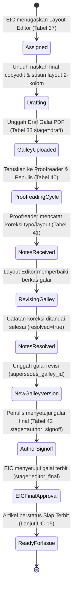

# Spesifikasi Teknis & Alur Kerja Portal Layout Editor
## Platform SIRIDA — Sistem Manajemen Jurnal Ilmiah
**Pemerintah Kota Makassar — Badan Riset dan Inovasi Daerah (BRIDA)**

---

## 1. Pengenalan & Gambaran Umum

Modul **Portal Layout Editor** mengelola tahap akhir produksi naskah setelah penyuntingan tata bahasa (copyediting) selesai dan disetujui penulis. Tugas utama Layout Editor adalah mentransformasikan naskah teks final (`.docx`) menjadi berkas tata letak publikasi resmi (**Galai PDF** sebagai format primer, serta pendamping interaktif **HTML/XML**), mengoordinasikan putaran koreksi tipografi dengan Proofreader (`UC-18`), menyelesaikan catatan perbaikan (*proofreading notes*), hingga galai memperoleh persetujuan akhir (*final sign-off*) dari Editor in Chief untuk diterbitkan pada edisi berkala jurnal (`UC-15`).

Dasar perancangan modul ini mengacu pada:
* **Use Case SRS:** `UC-14 Layout`, `UC-18 Proofreading`, dan persiapan ke `UC-15 Publikasi`.
* **Aturan Domain (Invariants):** [`docs/contract-decisions.md`](contract-decisions.md) (Bagian 3.4 & 4).
* **Skema ERD Definitif:** [`docs/erd.md`](erd.md) (Tabel 37 `layout_assignments`, Tabel 38 `galleys`, Tabel 39 `production_escalations`, Tabel 40 `proof_assignments`, Tabel 41 `proofreading_notes`, Tabel 42 `galley_approvals`, dan Tabel 51 `files`).

---

## 2. Siklus Hidup Alur Kerja Layout & Galley (UC-14 & UC-18)



### Aturan Bisnis & Invariant Wajib (Business Invariants)

1. **Predecessor & Version Guard (`UC-14`):**
   * Berkas galai final tidak boleh langsung diajukan tanpa melalui draf galai awal dan siklus koreksi proofreading (`UC-18`).
   * Setiap unggahan revisi galai wajib menautkan galai sebelumnya melalui kolom `supersedes_galley_id` untuk menjaga riwayat versi (*version genealogy*).
2. **Penyelesaian Wajib Catatan Proofreading (*Proofreading Notes Resolution*):**
   * Seluruh catatan koreksi yang dibuat oleh Proofreader (`proofreading_notes`) dengan tingkat keparahan *critical* atau *major* wajib diselesaikan (`resolved = true`, `resolved_at = NOW()`) dan diberi penjelasan perbaikan (`resolution`) oleh Layout Editor sebelum permohonan persetujuan akhir dapat diproses.
3. **Pemberangusan Persetujuan Akibat Perubahan Berkas (*Galley Checksum Invalidation*):**
   * Persetujuan galai mengunci hash **SHA-256** berkas PDF (`checksum_sha256`).
   * Jika berkas galai diganti atau dimutasi setelah disetujui, status persetujuan sebelumnya otomatis dibatalkan (`invalidated_at = NOW()`), dan galai wajib diperiksa ulang.
4. **Eskalasi Sengketa Tata Letak (*Production Escalation*):**
   * Jika terdapat kendala teknis layout yang tidak dapat disepakati antara proofreader, penulis, dan layout editor, Layout Editor dapat menerbitkan tiket eskalasi (`production_escalations`) yang mengikat `galley_id` (dengan constraint XOR `copyedit_id IS NULL AND galley_id IS NOT NULL`).
5. **Kesiapan Publikasi Artikel (*Ready for Issue Schedule*):**
   * Sebuah naskah hanya dapat dipilih oleh Journal Manager / EIC untuk diterbitkan dalam nomor terbitan (`issues`) jika memiliki minimal satu galai PDF aktif yang telah memperoleh `galley_approvals.stage = 'editor_final'`.

---

## 3. Pemetaan Skema Basis Data Definitif (`docs/erd.md`)

Modul Layout Editor mengelola 6 tabel inti dari **Modul 05 (Produksi dan Proofreading)** serta berelasi dengan tabel penyimpanan berkas dari **Modul 07**:

### A. Tabel 37: `layout_assignments`
Menyimpan penugasan Layout Editor per naskah oleh EIC/Section Editor.
* `id`: `CHAR(26)` NOT NULL — Primary Key berbasis ULID.
* `submission_id`: `CHAR(26)` NOT NULL — Foreign Key ke `submissions.id`.
* `layout_editor_id`: `CHAR(26)` NOT NULL — Foreign Key ke `users.id`.
* `due_at`: `DATETIME(6)` NOT NULL — Batas waktu pengerjaan tata letak.
* `version`: `INT` NOT NULL DEFAULT 1 — Optimistic locking counter.
* `assigned_by`: `CHAR(26)` NOT NULL — Foreign Key ke `users.id` (Editor penugaskan).
* `assigned_at`: `DATETIME(6)` NOT NULL — Waktu penugasan resmi (UTC).
* `revoked_at`: `DATETIME(6)` NULL — Waktu pembatalan/pergantian penugasan layout editor.
* `reason`: `TEXT` NOT NULL — Alasan atau instruksi khusus penugasan layout.
* `live_slot`: `TINYINT` GENERATED ALWAYS AS (`IF(revoked_at IS NULL, 1, NULL)`) STORED.
* *Constraints & Indexes:* `PRIMARY KEY (id)`, `UNIQUE KEY uq_layout_assign_live (submission_id, live_slot)`.

### B. Tabel 38: `galleys`
Katalog berkas galai publikasi naskah (PDF, HTML, XML).
* `id`: `CHAR(26)` NOT NULL — Primary Key berbasis ULID.
* `submission_id`: `CHAR(26)` NOT NULL — Foreign Key ke `submissions.id`.
* `file_id`: `CHAR(26)` NOT NULL — Foreign Key ke `files.id` (objek berkas PDF/HTML di storage).
* `supersedes_galley_id`: `CHAR(26)` NULL — Foreign Key self-referencing ke `galleys.id` (galai versi lama yang digantikan).
* `format`: `VARCHAR(191)` NOT NULL — Format galai (`pdf`, `html`, `xml`).
* `stage`: `VARCHAR(191)` NOT NULL — Tahap pengerjaan (`draft`, `proofreading`, `approved`).
* `status`: `VARCHAR(191)` NOT NULL — Status galai (`active`, `superseded`, `rejected`).
* `checksum_sha256`: `TEXT` NOT NULL — Hash SHA-256 berkas galai terkini.
* `approved_checksum`: `TEXT` NULL — Hash SHA-256 saat galai memperoleh persetujuan proofread.
* `version`: `INT` NOT NULL DEFAULT 1 — Versi galai (v1, v2, v3...).
* `label`: `TEXT` NOT NULL — Label galai (misal: "PDF Full Text", "HTML Interactive").
* *Constraints:* `PRIMARY KEY (id)`, Foreign Keys dengan `ON DELETE RESTRICT`.

### C. Tabel 40: `proof_assignments`
Penugasan putaran proofreading kepada Proofreader dan Penulis.
* `id`: `CHAR(26)` NOT NULL — Primary Key ULID.
* `galley_id`: `CHAR(26)` NOT NULL — FK ke `galleys.id`.
* `proofreader_id`: `CHAR(26)` NOT NULL — FK ke `users.id`.
* `due_at`: `DATETIME(6)` NOT NULL — Tenggat waktu pemeriksaan proofreading.
* `status`: `VARCHAR(191)` NOT NULL — Status penugasan (`assigned`, `in_progress`, `completed`).
* `assigned_at`: `DATETIME(6)` NOT NULL.
* `file_id`: `CHAR(26)` NOT NULL — FK ke `files.id` (berkas galai yang diperiksa).
* `checksum_sha256`: `CHAR(64)` NOT NULL.
* `message`: `TEXT` NULL — Pesan pengantar penugasan.

### D. Tabel 41: `proofreading_notes`
Daftar catatan koreksi spesifik dari Proofreader yang harus diselesaikan Layout Editor.
* `id`: `CHAR(26)` NOT NULL — Primary Key ULID.
* `proof_assignment_id`: `CHAR(26)` NOT NULL — FK ke `proof_assignments.id`.
* `galley_id`: `CHAR(26)` NOT NULL — FK ke `galleys.id`.
* `file_id`: `CHAR(26)` NOT NULL — FK ke `files.id`.
* `checksum_sha256`: `TEXT` NOT NULL — Hash berkas saat catatan dibuat.
* `category`: `TEXT` NOT NULL — Kategori kesalahan (`typo`, `layout`, `metadata`, `reference`).
* `page`: `INT` NULL — Nomor halaman lokasi kesalahan (NULL jika koreksi umum).
* `severity`: `TEXT` NOT NULL — Tingkat keparahan (`minor`, `major`, `critical`).
* `description`: `TEXT` NOT NULL — Rincian kekeliruan yang harus diperbaiki.
* `resolved`: `BOOLEAN` NOT NULL DEFAULT FALSE — Status penyelesaian oleh Layout Editor.
* `resolution`: `TEXT` NULL — Penjelasan tindakan perbaikan oleh Layout Editor.
* `resolved_at`: `DATETIME(6)` NULL — Waktu catatan diselesaikan.
* *Constraints:* `CHECK (page IS NULL OR page >= 1)`.

### E. Tabel 42: `galley_approvals`
Persetujuan resmi terhadap berkas galai oleh Penulis dan Editor in Chief.
* `id`: `CHAR(26)` NOT NULL — Primary Key ULID.
* `galley_id`: `CHAR(26)` NOT NULL — FK ke `galleys.id`.
* `approved_by`: `CHAR(26)` NOT NULL — FK ke `users.id`.
* `stage`: `VARCHAR(191)` NOT NULL — Tahap approval (`author_signoff`, `editor_final`).
* `checksum_sha256`: `TEXT` NOT NULL — Checksum galai yang disetujui.
* `approved_at`: `DATETIME(6)` NOT NULL (UTC).
* `invalidated_at`: `DATETIME(6)` NULL — Waktu pembatalan jika ada mutasi berkas ulang.
* `file_id`: `CHAR(26)` NOT NULL — FK ke `files.id`.
* `note`: `TEXT` NULL — Catatan keputusan approval.

### F. Tabel 39: `production_escalations`
Tiket eskalasi kendala tata letak publikasi ke Section Editor.
* `id`: `CHAR(26)` NOT NULL — Primary Key ULID.
* `submission_id`: `CHAR(26)` NOT NULL — FK ke `submissions.id`.
* `copyedit_id`: `CHAR(26)` NULL — FK ke `copyedits.id`.
* `galley_id`: `CHAR(26)` NULL — FK ke `galleys.id` (XOR dengan `copyedit_id`).
* `opened_by`: `CHAR(26)` NOT NULL — FK ke `users.id`.
* `reason`: `TEXT` NOT NULL — Uraian kendala teknis.
* `status`: `VARCHAR(191)` NOT NULL — Status (`open`, `investigating`, `resolved`).
* `resolution`: `TEXT` NULL — Solusi penyelesaian dari editor.
* *Constraints:* `CHECK ((copyedit_id IS NOT NULL AND galley_id IS NULL) OR (copyedit_id IS NULL AND galley_id IS NOT NULL))`.

---

## 4. Rute Web (Web Routes Contract)

Semua rute bernaung di bawah prefix `/layouteditor` dan menggunakan nama rute `layouteditor.*`:

| Metode | URI | Nama Rute | Controller & Method | Deskripsi |
| :--- | :--- | :--- | :--- | :--- |
| `GET` | `/layouteditor` | `layouteditor.dashboard` | Redirect ke `submissions.index` | Redirect beranda portal |
| `GET` | `/layouteditor/submissions` | `layouteditor.submissions.index` | `LayoutEditorSubmissionController@index` | Daftar penugasan galai & tata letak |
| `GET` | `/layouteditor/submissions/{id}` | `layouteditor.submissions.show` | `LayoutEditorSubmissionController@show` | Ruang kerja produksi galai naskah |
| `GET` | `/layouteditor/guidelines` | `layouteditor.guidelines` | `LayoutEditorSubmissionController@guidelines` | Panduan tata letak, margin & format PDF |
| `POST` | `/layouteditor/upload-galley` | `layouteditor.upload-galley` | `LayoutEditorSubmissionController@uploadGalley` | Unggah draf galai PDF/HTML baru atau revisi |
| `POST` | `/layouteditor/resolve-note` | `layouteditor.resolve-note` | `LayoutEditorSubmissionController@resolveNote` | Tandai catatan koreksi proofreading selesai |
| `POST` | `/layouteditor/request-proofread` | `layouteditor.request-proofread` | `LayoutEditorSubmissionController@requestProofread` | Kirim galai ke putaran proofreading |
| `POST` | `/layouteditor/escalate` | `layouteditor.escalate` | `LayoutEditorSubmissionController@submitEscalation` | Terbitkan tiket eskalasi kendala layout ke SE |
| `POST` | `/layouteditor/request-final-approval` | `layouteditor.request-final-approval` | `LayoutEditorSubmissionController@requestFinalApproval` | Minta persetujuan final EIC untuk terbit |

---

## 5. Kontrak Data Frontend (Blade View Variables Contract)

Seluruh tampilan Blade **bebas dari data hardcode** dan mengonsumsi data terstruktur melalui ViewModel:

### A. Kontrak Data Daftar Penugasan (`layouteditor.submissions.index`)

Variabel yang dipasok oleh `App\ViewModels\LayoutEditorSubmissionsViewModel`:

```php
[
    // 1. Profil Pengguna Layout Editor
    'userProfile' => [
        'name' => string,               // 'Rahmat Hidayat, S.Kom.'
        'role_label' => string,         // 'Layout Editor'
        'affiliation' => string,        // 'Bagian Publikasi Ilmiah BRIDA Makassar'
        'initials' => string,           // 'RH'
    ],

    // 2. Metrik Ringkasan Atas
    'metrics' => [
        [
            'title' => 'Total Penugasan Layout',
            'value' => int,             // 8
            'badge_text' => '8 Naskah',
            'color_class' => 'text-brand-maroon bg-red-50 border-red-100',
        ],
        [
            'title' => 'Perlu Draf Galai',
            'value' => int,             // 3
            'badge_text' => 'Prioritas',
            'color_class' => 'text-amber-700 bg-amber-50 border-amber-200',
        ],
        [
            'title' => 'Dalam Putaran Proofread',
            'value' => int,             // 3
            'badge_text' => 'Pemeriksaan',
            'color_class' => 'text-blue-700 bg-blue-50 border-blue-200',
        ],
        [
            'title' => 'Galai Siap Terbit',
            'value' => int,             // 14
            'badge_text' => 'Disetujui EIC',
            'color_class' => 'text-emerald-700 bg-emerald-50 border-emerald-200',
        ],
    ],

    // 3. Tab Filter Status
    'tabs' => [
        'active' => string,             // 'all' | 'drafting' | 'proofreading' | 'ready'
        'items' => [
            'all' => ['key' => 'all', 'label' => 'Semua Penugasan', 'count' => int],
            'drafting' => ['key' => 'drafting', 'label' => 'Perlu Draf Galai', 'count' => int],
            'proofreading' => ['key' => 'proofreading', 'label' => 'Koreksi Proofreading', 'count' => int],
            'ready' => ['key' => 'ready', 'label' => 'Siap Terbit', 'count' => int],
        ],
    ],

    // 4. Daftar Naskah Penugasan
    'submissions' => [
        [
            'id' => string,             // 'SUB-2026-00106'
            'number' => string,         // 'SUB-2026-00106'
            'title' => string,
            'section_title' => string,
            'corresponding_author' => ['name' => string, 'affiliation' => string],
            'proofreader' => string,    // 'Dra. Sitti Aminah, M.Hum.'
            'due_at' => string,
            'is_urgent' => bool,
            'status' => string,         // 'drafting' | 'proofreading' | 'ready'
            'status_label' => string,
            'status_badge_class' => string,
            'galley_count' => int,      // Jumlah berkas galai terunggah
            'unresolved_notes_count' => int, // Jumlah catatan koreksi yang belum selesai
            'url_workspace' => string,
        ],
    ],

    // 5. Paginasi
    'pagination' => [
        'current_page' => int,
        'per_page' => int,
        'total' => int,
        'from' => int,
        'to' => int,
        'last_page' => int,
    ],
]
```

### B. Kontrak Data Ruang Kerja Galai (`layouteditor.submissions.show`)

Variabel yang dipasok oleh `App\ViewModels\LayoutEditorDetailViewModel`:

```php
[
    'submission' => [
        'id' => string,                         // 'SUB-2026-00106'
        'number' => string,
        'assignment_code' => string,            // '#LE-01JARK948X'
        'title' => string,
        'section_title' => string,
        'corresponding_author' => [
            'name' => string,
            'email' => string,
            'affiliation' => string,
        ],
        'section_editor' => string,
        'proofreader' => string,
        'assigned_at' => string,
        'due_at' => string,
        'is_urgent' => bool,
        'is_completed' => bool,
        'status' => string,                     // 'drafting' | 'proofreading' | 'notes_received' | 'approved'
        'status_label' => string,
        'status_badge_class' => string,

        // 1. Naskah Acuan Final dari Copyeditor (source text acuan layout)
        'copyedit_final_file' => [
            'id' => string,
            'name' => string,                   // 'SUB2026-00106_Copyedit_Final_Approved.docx'
            'size_formatted' => string,
            'checksum_sha256' => string,
            'download_url' => string,
            'notes_from_copyeditor' => ?string, // Catatan serah terima copyeditor
        ],

        // 2. Berkas Galai Terunggah (galleys)
        'galleys' => [
            [
                'id' => string,
                'version' => int,               // 1, 2...
                'label' => string,              // 'PDF Full Text (Draf v1)'
                'format' => string,             // 'pdf' | 'html'
                'file_name' => string,
                'size_formatted' => string,
                'checksum_sha256' => string,
                'stage' => string,              // 'draft' | 'proofreading' | 'approved'
                'status' => string,             // 'active' | 'superseded'
                'uploaded_at' => string,
                'download_url' => string,
            ],
        ],

        // 3. Catatan Koreksi Proofreader (proofreading_notes)
        'proofreading' => [
            'has_assignment' => bool,
            'status' => string,                 // 'waiting_review' | 'notes_received' | 'all_resolved'
            'total_notes_count' => int,
            'unresolved_count' => int,
            'notes' => [
                [
                    'id' => string,
                    'page' => ?int,             // 3
                    'category' => string,       // 'layout' | 'typo' | 'metadata' | 'reference'
                    'severity' => string,       // 'critical' | 'major' | 'minor'
                    'severity_badge' => string,
                    'description' => string,    // Rincian kesalahan
                    'resolved' => bool,
                    'resolution' => ?string,    // Penjelasan tindakan perbaikan
                    'resolved_at' => ?string,
                ],
            ],
        ],

        // 4. Status Persetujuan Akhir Galai (galley_approvals)
        'approval' => [
            'author_signoff' => [
                'approved' => bool,
                'approved_at' => ?string,
                'notes' => ?string,
            ],
            'editor_final' => [
                'approved' => bool,
                'approved_at' => ?string,
                'ready_for_publication' => bool, // True jika EIC telah menyetujui terbit
            ],
        ],

        // 5. Eskalasi Masalah Produksi Layout (production_escalations)
        'escalation' => [
            'has_active' => bool,
            'ticket_id' => ?string,
            'reason' => ?string,
            'status' => ?string,
            'resolution' => ?string,
            'resolved_at' => ?string,
        ],

        // 6. Jejak Aktivitas Produksi (Timeline)
        'activity_timeline' => [
            [
                'title' => string,
                'actor' => string,
                'date' => string,
                'description' => string,
                'badge_class' => string,
            ],
        ],
    ]
]
```

---

## 6. Panduan untuk Developer Backend Saat Integrasi

1. **Query Sumber Data:** Ambil penugasan dari `layout_assignments` dengan relasi:
   - `submission.contributors` (penulis naskah)
   - `submission.copyedits.outputs.file` (berkas Word acuan yang disetujui)
   - `galleys.file`, `galleys.proofAssignments.notes`, `galleys.approvals`
2. **Penegakan Invariant Saat Mutasi Galai Baru:**
   - Ketika Layout Editor mengunggah galai versi baru (`uploadGalley`), buat entri baru di `files` dan `galleys` dengan mengisi `supersedes_galley_id` merujuk ke galai sebelumnya, dan ubah status galai lama menjadi `status = 'superseded'`.
3. **Penyelesaian Catatan Proofreading:**
   - Eksekusi query update `UPDATE proofreading_notes SET resolved = 1, resolution = ?, resolved_at = NOW() WHERE id = ?`.
4. **Persetujuan Final EIC:**
   - Hanya izinkan pembuatan rekaman `galley_approvals (stage = 'editor_final')` jika `unresolved_count = 0`. Setelah tersimpan, tandai artikel siap dijadwalkan ke `issue_articles`.
5. **Kesesuaian Frontend:**
   - Tim frontend telah membangun seluruh Blade view dengan variabel dinamis di atas. Backend hanya perlu memasok array data yang sesuai tanpa mengubah kode tampilan.
