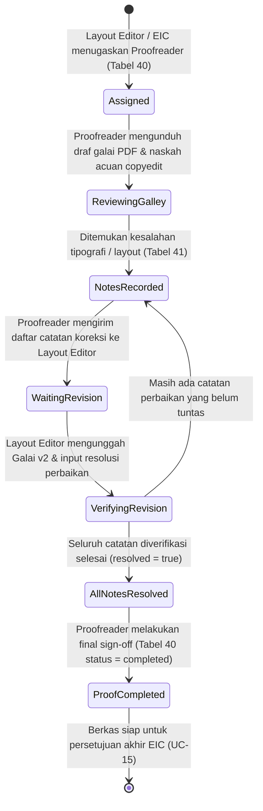

# Spesifikasi Teknis & Alur Kerja Portal Proofreader
## Platform SIRIDA — Sistem Manajemen Jurnal Ilmiah
**Pemerintah Kota Makassar — Badan Riset dan Inovasi Daerah (BRIDA)**

---

## 1. Pengenalan & Gambaran Umum

Peran **Proofreader (Pembaca Pralayang / Pemeriksa Bukti Cetak)** bertanggung jawab atas verifikasi tipografi dan tata letak akhir naskah sebelum terbit. Tugas utama Proofreader adalah memeriksa berkas draf publikasi (**Galai PDF** sebagai format utama serta HTML pendamping) yang dihasilkan oleh Layout Editor (`UC-14`), membandingkannya dengan naskah acuan hasil copyediting yang telah disetujui penulis (`UC-13`), dan mencatat setiap kesalahan tipografi, ejaan, tata letak tabel, atau ketidaksesuaian metadata sebelum berkas memperoleh persetujuan akhir dari Editor in Chief (`UC-15`).

Dasar perancangan modul ini mengacu pada:
* **Use Case SRS:** `UC-18 Proofreading`, berinterelasi dengan `UC-14 Layout` dan persiapan ke `UC-15 Publikasi`.
* **Aturan Domain (Invariants):** [`docs/contract-decisions.md`](contract-decisions.md) (Bagian 4).
* **Skema ERD Definitif:** [`docs/erd.md`](erd.md) (Tabel 40 `proof_assignments`, Tabel 41 `proofreading_notes`, Tabel 42 `galley_approvals`, Tabel 38 `galleys`, Tabel 39 `production_escalations`, dan Tabel 51 `files`).

---

## 2. Siklus Hidup Alur Kerja Proofreading (UC-18)



### Aturan Bisnis & Invariant Wajib (Business Invariants)

1. **Pengikatan Checksum Berkas Galai (*Galley Checksum Binding* - `UC-18`):**
   * Penugasan bukti baca (`proof_assignments`) dan setiap catatan koreksi (`proofreading_notes`) wajib mengikat kombinasi `galley_id`, `file_id`, dan hash SHA-256 berkas galai aktif (`checksum_sha256`).
   * Jika berkas galai dimutasi atau diunggah ulang oleh Layout Editor (`supersedes_galley_id`), catatan lama tetap tersimpan dalam riwayat audit, dan galai versi baru wajib diverifikasi ulang.
2. **Taksonomi & Atribut Catatan Koreksi (*Proofreading Notes Taxonomy*):**
   * **Kategori (`category`):**
     - `typo`: Kesalahan ejaan, tanda baca, huruf kapital, atau salah ketik mengacu pada EYD Edisi V.
     - `layout`: Tabel terpotong canggung antar halaman, gambar melompat, penomoran caption salah.
     - `metadata`: Ketidaksesuaian running header, judul artikel, nomor halaman, atau nomor DOI.
     - `reference`: Ketidakkonsistenan format sitasi dan daftar pustaka (APA Style 7th Edition).
   * **Tingkat Keparahan (`severity`):**
     - `minor`: Kesalahan ringan yang tidak mengaburkan substansi (misal: spasi ganda, tanda petik).
     - `major`: Kesalahan tata letak yang mengganggu keterbacaan (tabel terpotong, grafik buram).
     - `critical`: Kesalahan fatal yang membatalkan keabsahan artikel (nama penulis salah, DOI keliru).
   * **Lokasi Halaman (`page`):**
     - Wajib bernilai integer $\ge 1$, atau `NULL` khusus catatan yang berlaku untuk keseluruhan dokumen.
3. **Penyelesaian Catatan Sebelum Persetujuan (*Sign-off Guard* - `UC-18`):**
   * Proofreader tidak dapat menyelesaikan penugasan (`proof_assignments.status = 'completed'`) jika masih terdapat catatan koreksi berkategori *critical* atau *major* yang belum diselesaikan (`resolved = false`).
4. **Eskalasi Ketidaksesuaian Copyedit (*Copyedit Mismatch Escalation*):**
   * Jika Proofreader mendeteksi adanya teks yang diubah menyimpang dari naskah final copyedit yang disetujui penulis, Proofreader dapat menerbitkan tiket eskalasi ke Section Editor (`production_escalations` dengan constraint XOR `galley_id IS NOT NULL AND copyedit_id IS NULL`).

---

## 3. Pemetaan Skema Basis Data Definitif (`docs/erd.md`)

Modul Proofreader mengelola 4 tabel inti dari **Modul 05 (Produksi dan Proofreading)** serta berelasi dengan tabel penyimpanan berkas dari **Modul 07**:

### A. Tabel 40: `proof_assignments`
Menyimpan penugasan pemeriksaan bukti baca per berkas galai.
* `id`: `CHAR(26)` NOT NULL — Primary Key berbasis ULID.
* `galley_id`: `CHAR(26)` NOT NULL — Foreign Key ke `galleys.id`.
* `proofreader_id`: `CHAR(26)` NOT NULL — Foreign Key ke `users.id`.
* `due_at`: `DATETIME(6)` NOT NULL — Batas waktu penyelesaian pemeriksaan bukti baca.
* `status`: `VARCHAR(191)` NOT NULL — Status penugasan (`assigned`, `in_progress`, `completed`).
* `assigned_at`: `DATETIME(6)` NOT NULL — Waktu penugasan resmi (UTC).
* `file_id`: `CHAR(26)` NOT NULL — Foreign Key ke `files.id` (berkas galai PDF yang diperiksa).
* `checksum_sha256`: `CHAR(64)` NOT NULL — Hash SHA-256 berkas galai saat penugasan.
* `message`: `TEXT` NULL — Instruksi khusus dari editor.
* *Constraints:* `PRIMARY KEY (id)`, Foreign Keys dengan `ON DELETE RESTRICT`.

### B. Tabel 41: `proofreading_notes`
Daftar catatan koreksi spesifik dari Proofreader yang harus diselesaikan Layout Editor.
* `id`: `CHAR(26)` NOT NULL — Primary Key berbasis ULID.
* `proof_assignment_id`: `CHAR(26)` NOT NULL — Foreign Key ke `proof_assignments.id`.
* `galley_id`: `CHAR(26)` NOT NULL — Foreign Key ke `galleys.id`.
* `file_id`: `CHAR(26)` NOT NULL — Foreign Key ke `files.id`.
* `checksum_sha256`: `TEXT` NOT NULL — Checksum berkas saat catatan dibuat.
* `category`: `TEXT` NOT NULL — Kategori kesalahan (`typo`, `layout`, `metadata`, `reference`).
* `page`: `INT` NULL — Nomor halaman (NULL jika catatan umum, atau $\ge 1$).
* `severity`: `TEXT` NOT NULL — Tingkat keparahan (`minor`, `major`, `critical`).
* `description`: `TEXT` NOT NULL — Rincian teks atau instruksi koreksi perbaikan.
* `resolved`: `BOOLEAN` NOT NULL DEFAULT FALSE — Status penyelesaian.
* `resolution`: `TEXT` NULL — Penjelasan tindakan perbaikan dari Layout Editor.
* `resolved_at`: `DATETIME(6)` NULL — Waktu penyelesaian koreksi.
* `version`: `INT` NOT NULL DEFAULT 1.
* *Constraints:* `PRIMARY KEY (id)`, `CHECK (page IS NULL OR page >= 1)`.

### C. Tabel 42: `galley_approvals`
Rekaman persetujuan formal galai.
* `id`: `CHAR(26)` NOT NULL — Primary Key ULID.
* `galley_id`: `CHAR(26)` NOT NULL — Foreign Key ke `galleys.id`.
* `approved_by`: `CHAR(26)` NOT NULL — Foreign Key ke `users.id`.
* `stage`: `VARCHAR(191)` NOT NULL — `author_signoff` atau `editor_final`.
* `checksum_sha256`: `TEXT` NOT NULL.
* `approved_at`: `DATETIME(6)` NOT NULL.

---

## 4. Pemetaan Rute Web & Kontrak API

Prefix rute: `/proofreader`

| Metode | URL | Nama Rute | Action Controller | Deskripsi |
| :--- | :--- | :--- | :--- | :--- |
| `GET` | `/proofreader` | `proofreader.dashboard` | Redirect | Dialihkan ke `proofreader.submissions.index` |
| `GET` | `/proofreader/submissions` | `proofreader.submissions.index` | `ProofreaderSubmissionController@index` | Daftar seluruh penugasan proofreading galai naskah |
| `GET` | `/proofreader/submissions/{id}` | `proofreader.submissions.show` | `ProofreaderSubmissionController@show` | Ruang kerja pemeriksaan galai & catatan koreksi naskah |
| `GET` | `/proofreader/guidelines` | `proofreader.guidelines` | `ProofreaderSubmissionController@guidelines` | Halaman panduan bukti baca, checklist & pedoman EYD |
| `POST` | `/proofreader/add-note` | `proofreader.add-note` | `ProofreaderSubmissionController@addNote` | Menambahkan catatan koreksi spesifik pada berkas galai |
| `POST` | `/proofreader/verify-note` | `proofreader.verify-note` | `ProofreaderSubmissionController@verifyNote` | Memverifikasi resolusi perbaikan dari layout editor |
| `POST` | `/proofreader/complete` | `proofreader.complete` | `ProofreaderSubmissionController@completeProofread` | Final sign-off penyelesaian putaran pemeriksaan proof |
| `POST` | `/proofreader/escalate` | `proofreader.escalate` | `ProofreaderSubmissionController@submitEscalation` | Menerbitkan tiket eskalasi ketidaksesuaian copyedit |

---

## 5. Kontrak Data ViewModel (Tanpa Hardcode)

### A. Kontrak Data Katalog Penugasan (`ProofreaderSubmissionsViewModel`)
```php
[
    'userProfile' => [
        'name' => string,               // 'Dra. Sitti Aminah, M.Hum.'
        'role_label' => string,         // 'Proofreader'
        'affiliation' => string,        // 'Pusat Bahasa & Budaya Sulawesi Selatan'
        'initials' => string,           // 'SA'
    ],
    'metrics' => [
        ['title' => 'Total Penugasan Proofread', 'value' => 6, 'badge_text' => '6 Naskah', 'color_class' => string],
        ['title' => 'Perlu Diperiksa', 'value' => 2, 'badge_text' => 'Draf Baru', 'color_class' => string],
        ['title' => 'Menunggu Revisi Layout', 'value' => 2, 'badge_text' => 'Catatan Terbuka', 'color_class' => string],
        ['title' => 'Pemeriksaan Selesai', 'value' => 18, 'badge_text' => 'Disetujui', 'color_class' => string],
    ],
    'tabs' => [
        'active' => string,             // 'all' | 'pending' | 'waiting_layout' | 'completed'
        'items' => [
            'all' => ['key' => 'all', 'label' => 'Semua Penugasan', 'count' => int],
            'pending' => ['key' => 'pending', 'label' => 'Perlu Diperiksa', 'count' => int],
            'waiting_layout' => ['key' => 'waiting_layout', 'label' => 'Menunggu Revisi Layout', 'count' => int],
            'completed' => ['key' => 'completed', 'label' => 'Pemeriksaan Selesai', 'count' => int],
        ],
    ],
    'submissions' => [
        [
            'id' => string,             // 'SUB-2026-00107'
            'number' => string,
            'title' => string,
            'section_title' => string,
            'corresponding_author' => ['name' => string, 'affiliation' => string],
            'layout_editor' => string,  // 'Rahmat Hidayat, S.Kom.'
            'galley_version' => string, // 'v1'
            'due_at' => string,
            'is_urgent' => bool,
            'status' => string,         // 'pending' | 'waiting_layout' | 'completed'
            'status_label' => string,
            'status_badge_class' => string,
            'unresolved_notes_count' => int,
            'url_workspace' => string,
        ],
    ],
    'pagination' => [
        'current_page' => int,
        'per_page' => int,
        'total' => int,
        'from' => int,
        'to' => int,
        'last_page' => int,
    ],
]
```

### B. Kontrak Data Ruang Kerja Pemeriksaan (`ProofreaderDetailViewModel`)
```php
[
    'submission' => [
        'id' => string,                         // 'SUB-2026-00107'
        'number' => string,
        'assignment_code' => string,            // '#PR-01JARK949Y'
        'title' => string,
        'section_title' => string,
        'corresponding_author' => ['name' => string, 'email' => string, 'affiliation' => string],
        'section_editor' => string,
        'layout_editor' => string,
        'due_at' => string,
        'is_urgent' => bool,
        'status' => string,                     // 'in_review' | 'notes_submitted' | 'completed'
        'status_label' => string,
        'status_badge_class' => string,
        'is_completed' => bool,

        // 1. Berkas Galai PDF Aktif
        'active_galley' => [
            'id' => string,
            'version' => int,                   // 1
            'file_name' => string,
            'size_formatted' => string,
            'checksum_sha256' => string,
            'download_url' => string,
            'uploaded_at' => string,
        ],

        // 2. Naskah Acuan Copyediting Final (.docx)
        'copyedit_reference' => [
            'id' => string,
            'file_name' => string,
            'size_formatted' => string,
            'checksum_sha256' => string,
            'download_url' => string,
        ],

        // 3. Catatan Koreksi Proofreader
        'notes' => [
            [
                'id' => string,                 // 'NOTE-01JARK-01'
                'page' => ?int,                 // 4
                'category' => string,           // 'layout' | 'typo' | 'metadata' | 'reference'
                'category_label' => string,
                'severity' => string,           // 'critical' | 'major' | 'minor'
                'severity_badge' => string,
                'description' => string,
                'resolved' => bool,
                'resolution' => ?string,        // Penjelasan tindakan dari layout editor
                'resolved_at' => ?string,
            ],
        ],

        // 4. Ringkasan Status Penyelesaian
        'summary' => [
            'total_notes' => int,
            'unresolved_notes' => int,
            'can_signoff' => bool,              // True jika unresolved_notes === 0
        ],

        // 5. Linimasa Aktivitas Proofreading
        'activity_timeline' => [
            [
                'title' => string,
                'actor' => string,
                'date' => string,
                'description' => string,
                'badge_class' => string,
            ],
        ],
    ]
]
```

---

## 6. Standar UX & Desain Ergonomis

1. **Sidebar Bersih & Terfokus:** Hanya 2 menu penting (*Penugasan Proofreading* dan *Panduan Bukti Baca*) untuk menjaga fokus pemeriksa naskah.
2. **Formulir Catatan Koreksi Cepat (*Inline Fast Logging*):** Proofreader dapat menginput nomor halaman, kategori kesalahan, tingkat keparahan, dan teks koreksi dengan alur singkat tanpa dialog berlapis yang rumit.
3. **Penyajian Penjelasan Resolusi yang Jelas:** Memperlihatkan perbandingan antara catatan koreksi asli dan penjelasan tindakan yang dilakukan oleh Layout Editor untuk mempermudah verifikasi ulang.
4. **Guard Rails & Pencegahan Kesalahan:** Tombol sign-off dinonaktifkan secara ramah dengan informasi peringatan jika masih ada catatan *major* atau *critical* yang belum diverifikasi.
