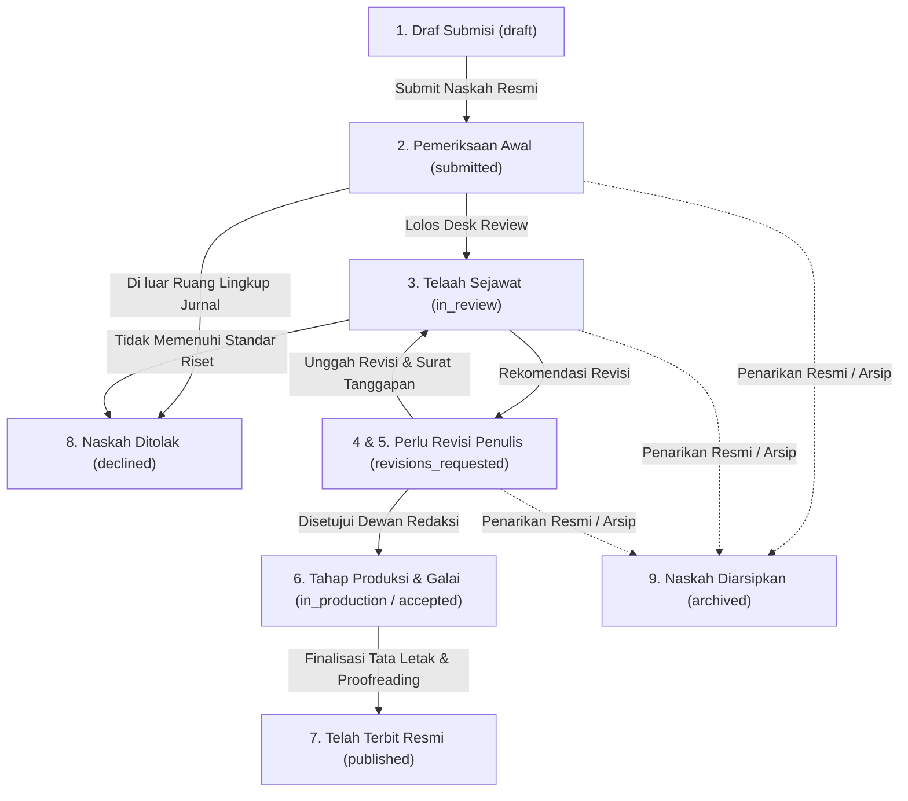

# Panduan Lengkap & Spesifikasi Teknis Fitur Submisi Naskah
## Platform SIRIDA — Portal Penulis & Sistem Manajemen Jurnal Ilmiah
**Pemerintah Kota Makassar — Badan Riset dan Inovasi Daerah (BRIDA)**

---

## 1. Pengenalan & Gambaran Umum

Modul **Submisi Naskah (Author Submission Portal)** adalah komponen inti dalam sistem **SIRIDA** yang mengotomatisasi seluruh siklus penerbitan manuskrip ilmiah dari tahap draf awal penulis hingga artikel resmi terbit dengan pengindeksan DOI global.

Sistem ini dirancang berbasis arsitektur **OJS 3 Modern** dan berpedoman teguh pada:
* **Kontrak ERD Definitif:** [`docs/erd.md`](erd.md) (Tabel 18 `submissions`, Tabel 19 `submission_contributors`, Tabel 56 `files`, Tabel 57 `submission_files`).
* **Prinsip Etika Publikasi Ilmiah:** Penegakan privasi mutlak ***Double-Blind Peer Review*** (identitas mitra bestari dan catatan rahasia editor tidak pernah dibocorkan ke penulis).

---

## 2. Siklus Hidup Alur Kerja (9 Skenario Lengkap)

Setiap naskah yang masuk ke sistem SIRIDA akan berada pada salah satu dari **9 status resmi** berikut:



### Matriks 9 Skenario & Perilaku Antarmuka:

| # | Status Database (`status`) | Tahap Alur | Keterangan Bisnis | Panel Kontekstual Sidebar | Aksi Utama Penulis |
|---|---|---|---|---|---|
| **1** | `draft` | 1 (Draf) | Naskah tersimpan parsial, belum diserahkan ke dewan redaksi. | **Naskah Draf Parsial** | Lanjutkan Draf Formulir |
| **2** | `submitted` | 2 (Pemeriksaan) | Naskah masuk tahap evaluasi awal (*Desk Review*) dan verifikasi uji kesamaan Turnitin (ambang batas maks. 20%). | **Desk Review & Turnitin Check** | Cek Status Pemeriksaan |
| **3** | `in_review` | 3 (Review) | Naskah dialokasikan secara anonim kepada minimal 2 mitra bestari (*Double-Blind Review*). | **Proses Telaah Sejawat** | Cek Status Review |
| **4** | `revisions_requested` (Minor) | 4 (Revisi) | Editor menerbitkan keputusan revisi minor (penajaman analisis data atau pembaruan literatur 5 tahun terakhir). | **Perlu Tindakan Penulis** | Unggah Revisi & Response Letter |
| **5** | `revisions_requested` (Mayor) | 4 (Revisi) | Editor menerbitkan keputusan revisi mayor (rekonstruksi metodologi atau penambahan data empiris). | **Perlu Tindakan Penulis** | Unggah Revisi & Response Letter |
| **6** | `in_production` / `accepted` | 5 (Produksi) | Naskah resmi diterima untuk terbit, masuk proses *copyediting*, *layout setting*, dan *proofreading* galai cetak. | **Tahap Produksi & Galai** | Cek Status Produksi |
| **7** | `published` | 6 (Terbit) | Artikel tayang daring (*Open Access*) dengan volume, nomor, halaman, dan tautan aktif DOI Crossref. | **Publikasi & Generator Sitasi (APA/IEEE/BibTeX)** | Lihat Publikasi & Unduh PDF |
| **8** | `declined` | Terminasi | Naskah ditolak pada tahap awal atau pasca-review karena di luar fokus jurnal (*Desk Reject*). | **Catatan Redaksi & Panduan Banding** | Baca Catatan Redaksi |
| **9** | `archived` | Terminasi | Proses editorial dihentikan resmi dan naskah dibekukan ke arsip OJS atas permohonan penulis (*Withdrawal/Archived*). | **Konfirmasi Arsip Editorial** | Cek Status Arsip |

---

## 3. Struktur Direktori & Panduan Perbaikan Berkas (Where to Improve)

Untuk memudahkan pengembang baru maupun tim yang ingin memodifikasi atau mengoptimalkan fitur submisi (*improvement*), berikut adalah pemetaan lengkap seluruh berkas terkait beserta tanggung jawabnya:

### A. Diagram Pohon Direktori Fitur Submisi

```text
ojs-rpl-backend/
├── app/
│   ├── Http/
│   │   ├── Controllers/Author/
│   │   │   └── AuthorSubmissionController.php     <-- Pengendali alur HTTP (CRUD, AJAX tab, wizard, download)
│   │   └── Requests/Author/
│   │       └── StoreSubmissionRequest.php         <-- Validasi ketat formulir submisi, draf, & kontributor
│   ├── Models/
│   │   ├── Submission.php                         <-- Model Eloquent naskah utama & relasi
│   │   ├── SubmissionContributor.php              <-- Model kontributor/penulis naskah
│   │   └── FileEntry.php / SubmissionFile.php     <-- Model berkas naskah & integritas SHA-256
│   └── ViewModels/
│       ├── AuthorSubmissionsViewModel.php         <-- Presenter data daftar naskah (tab, filter, pencarian)
│       └── AuthorSubmissionDetailViewModel.php    <-- Presenter detail naskah (stepper, privasi blind review, sitasi)
├── database/
│   ├── migrations/
│   │   ├── 2026_10_18_132715_create_submissions_table.php
│   │   ├── 2026_10_18_132716_create_submission_contributors_table.php
│   │   └── 2026_10_18_132717_create_files_and_submission_files_table.php
│   └── seeders/
│       └── SubmissionSeeder.php                   <-- Injeksi data realistis 9 skenario alur kerja
├── resources/
│   └── views/
│       ├── components/                            <-- Komponen Global Antarmuka
│       │   ├── action-modal.blade.php             <-- Modal konfirmasi aksi interaktif global (<x-action-modal />)
│       │   ├── modal.blade.php                    <-- Komponen modal dialog serbaguna (<x-modal />)
│       │   ├── toast.blade.php                    <-- Container & sistem toast global (<x-toast />)
│       │   ├── alert.blade.php                    <-- Banner notifikasi (<x-alert />)
│       │   ├── button.blade.php                   <-- Tombol aksi CTA (<x-button />)
│       │   ├── input.blade.php                    <-- Input teks formulir (<x-input />)
│       │   ├── label.blade.php                    <-- Label formulir (<x-label />)
│       │   └── author/                            <-- Komponen Khusus Penulis (Role Scoped)
│       │       ├── sidebar.blade.php              <-- Sidebar navigasi responsif & collapsible (<x-author.sidebar />)
│       │       └── header.blade.php               <-- Top navigation bar & user profile (<x-author.header />)
│       └── author/submissions/
│           ├── index.blade.php                    <-- Tampilan utama daftar naskah penulis
│           ├── show.blade.php                     <-- Tampilan utama detail naskah penulis
│           ├── create.blade.php                   <-- Wizard pengajuan naskah 5 tahap
│           └── partials/
│               ├── table.blade.php                <-- Potongan tabel naskah untuk AJAX live update
│               ├── detail-header.blade.php        <-- Header naskah (judul Lora serif, badge status, tombol aksi)
│               ├── detail-workflow-tracker.blade.php <-- Stepper horizontal visualisasi status 6 tahap
│               ├── detail-metadata.blade.php      <-- Panel metadata (abstrak Lora, kata kunci, sitasi APA/IEEE)
│               ├── detail-files.blade.php         <-- Tabel berkas naskah (hash SHA-256, ukuran, antivirus)
│               ├── detail-contributors.blade.php  <-- Tabel daftar kontributor, afiliasi, & identitas ORCID
│               ├── detail-sidebar.blade.php       <-- Panel status dinamis, batas waktu revisi, catatan editor
│               ├── step-1-section.blade.php       <-- Wizard Tahap 1: Pemilihan Rubrik Jurnal
│               ├── step-2-files.blade.php         <-- Wizard Tahap 2: Unggah Berkas Manuskrip
│               ├── step-3-metadata.blade.php      <-- Wizard Tahap 3: Metadata Artikel
│               ├── step-4-contributors.blade.php  <-- Wizard Tahap 4: Penulis & Kontributor
│               └── step-5-confirm.blade.php       <-- Wizard Tahap 5: Pernyataan Etika & Konfirmasi
└── tests/Feature/Author/
    ├── AuthorSubmissionDetailTest.php             <-- Suite pengujian halaman detail (9 skenario lengkap)
    └── AuthorSubmissionsPageTest.php              <-- Suite pengujian halaman index & interaksi AJAX
```

### B. Matriks Panduan "Ingin Mengubah Apa? Edit Berkas Ini!"

| Kebutuhan Pengembangan / Perbaikan (*Improvement*) | Berkas Utama yang Perlu Diedit |
| :--- | :--- |
| **Menambah / Memodifikasi Aturan Validasi** (misal: format ORCID, ekstensi file yang diizinkan, batasan kata abstrak) | `app/Http/Requests/Author/StoreSubmissionRequest.php` |
| **Mengubah Format Penyajian Data Detail** (misal: logika penentuan tahapan stepper, format sitasi APA/IEEE/BibTeX, penyembunyian reviewer) | `app/ViewModels/AuthorSubmissionDetailViewModel.php` |
| **Mengubah Logika Filter Tab & Pencarian Daftar Naskah** (misal: tab status baru, logika pencarian judul/kontributor) | `app/ViewModels/AuthorSubmissionsViewModel.php` |
| **Mengubah Endpoint / Alur Simpan & Penarikan Naskah** (misal: logic withdraw naskah, autosave draf, pengalihan route) | `app/Http/Controllers/Author/AuthorSubmissionController.php` |
| **Memodifikasi Judul Naskah & Tampilan Badge Status Utama** | `resources/views/author/submissions/partials/detail-header.blade.php` |
| **Memperbaiki / Mempercantik Visualisasi Stepper Alur Naskah** | `resources/views/author/submissions/partials/detail-workflow-tracker.blade.php` |
| **Menata Ulang Abstrak, Kata Kunci, atau Generator Sitasi Ilmiah** | `resources/views/author/submissions/partials/detail-metadata.blade.php` |
| **Mengubah Daftar Berkas, Tampilan Hash SHA-256, atau Status Antivirus** | `resources/views/author/submissions/partials/detail-files.blade.php` |
| **Menambah Kolom / Merapikan Informasi Kontributor & Afiliasi** | `resources/views/author/submissions/partials/detail-contributors.blade.php` |
| **Mengubah Tampilan Sidebar Kontekstual, Catatan Redaksi, atau Form Revisi** | `resources/views/author/submissions/partials/detail-sidebar.blade.php` |
| **Mengubah Alur / Tahapan Wizard Pengajuan Baru (5 Langkah)** | `resources/views/author/submissions/partials/step-1` s.d. `step-5` |
| **Mengubah Navigasi Samping / Menu Dashboard Portal Penulis** | `resources/views/components/author/sidebar.blade.php` |
| **Menambah Skenario Dummy Baru untuk Keperluan Demo / Pengujian** | `database/seeders/SubmissionSeeder.php` |
| **Membuat Kasus Uji Otomatis Baru untuk Fitur Submisi** | `tests/Feature/Author/AuthorSubmissionDetailTest.php` |

---

## 4. Konsep Keterhubungan dengan Backend

> **Pertanyaan Umum:** *Bagaimana antarmuka frontend terhubung dengan backend Laravel? Apakah render langsung atau API?*

### Jawabannya: **Monolith Server-Side Rendering (SSR) via Laravel Blade dengan Progressive AJAX Enhancement (Hybrid Architecture).**

### 1. Initial Load via Blade SSR
* Saat pengguna mengakses URL (misal: `GET /author/submissions/{id}`):
  1. Router [`routes/web.php`](../routes/web.php) mengarahkan permintaan ke [`AuthorSubmissionController@show`](../app/Http/Controllers/Author/AuthorSubmissionController.php).
  2. Controller memanggil [`AuthorSubmissionDetailViewModel`](../app/ViewModels/AuthorSubmissionDetailViewModel.php) untuk mengambil data relasional dari Eloquent Model (`Submission`, `Journal`, `Section`, `SubmissionContributor`, `FileEntry`).
  3. ViewModel memformat data menjadi struktur presentasi yang aman (penyusunan stepper 6 tahap, penyembunyian identitas reviewer untuk privasi *Double-Blind*, generator sitasi APA/IEEE/BibTeX).
  4. Blade Template [`resources/views/author/submissions/show.blade.php`](../resources/views/author/submissions/show.blade.php) merender HTML utuh di sisi server.
  5. Halaman tampil secara instan (*Zero Blank Screen*, Core Web Vitals optimal).

### 2. Progressive AJAX Enhancement (Interaksi Cepat Tanpa Full Reload)
* Antarmuka dilengkapi interaksi dinamis di browser:
  * **Tab Filter & Live Search:** Saat mengklik tab (*Semua*, *Aktif*, *Perlu Revisi*, *Produksi*, *Terbit*, *Arsip*) atau mengetik kata kunci pencarian, JavaScript mengirim request `fetch()` asinkron. Controller mengenali header AJAX (`$request->ajax()`) dan hanya mengembalikan potongan HTML tabel baru (`table_html`) beserta URL ekspor CSV terkini. DOM tabel berganti seketika tanpa me-reload layout halaman.
  * **Lazy-Load Seksi Jurnal:** Pada wizard pengajuan naskah baru, seksi rubrik jurnal dimuat secara paginated melalui endpoint `GET /author/submissions/sections?q=...&page=...`.
  * **Clipboard Utility:** Fitur penyalinan nomor submisi, abstrak naskah, daftar pustaka, dan sitasi ilmiah berjalan di sisi klien melalui modern Clipboard API disertai notifikasi Toast visual.

### 3. Kesiapan REST API (Dual-Transport / BFF Ready)
* Sesuai ketentuan pada [`docs/architecture.md`](architecture.md), logika bisnis diisolasi pada Form Request ([`StoreSubmissionRequest`](../app/Http/Requests/Author/StoreSubmissionRequest.php)) dan Eloquent Models. Jika di masa depan dibutuhkan aplikasi mobile (Android/iOS) atau integrasi API eksternal, backend siap menyediakan endpoint JSON Bearer Token via `routes/api.php` dengan aturan bisnis yang sama persis.

---

## 5. Panduan Menjalankan Semua Secara Optimal (Step-by-Step)

Untuk menjalankan seluruh sistem dengan performa terbaik, data pengujian realistis, dan tampilan terkompilasi sempurna, ikuti langkah-langkah berikut:

### Langkah 1: Buka Terminal dan Masuk ke Direktori Backend
```bash
cd ojs-rpl-backend
```

### Langkah 2: Pasang Dependensi (Jika Belum Terpasang)
```powershell
composer install
npm install
```

### Langkah 3: Konfigurasi File Lingkungan (`.env`)
Pastikan file `.env` sudah ada dan memiliki Application Key:
```powershell
# Jika file .env belum ada:
cp .env.example .env
php artisan key:generate
```

### Langkah 4: Hubungkan Storage Simbolik
Jalankan perintah ini agar berkas yang diunggah dapat diakses oleh sistem:
```powershell
php artisan storage:link
```

### Langkah 5: Bersihkan Cache dan Jalankan Migrasi Database
Untuk memastikan skema tabel bersih dan mutakhir sesuai patokan `docs/erd.md`:
```powershell
php artisan optimize:clear
php artisan migrate
```

### Langkah 6: Jalankan Seeder 9 Skenario Alur Kerja
Eksekusi seeder idempoten untuk mengisi seluruh variasi data naskah realistis:
```powershell
php artisan db:seed --class=SubmissionSeeder
```
> [!TIP]
> Perintah di atas akan membuat akun penulis resmi (`andi.ilyas@unhas.ac.id`) beserta 9 naskah ilmiah Kota Makassar dengan relasi lengkap (kontributor, berkas SHA-256, dan hasil scan Microsoft Defender bersih).

### Langkah 7: Kompilasi Aset Frontend (Tailwind CSS v4 & Vite)
Pilih salah satu sesuai kebutuhan:
* **Mode Pengembangan (Hot-Reloading aktif saat mengedit UI):**
  ```powershell
  npm run dev
  ```
* **Mode Produksi (Kompilasi final sekali jalan):**
  ```powershell
  npm run build
  ```

### Langkah 8: Jalankan Server Lokal Laravel
Di jendela terminal terpisah, jalankan server aplikasi:
```powershell
php artisan serve
```
Server akan aktif di: **`http://localhost:8000`** atau **`http://127.0.0.1:8000`**.

---

## 6. Akses Akun Uji Coba & Tautan Pengujian 9 Skenario

### A. Kredensial Login Penulis
* **URL Login:** `http://localhost:8000/login`
* **Email:** `andi.ilyas@unhas.ac.id`
* **Kata Sandi:** `password123`
* **Identitas:** Dr. Andi Muhammad Ilyas, M.Si. (Departemen Administrasi Publik, Universitas Hasanuddin)

### B. URL Dashboard Naskah Penulis
* Buka browser dan akses: **`http://localhost:8000/author/submissions`**

### C. Uji Coba Langsung ke 9 Skenario Halaman Detail
Anda dapat langsung mengakses setiap skenario alur kerja melalui URL berikut:

| Nomor Submisi | Skenario yang Ditampilkan | Tautan Langsung Pengujian |
|---|---|---|
| **`SUB-2026-00101`** | **Tahap 1: Draf Submisi** (Naskah Bank Sampah Digital Mariso) | [`/author/submissions/SUB-2026-00101`](http://localhost:8000/author/submissions/SUB-2026-00101) |
| **`SUB-2026-00102`** | **Tahap 2: Pemeriksaan Awal Redaksi** (Evaluasi PBB-P2 & Turnitin 12%) | [`/author/submissions/SUB-2026-00102`](http://localhost:8000/author/submissions/SUB-2026-00102) |
| **`SUB-2026-00103`** | **Tahap 3: Telaah Sejawat** (Pemodelan Banjir Rob & 2 Mitra Bestari) | [`/author/submissions/SUB-2026-00103`](http://localhost:8000/author/submissions/SUB-2026-00103) |
| **`SUB-2026-00104`** | **Tahap 4: Revisi Minor** (Kebijakan Lorong Wisata & Batas Waktu) | [`/author/submissions/SUB-2026-00104`](http://localhost:8000/author/submissions/SUB-2026-00104) |
| **`SUB-2026-00105`** | **Tahap 4: Revisi Mayor** (Tinjauan PRISMA Data Kependudukan) | [`/author/submissions/SUB-2026-00105`](http://localhost:8000/author/submissions/SUB-2026-00105) |
| **`SUB-2026-00106`** | **Tahap 5: Tahap Produksi & Galai** (IoT Udara Biringkanaya & Typesetting) | [`/author/submissions/SUB-2026-00106`](http://localhost:8000/author/submissions/SUB-2026-00106) |
| **`SUB-2026-00107`** | **Tahap 6: Telah Terbit Resmi** (Transformasi Digital & DOI `10.55981/brida.v2i2.88`) | [`/author/submissions/SUB-2026-00107`](http://localhost:8000/author/submissions/SUB-2026-00107) |
| **`SUB-2026-00108`** | **Terminasi: Naskah Ditolak** (Makroekonomi APBD & Catatan Dewan Redaksi) | [`/author/submissions/SUB-2026-00108`](http://localhost:8000/author/submissions/SUB-2026-00108) |
| **`SUB-2026-00109`** | **Terminasi: Naskah Diarsipkan** (Mikroplastik Jeneberang / Status `archived`) | [`/author/submissions/SUB-2026-00109`](http://localhost:8000/author/submissions/SUB-2026-00109) |

---

## 7. Pemetaan Skema Database (Kepatuhan Penuh pada `docs/erd.md`)

Seluruh implementasi model dan migrasi mematuhi kontrak resmi pada [`docs/erd.md`](erd.md):

### A. Tabel 18: `submissions`
* `id`: `CHAR(26)` NOT NULL — Primary Key berbasis ULID.
* `journal_id`: `CHAR(26)` NOT NULL — Foreign Key ke `journals.id` (Multi-Tenancy Scoping).
* `section_id`: `CHAR(26)` NOT NULL — Foreign Key ke `sections.id` (Rubrik Naskah).
* `author_id`: `CHAR(26)` NOT NULL — Foreign Key ke `users.id` (Penulis Utama).
* `title`: `TEXT` NOT NULL — Judul manuskrip ilmiah.
* `abstract`: `TEXT` NOT NULL — Abstrak naskah.
* `keywords`: `JSON` NOT NULL — Array kata kunci terindeks.
* `references`: `TEXT` NULL — Daftar pustaka awal.
* `subject_area`: `TEXT` NULL — Bidang kepakaran/fokus naskah.
* `status`: `VARCHAR(191)` NOT NULL — Status alur kerja:
  `draft`, `submitted`, `in_review`, `revisions_requested`, `accepted`, `declined`, `in_production`, `published`, `archived`.
* `guideline_acceptance`: `JSON` NOT NULL — Jejak persetujuan etika publikasi & checklist penulis.
* `submitted_at`: `DATETIME(6)` NULL — Waktu pengiriman resmi (`NULL` jika naskah draf).
* `version`: `INT` NOT NULL DEFAULT 1 — Optimistic Locking Concurrency Counter.

### B. Tabel 19: `submission_contributors`
* `id`: `CHAR(26)` NOT NULL — Primary Key ULID.
* `submission_id`: `CHAR(26)` NOT NULL — Foreign Key ke `submissions.id`.
* `user_id`: `CHAR(26)` NULL — Foreign Key ke `users.id` (opsional jika co-author eksternal).
* `given_name`: `TEXT` NOT NULL — Nama depan penulis (Wajib diisi sesuai standar OJS).
* `family_name`: `TEXT` NULL — Nama keluarga/belakang (Opsional untuk nama tunggal).
* `email`: `VARCHAR(254)` NOT NULL — Email korespondensi.
* `affiliation`: `TEXT` NOT NULL — Institusi akademik / riset.
* `orcid`: `TEXT` NULL — Nomor identifikasi global ORCID (`0000-0002-XXXX-XXXX`).
* `is_corresponding`: `BOOLEAN` NOT NULL DEFAULT FALSE — Tanda penulis korespondensi.
* `position`: `INT` NOT NULL DEFAULT 1 — Urutan posisi kepengarangan.

### C. Tabel 56: `files` & Tabel 57: `submission_files`
* Mengelola penyimpanan fisik dokumen naskah dengan enkripsi storage, hash integritas **SHA-256** (64 karakter heksadesimal), dan status karantina antivirus (`clean`, `infected`, `pending_scan`).

---

## 8. Standar UI/UX Defensif & Kepatuhan Keamanan

Sesuai ketentuan sistem desain BRIDA Kota Makassar pada [`guide-code.md`](../../guide-code.md):

1. **Tipografi Dual-Font Eksklusif:**
   * **Inter (Sans-Serif):** Dipakai untuk seluruh UI fungsional, tombol, badge status, tabel, dan input formulir.
   * **Lora (Serif):** Dipakai secara khusus untuk judul naskah akademik ([`detail-header.blade.php`](../resources/views/author/submissions/partials/detail-header.blade.php)) dan teks abstrak riset ([`detail-metadata.blade.php`](../resources/views/author/submissions/partials/detail-metadata.blade.php)).
2. **Pencegahan Broken Layout (Desain Defensif):**
   * Teks judul ilmiah ekstrem diproteksi menggunakan utilitas `break-words [overflow-wrap:anywhere]`.
   * Seluruh badge status, tanggal, dan tombol aksi diberi utility `shrink-0` agar tidak terjepit saat layar mengecil atau judul sangat panjang.
   * Penerapan `tabular-nums` pada seluruh angka counter, tanggal, nomor DOI, dan hash SHA-256 agar perataan kolom tabel tetap simetris.
3. **Pemberantasan Celah Keamanan XSS:**
   * Catatan dewan redaksi pada panel sidebar disanitasi secara ketat:
     ```php
     {!! nl2br(e(str_replace(['<br>', '<br/>', '<br />'], "\n", $submission['editorial_feedback']['comments']))) !!}
     ```
     Fungsi ini mengenkripsi seluruh entitas HTML berbahaya melalui `e()`, baru kemudian mengonversi baris baru menjadi tag `<br />` yang aman.
4. **Target Sentuh Responsif (Touch Target Size):**
   * Seluruh elemen interaktif memiliki area sentuh minimal **44 × 44 piksel** (WCAG 2.1 AA).

---

## 9. Verifikasi Kualitas Kode & Pengujian Otomatis

Sebelum melakukan commit atau rilis produksi, pastikan seluruh pengujian otomatis lulus:

### A. Uji Otomatis PHPUnit
Jalankan pengujian modul submisi:
```powershell
php artisan test --filter=AuthorSubmission --compact
```
Atau jalankan seluruh test suite aplikasi:
```powershell
php artisan test --compact
```
*(Seluruh 68 automated tests dan 593 assertions wajib berstatus hijau / 100% Passed)*.

### B. Pemeriksaan Standar Gaya Kode (Laravel Pint)
```powershell
vendor/bin/pint --dirty --format agent
```
*(Memastikan kepatuhan penuh terhadap standar PSR-12 dan konvensi Laravel)*.

---

## 10. Pemecahan Masalah (Troubleshooting)

### Q1: Error "Unable to locate file in Vite manifest"
**Solusi:** Anda belum mengompilasi aset frontend. Jalankan:
```powershell
npm run build
# atau jalankan mode development:
npm run dev
```

### Q2: Data naskah di dashboard kosong
**Solusi:** Basis data lokal Anda belum diisi. Jalankan seeder resmi:
```powershell
php artisan db:seed --class=SubmissionSeeder
```

### Q3: File dokumen tidak bisa diunduh
**Solusi:** Pastikan symbolic link storage sudah aktif:
```powershell
php artisan storage:link
```
